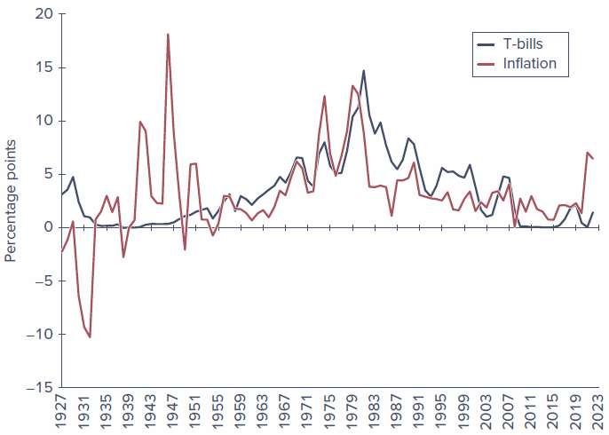
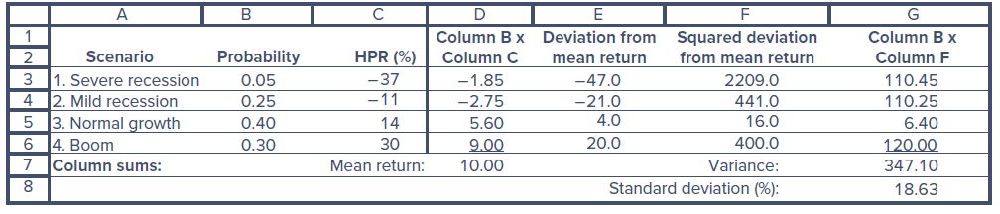
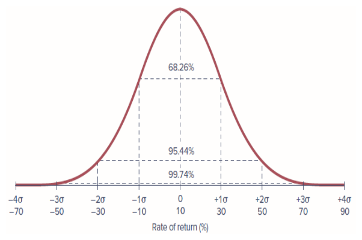
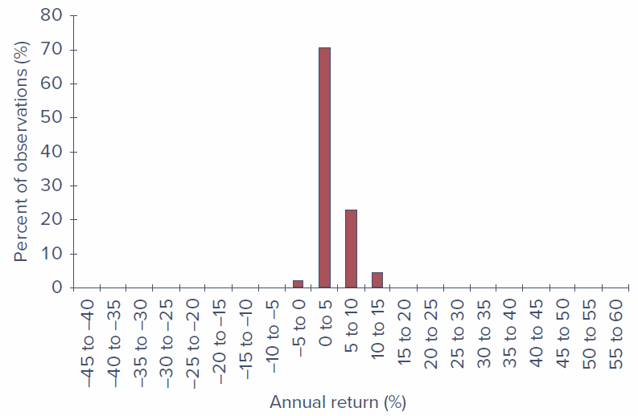
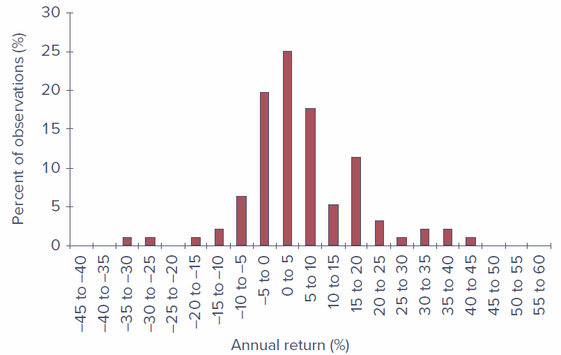
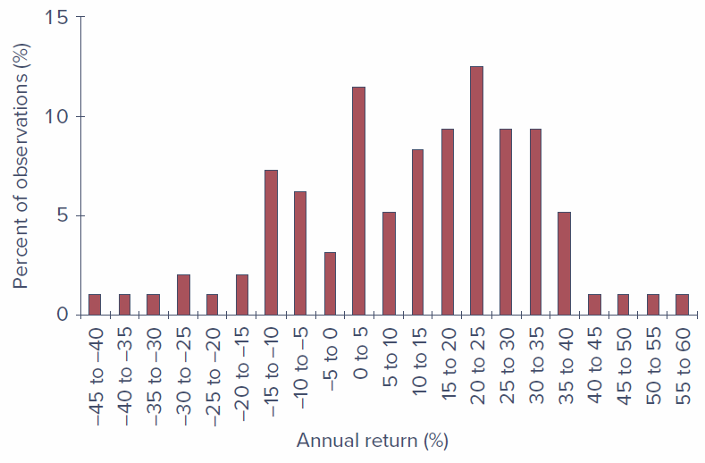
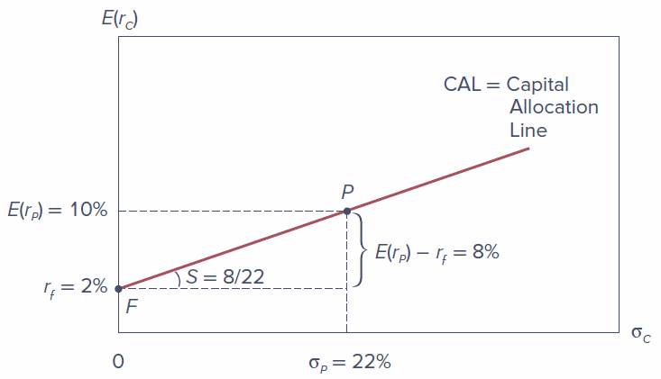

## Learning Objectives

**LO 5-1** Compute various measures of return on multiyear investments.

**LO 5-2** Use either historical data on the past performance of stocks and bonds or forward-looking scenario analysis to characterize the risk and return features of these investments.

**LO 5-3** Determine the expected return and risk of portfolios that are constructed by combining risky assets with risk-free investments in Treasury bills.

**LO 5-4** Use the Sharpe ratio to evaluate the performance of a portfolio and provide a guide for capital allocation.

------------------------------------------------------------------------

## 5.1 Rates of Return

The **holding-period return (HPR)** on a share of stock reflects both the increase (or decrease) in the price of the share over the investment period as well as any dividend income the share has provided. It is defined as dollars earned (price appreciation plus dividends) per dollar invested:

$$
HPR = \frac{\text{Ending price} - \text{Beginning price} + \text{Cash dividend}}{\text{Beginning price}}
$$ {#eq-hpr}

The percentage return from dividends, cash dividends divided by beginning price, is called the **dividend yield**, and the percentage price increase is called the **capital gains yield**. Therefore, the dividend yield plus the capital gains yield equals the HPR.

**Example 5.1 — Holding-Period Return:** The price of a share of a stock is currently \$100, and your time horizon is one year. You expect the cash dividend during the year to be \$4, so your expected dividend yield is 4%. Suppose your best guess is that the price one year from now will be \$110 per share. If you are right, the HPR will be:

$$
HPR = \frac{\$110 - \$100 + \$4}{\$100} = 0.14, \text{ or } 14\%
$$

Your predicted capital gain is \$10, which implies a capital gains yield of \$10/\$100 = 0.10, or 10%. The HPR is the sum of the dividend yield plus the capital gains yield: 4% + 10% = 14%.

### 5.1.1 Measuring Investment Returns over Multiple Periods

The HPR is a simple and unambiguous measure of investment return over a single period. But often you will be interested in average returns over longer periods of time. There are several alternative measures of performance, each with its own advantages and shortcomings: the **arithmetic average**, the **geometric average**, and the **dollar-weighted return**.

| | 1st Year | 2nd Year | 3rd Year | 4th Year |
|:---|:---:|:---:|:---:|:---:|
| Assets under management at start of year (\$ million) | 1.0 | 1.2 | 2.0 | 0.8 |
| Holding-period return (%) | 10.0 | 25.0 | (20.0) | 20.0 |
| Total assets before net inflows | 1.1 | 1.5 | 1.6 | 0.96 |
| Net inflow (\$ million)\* | 0.1 | 0.5 | (0.8) | 0.6 |
| Assets under management at end of year (\$ million) | 1.2 | 2.0 | 0.8 | 1.56 |

: Table 5.1 — Annual cash flows and rates of return of a mutual fund {.striped}

\*New investment less redemptions and distributions, all assumed to occur at the end of each year.

#### 5.1.1.1 Arithmetic Average

The **arithmetic average** of the annual returns is just the sum of the returns divided by the number of years:

$$
\text{Arithmetic average} = \frac{10 + 25 - 20 + 20}{4} = 8.75\%
$$

The arithmetic average of past returns is a common forecast of performance for future periods.

#### 5.1.1.2 Geometric Average

The **geometric average** equals the single per-period return that would give the same cumulative performance as the sequence of actual returns. We calculate the geometric average by compounding the actual period-by-period returns and then finding the single per-period rate that will compound to the same final value:

$$
(1 + 0.10) \times (1 + 0.25) \times (1 - 0.20) \times (1 + 0.20) = (1 + r_G)^4
$$

Solving for $r_G$:

$$
r_G = [(1 + 0.10) \times (1 + 0.25) \times (1 - 0.20) \times (1 + 0.20)]^{1/4} - 1 = 0.0719, \text{ or } 7.19\%
$$ {#eq-geometric}

The geometric return is also called a **time-weighted average return** because it ignores the year-by-year variation in funds under management.

#### 5.1.1.3 Dollar-Weighted Return

The **dollar-weighted average return** is the internal rate of return (IRR) on the investment. To account for varying amounts under management, we treat the fund cash flows as we would a capital budgeting problem in corporate finance. The initial value of \$1 million and the net cash inflows are treated as the cash flows associated with an investment "project."

| | Year 0 | Year 1 | Year 2 | Year 3 | Year 4 |
|:---|:---:|:---:|:---:|:---:|:---:|
| Net cash flow (\$ million) | −1.0 | −0.1 | −0.5 | 0.8 | −0.6 + 1.56 = 0.96 |

The IRR is the interest rate that satisfies:

$$
0 = -1.0 + \frac{-0.1}{1 + IRR} + \frac{-0.5}{(1 + IRR)^2} + \frac{0.8}{(1 + IRR)^3} + \frac{0.96}{(1 + IRR)^4}
$$ {#eq-irr}

The solution is IRR = 0.0338 = 3.38%. The dollar-weighted return in this example is smaller than the time-weighted return of 7.19% because the portfolio returns were higher when less money was under management — an unfavorable combination.

::: {.callout-tip title="Concept Check 5.1"}
A fund begins with \$10 million and reports the following monthly results (with negative figures in parentheses):

| | Month 1 | Month 2 | Month 3 |
|:---|:---:|:---:|:---:|
| Net inflows (end of month, \$ million) | 3 | 5 | 0 |
| HPR (%) | 2 | 8 | (4) |

Compute the arithmetic, time-weighted, and dollar-weighted average monthly returns.
:::

### 5.1.2 Conventions for Annualizing Rates of Return

There are several ways to annualize rates of return. Returns on assets with regular intra-year cash flows are usually quoted as **annual percentage rates (APRs)**, which annualize per-period rates using a simple interest approach, ignoring compound interest:

$$
APR = \text{Per-period rate} \times \text{Periods per year}
$$

However, because it ignores compounding, the APR does not equal the rate at which your invested funds actually grow. The latter is called the **effective annual rate (EAR)**. When there are $n$ compounding periods in the year:

$$
1 + EAR = \left(1 + \frac{APR}{n}\right)^n
$$ {#eq-ear}

**Example 5.2 — Annualizing Treasury-Bill Returns:** Suppose you buy a \$10,000 face value Treasury bill maturing in six months for \$9,900. The holding period return for this six-month investment is:

$$
HPR = \frac{0 + \$100}{\$9{,}900} = 0.0101 = 1.01\%
$$

The APR on this investment is therefore $1.01\% \times 2 = 2.02\%$. The effective annual rate is a bit higher: $1 + EAR = (1.0101)^2 = 1.0203$, which implies that $EAR = 2.03\%$.

With continuous compounding, the APR is related to EAR by:

$$
1 + EAR = e^{APR}
$$ {#eq-continuous}

or equivalently: $APR = \ln(1 + EAR) = r_{cc}$

------------------------------------------------------------------------

## 5.2 Inflation and the Real Rate of Interest

When prices of goods and services change, we need to distinguish between **nominal** and **real** rates of return. The **nominal interest rate** is the rate at which the dollar value of your account grows. The **real interest rate** is the rate at which the goods you can buy with your funds grows.

The exact relationship is:

$$
1 + r_{real} = \frac{1 + r_{nom}}{1 + i}
$$ {#eq-real-rate}

which can be rearranged to:

$$
r_{real} = \frac{r_{nom} - i}{1 + i}
$$ {#eq-real-rate-exact}

A common approximation is:

$$
r_{real} \approx r_{nom} - i
$$ {#eq-real-approx}

The approximation rule overstates the real rate by the multiple $1 + i$.

**Example 5.3 — Real versus Nominal Rates:** If the interest rate on a one-year CD is 8%, and you expect inflation to be 5% over the coming year, the approximation gives $r_{real} = 8\% - 5\% = 3\%$. Using the exact formula: $r_{real} = \frac{0.08 - 0.05}{1 + 0.05} = 0.0286$, or 2.86%. The approximation overstates the expected real rate by only 0.14 percentage point.

### 5.2.1 The Equilibrium Nominal Rate of Interest

Irving Fisher (1930) argued that the nominal rate ought to increase one-for-one with increases in the expected inflation rate. The **Fisher equation** is:

$$
r_{nom} = r_{real} + E(i)
$$ {#eq-fisher}

Suppose the real rate of interest is 2%, and expected inflation is 4%, so that the nominal interest rate is about 6%. If expected inflation rises to 5%, the nominal interest rate should climb to roughly 7%. The increase in the nominal rate offsets the increase in expected inflation, giving investors an unchanged growth rate of purchasing power of 2%.

::: {.callout-tip title="Concept Check 5.2"}
a. Suppose the real interest rate is 3% per year and the expected inflation rate is 8%. What is the nominal interest rate?

b. Suppose the expected inflation rate rises to 10%, but the real rate is unchanged. What must happen to the nominal interest rate?
:::

### 5.2.2 Treasury Bills and Inflation, 1927–2022

| | Average Annual Rates | | | Standard Deviation | | |
|:---|:---:|:---:|:---:|:---:|:---:|:---:|
| | T-Bills | Inflation | Real T-Bill | T-Bills | Inflation | Real T-Bill |
| Full sample | 3.28 | 3.06 | 0.32 | 3.09 | 3.97 | 3.80 |
| 1927–1951 | 0.95 | 1.80 | −0.48 | 1.24 | 6.06 | 6.34 |
| 1952–2022 | 4.11 | 3.50 | 0.61 | 3.13 | 2.85 | 2.34 |

: Table 5.2 — Statistics for T-bill rates, inflation rates, and real rates, 1927–2022 {.striped}

Over the full sample, the average nominal rate on T-bills was 3.28%. However, the average inflation rate of 3.06% meant that the average real return on bills was only 0.32%. The Fisher relation appears to work far better when inflation is itself more predictable and investors can more accurately gauge the nominal interest rate they require to provide an acceptable real rate of return.

------------------------------------------------------------------------

## 5.3 Risk and Risk Premiums

Any investment involves some degree of uncertainty about future holding-period returns. Sources of investment risk range from macroeconomic fluctuations, to the changing fortunes of various industries, to firm-specific unexpected developments.

### 5.3.1 Scenario Analysis and Probability Distributions

**Scenario analysis** is an approach that devises a list of possible economic scenarios and specifies both the probability of each scenario and the HPR the asset will realize in that scenario. The list of possible HPRs with associated probabilities is called the **probability distribution** of HPRs.

The **expected return**, denoted $E(r)$, is the weighted average of returns in all possible scenarios, with weights equal to the probability of each scenario:

$$
E(r) = \sum_{s=1}^{S} p(s) \, r(s)
$$ {#eq-expected-return}

**Applying this formula** to the stock index fund scenario in Spreadsheet 5.1:

$$
E(r) = (0.05 \times -37) + (0.25 \times -11) + (0.40 \times 14) + (0.30 \times 30) = 10.0\%
$$

The **variance** is the expected value of the squared deviation from the mean:

$$
\text{Var}(r) \equiv \sigma^2 = \sum_{s=1}^{S} p(s) \left[ r(s) - E(r) \right]^2
$$ {#eq-variance}

The **standard deviation** is the square root of the variance:

$$
SD(r) \equiv \sigma = \sqrt{\text{Var}(r)}
$$ {#eq-stdev}

**Example 5.4 — Variance and Standard Deviation:**

$$
\sigma^2 = 0.05(-37 - 10)^2 + 0.25(-11 - 10)^2 + 0.40(14 - 10)^2 + 0.30(30 - 10)^2 = 347.10
$$

$$
\sigma = \sqrt{347.10} = 18.63\%
$$

::: {.callout-tip title="Concept Check 5.3"}
The current value of a stock portfolio is \$23 million. The following spreadsheet lays out next year's dividend and portfolio value in each of four possible economic scenarios. What is the portfolio's holding-period return in each scenario? Calculate both its expected holding-period return and standard deviation.

| Business conditions | Scenario, s | Probability, p | End-of-year value (\$ million) | Annual dividend (\$ million) |
|:---|:---:|:---:|:---:|:---:|
| High growth | 1 | 0.30 | 35 | 4.40 |
| Normal growth | 2 | 0.45 | 27 | 4.00 |
| No growth | 3 | 0.20 | 15 | 4.00 |
| Recession | 4 | 0.05 | 8 | 2.00 |
:::

### 5.3.2 The Normal Distribution

The **normal distribution** is central to the theory and practice of investments. Its plot is symmetric, with identical values for all three standard measures of "typical" results: the mean, the median, and the mode.

When returns are normally distributed, roughly two-thirds (68.26%) of the observations fall within one standard deviation of the mean. 95.44% of the observations are expected to lie within two standard deviations. Only 2.6 out of 1,000 observations are expected to deviate from the mean by three or more standard deviations.

**Example 5.5 — Normal Distribution in Excel:** Suppose the monthly rate of return on the S&P 500 is approximately normally distributed with a mean of 1% and standard deviation of 6%. The probability that the return on the index in any month will be negative is: NORM.DIST(0, 1, 6, TRUE) = 0.4338, or about 43.38%.

::: {.callout-tip title="Concept Check 5.4"}
What is the probability that the monthly return on a stock with a mean return of 1% per month and standard deviation of 3% per month will be less than −5%? What if the standard deviation is 5% per month?
:::

### 5.3.3 Normality and the Investment Horizon

Portfolios of normally distributed assets are also normally distributed, which greatly simplifies analysis of risk. When returns over very short time periods (e.g., an hour or even a day) are normally distributed, then HPRs for holding periods as long as a month will be *nearly* normal and can be treated as if they are normal.

The practical implication is this: use continuously compounded rates when normality plays a crucial role.

### 5.3.4 Deviation from Normality and Tail Risk

**Value at risk (VaR)** is a measure of downside risk — the worst loss that will be suffered with a given probability, often 1% or 5%. For normally distributed returns, the 5% VaR can be calculated as:

$$
VaR(5\%) = E(r) + (-1.64485)\sigma
$$ {#eq-var}

Three additional statistics indicate whether a portfolio's probability distribution differs significantly from normality:

- **Kurtosis** compares the frequency of extreme values to that of the normal distribution. Positive kurtosis indicates "fat tails" — a higher likelihood of extreme outcomes.

- **Skew** measures the asymmetry of the distribution. Negative values of skew indicate that extreme bad outcomes are more frequent than extreme positive ones.

- Extreme returns are often called **jumps**, as the stock price makes a big sudden movement.

::: {.callout-tip title="Concept Check 5.5"}
a. Return to Concept Check 5.3. What is the 5% VaR of the portfolio?

b. What is the VaR of a portfolio with normally distributed returns with the same mean and standard deviation as this portfolio?
:::

### 5.3.5 Risk Premiums and Risk Aversion

The **risk-free rate** is the rate of return that can be earned with certainty, often measured by the rate on Treasury bills. The **risk premium** is the expected return in excess of that on risk-free securities. The **excess return** is the rate of return in excess of the risk-free rate.

**Risk aversion** is the reluctance to accept risk. A positive risk premium distinguishes speculation from gambling. Investors taking on risk to earn a risk premium are speculating. Gambling is the assumption of risk for no purpose beyond the enjoyment of the risk itself.

The **price of risk** is the ratio of a portfolio's risk premium to its variance:

$$
A = \frac{E(r_Q) - r_f}{\sigma_Q^2}
$$ {#eq-price-of-risk}

For example, if we observe an investor whose entire wealth has been invested in portfolio $Q$ with annual risk premium of 0.10 (10%) and variance of 0.0256 (SD = 0.16, or 16%), we would infer the degree of risk aversion as:

$$
A = \frac{0.10}{0.0256} = 3.91
$$

Using historical S&P 500 data, the average excess return on the market has been about 0.08, and variance has been nearly 0.04, implying average risk aversion of approximately:

$$
\bar{A} = \frac{0.08}{0.04} \approx 2
$$

Conventional wisdom holds that plausible estimates for the value of $A$ lie in the range of 1.5–4.

### 5.3.6 The Sharpe Ratio

The **Sharpe ratio** (also called the reward-to-volatility ratio) is commonly used to rank portfolios in terms of their risk-return trade-off:

$$
S = \frac{\text{Portfolio risk premium}}{\text{Standard deviation of portfolio excess return}} = \frac{E(r_P) - r_f}{\sigma_P}
$$ {#eq-sharpe}

A risk-free asset would have a risk premium of zero and a standard deviation of zero. A higher Sharpe ratio indicates a better reward per unit of standard deviation — a more efficient portfolio.

**Important warning:** The Sharpe ratio is a valid statistic only for ranking *portfolios*; it is not appropriate for comparing individual assets.

Portfolio analysis in terms of mean and standard deviation (or variance) of excess returns is called **mean-variance analysis**.

::: {.callout-tip title="Concept Check 5.6"}
a. Investors forecast that the return of the market index over the coming year will be 10%. The one-year T-bill rate is 5%. Examination of recent returns of the S&P 500 Index suggests that the standard deviation of returns will be 18%. What does this information suggest about the degree of risk aversion of the average investor, assuming that the average portfolio resembles the market index?

b. What is the Sharpe ratio of the index portfolio in (a)?
:::

------------------------------------------------------------------------

## 5.4 The Historical Record

### 5.4.1 Using Time Series of Returns

Scenario analysis begins with a probability distribution of future returns, but where do the probabilities come from? They are in large part informed by historical experience. The estimates of variance and standard deviation from a time series of returns, $r_t$, are:

$$
\bar{r}_t = \frac{1}{n} \sum r_t; \qquad \text{Var}(r_t) = \frac{1}{n-1} \sum (r_t - \bar{r}_t)^2; \qquad SD(r_t) = \sqrt{\text{Var}(r_t)}
$$ {#eq-time-series}

The $n/(n-1)$ correction is sometimes called a correction for degrees of freedom bias.

### 5.4.2 Risk and Return: A First Look

The standard deviation of the return on stocks over the 1927–2022 period was 20.06%, nearly double that of T-bonds (12.20%) and more than six times that of T-bills (3.09%). That greater risk brought with it greater reward: the excess return on stocks averaged 8.55% per year.

| | T-bills | T-bonds | Stocks |
|:---|:---:|:---:|:---:|
| Average | 3.28 | 5.56 | 11.84 |
| Risk premium | na | 2.27 | 8.55 |
| Standard deviation | 3.09 | 12.20 | 20.06 |
| Max | 14.71 | 41.68 | 57.35 |
| Min | −0.02 | −33.33 | −44.04 |

: Table 5.3 — Risk and return of investments in major asset classes, 1927–2022 {.striped}

The figures below show the frequency distributions of annual returns on these three portfolios. The greater volatility of stock returns compared to T-bill or T-bond returns is immediately apparent.

Historical returns on stocks exhibit somewhat more frequent, large deviations from the mean than would be predicted from a normal distribution. The actual frequencies of extreme returns, both high and low, are higher than would be predicted by the normal distribution — evidence of a fat-tailed distribution. Nevertheless, extreme returns are in fact quite uncommon, especially in more recent years, so it is not unreasonable to accept the simplification offered by normality as an acceptable approximation.

------------------------------------------------------------------------

## 5.5 Asset Allocation Across Risky and Risk-Free Portfolios

History shows that long-term bonds have been riskier investments than investments in Treasury bills and that stock investments have been riskier still. At the same time, the riskier investments have offered higher average returns. But investors do not make all-or-nothing choices from these investment classes.

**Asset allocation** is the allocation of an investment portfolio across broad asset classes. **Capital allocation to risky assets** is the fraction of the portfolio placed in risky assets. The **complete portfolio** is the entire portfolio including risky and risk-free assets.

### 5.5.1 The Risk-Free Asset

Only the government can issue default-free (Treasury) bonds and bills. Treasury bills are commonly viewed as *the* risk-free asset. In practice, most investors treat a broader range of money market instruments as effectively risk-free assets, since the risk of any of these money market instruments is trivial compared to that of long-term bonds or stocks.

### 5.5.2 Portfolio Expected Return and Risk

Let $y$ be the proportion of the investment budget allocated to the risky portfolio $P$, and $(1 - y)$ be the proportion in the risk-free asset with return $r_f$.

**Expected return of the complete portfolio:**

$$
E(r_C) = r_f + y\left[E(r_P) - r_f\right]
$$ {#eq-complete-return}

**Standard deviation of the complete portfolio:**

$$
\sigma_C = y \, \sigma_P
$$ {#eq-complete-sd}

**Numerical example:** Suppose $E(r_P) = 10\%$, $\sigma_P = 22\%$, and $r_f = 2\%$, so the risk premium on the risky asset is 8%. If $y = 0.5$:

- $E(r_C) = 0.5 \times 2\% + 0.5 \times 10\% = 6\%$
- Risk premium of complete portfolio = 6% − 2% = 4% (half of the risky portfolio's risk premium)
- $\sigma_C = 0.5 \times 22\% = 11\%$ (half of the risky portfolio's standard deviation)

::: {.callout-tip title="Concept Check 5.7"}
What are the expected return, risk premium, standard deviation, and ratio of risk premium to standard deviation for a complete portfolio with $y = 0.75$?
:::

### 5.5.3 The Capital Allocation Line

The **capital allocation line (CAL)** depicts the risk-return combinations available by varying capital allocation (choosing different values of $y$). The slope, $S$, of the CAL equals the increase in expected return that an investor can obtain per unit of additional standard deviation — the Sharpe ratio:

$$
S = \frac{E(r_P) - r_f}{\sigma_P} = \frac{10 - 2}{22} = 0.36
$$ {#eq-cal-slope}

The Sharpe ratio is the same for all complete portfolios that plot on the capital allocation line. While the risk-return combinations differ according to the investor's choice of $y$, the ratio of reward to risk is constant.

| | Expected Return | Risk Premium | Standard Deviation | Sharpe Ratio |
|:---|:---:|:---:|:---:|:---:|
| Portfolio P | 10% | 8% | 22% | 8/22 = 0.36 |
| Portfolio C ($y = 0.5$) | 6% | 4% | 11% | 4/11 = 0.36 |

**Example 5.7 — Levered Complete Portfolios:** Suppose the investment budget is \$300,000, and an investor borrows an additional \$120,000, investing the \$420,000 in the risky asset. Then $y = 420{,}000/300{,}000 = 1.4$ and $1 - y = -0.4$ (a borrowing position).

- $E(r_C) = (-0.4) \times 2\% + 1.4 \times 10\% = 13.2\%$
- $\sigma_C = 1.4 \times 22\% = 30.8\%$
- Sharpe ratio = $11.2\% / 30.8\% = 0.36$ (unchanged)

### 5.5.4 Risk Aversion and Capital Allocation

More risk-averse investors will choose portfolios near point $F$ (risk-free) on the capital allocation line. More risk-tolerant investors will choose points closer to $P$, or even beyond $P$ using leverage.

The optimal capital allocation to the risky portfolio is found by dividing the risky portfolio's price of risk by the investor's risk aversion:

$$
y^* = \frac{E(r_P) - r_f}{A \, \sigma_P^2}
$$ {#eq-optimal-y}

This equation has the intuitive implication that the optimal allocation to the risky portfolio is directly proportional to its price of risk and inversely proportional to the investor's risk aversion.

------------------------------------------------------------------------

## 5.6 Passive Strategies and the Capital Market Line

A **passive strategy** is based on the premise that securities are fairly priced, and thus avoids the costs involved in undertaking security analysis. Such strategies are called *indexing*: the investor chooses a portfolio of all the stocks in a broad market index such as the S&P 500.

The **capital market line (CML)** is the capital allocation line provided by one-month T-bills and a broad index of common stocks. A passive strategy using the broad stock market index as the risky portfolio generates an investment opportunity set represented by the CML.

### 5.6.1 Historical Evidence on the Capital Market Line

| Period | Average | Standard Deviation | Sharpe Ratio |
|:---|:---:|:---:|:---:|
| 1927–2022 | 8.55 | 20.39 | 0.42 |
| 1927–1950 | 9.33 | 26.57 | 0.35 |
| 1951–1974 | 6.63 | 20.32 | 0.33 |
| 1975–1998 | 11.00 | 14.40 | 0.76 |
| 1999–2022 | 7.25 | 19.43 | 0.37 |

: Table 5.5 — Excess returns statistics for the market index {.striped}

The Sharpe ratio for the overall 1927–2022 period was 0.42. Sharpe ratios across subperiods vary dramatically, ranging from 0.33 to 0.76. The lesson is that we should be very humble when we use historical data to forecast future performance.

### 5.6.2 Costs and Benefits of Passive Investing

The annual expense ratio of an active stock mutual fund averages around 0.8% of invested assets. In contrast, you can invest in a stock market index fund with an expense ratio of 0.05% or even less.

Because of the power of compounding, an extra 1% of annual costs can have large consequences. With a risk-free rate of 2% and a risk premium of 8%, you might expect your wealth to grow by a multiple of $1.10^{30} = 17.45$ over a 30-year investment horizon. If fees are 1%, your net return is reduced to 9%, and your wealth grows by a multiple of only $1.09^{30} = 13.26$ — that seemingly small management fee reduces your final wealth by about one-quarter.

The CML using the passive market index is not obviously inferior to active strategies.

------------------------------------------------------------------------

## Key Terms

**holding-period return (HPR)** — Rate of return over a given investment period.

**arithmetic average** — The sum of returns in each period divided by the number of periods.

**geometric average** — The single per-period return that gives the same cumulative performance as the sequence of actual returns.

**dollar-weighted rate of return** — The internal rate of return on an investment.

**nominal interest rate** — The interest rate in terms of nominal (not adjusted for purchasing power) dollars.

**real interest rate** — The growth rate of purchasing power derived from an investment.

**inflation rate** — The rate at which prices are rising, measured as the rate of increase of the CPI.

**scenario analysis** — A list of possible economic scenarios, the likelihood of each, and the HPR that will be realized in each case.

**probability distribution** — List of possible outcomes with associated probabilities.

**expected return** — The mean value of the distribution of HPR.

**variance** — The expected value of the squared deviation from the mean.

**standard deviation** — The square root of the variance.

**value at risk (VaR)** — Measure of downside risk. The worst loss that will be suffered with a given probability, often 1% or 5%.

**kurtosis** — Measure of the fatness of the tails of a probability distribution relative to that of a normal distribution. Indicates likelihood of extreme outcomes.

**skew** — Measure of the asymmetry of a probability distribution.

**risk-free rate** — The rate of return that can be earned with certainty, often measured by the rate on Treasury bills.

**risk premium** — An expected return in excess of that on risk-free securities.

**excess return** — Rate of return in excess of the risk-free rate.

**risk aversion** — Reluctance to accept risk.

**price of risk** — The ratio of portfolio risk premium to variance.

**Sharpe ratio** — Ratio of portfolio risk premium to standard deviation.

**mean-variance analysis** — Evaluating portfolios according to their expected returns and standard deviations (or variances).

**asset allocation** — Allocation of an investment portfolio across broad asset classes.

**capital allocation to risky assets** — The choice between risky and risk-free assets.

**complete portfolio** — The entire portfolio including risky and risk-free assets.

**capital allocation line (CAL)** — Plot of risk-return combinations available by varying portfolio allocation between a risk-free asset and a risky portfolio.

**passive strategy** — Investment policy that avoids security analysis. Often entails indexing.

**capital market line (CML)** — The capital allocation line using the market index portfolio as the risky asset.
