<!--
SOURCING NOTE: All content in this file is drawn only from Bodie, Kane & Marcus, Essentials of Investments (2024 Release), Chapter 6,
and the publisher's Chapter 6 PowerPoint. No outside material, no new visuals, and no executable code chunks.
Figures are extracted from the PowerPoint or cropped from the chapter PDF and are stored in ../assets/images/Ch06/
-->

# Introduction

**"Don't put all your eggs in one basket."**

The adage is age-old and obviously predates formal economic theory. However, a rigorous model showing how to make the most of the power of diversification was not devised until 1952, a feat for which **Harry Markowitz** won the Nobel Prize in Economics.

This chapter describes how investors can construct the **best possible risky portfolio**. The key concept is **efficient diversification**.

## Learning Objectives {.unnumbered}

-   **LO 6-1** Show how covariance and correlation affect the power of diversification to reduce portfolio risk.
-   **LO 6-2** Calculate mean, variance, and covariance using either historical data or scenario analysis.
-   **LO 6-3** Construct efficient portfolios and use the Sharpe ratio to evaluate portfolio efficiency.
-   **LO 6-4** Calculate the composition of the optimal risky portfolio.
-   **LO 6-5** Use index models to analyze the risk and return characteristics of securities and portfolios.
-   **LO 6-6** Understand the effect of investment horizon on portfolio risk.

## Chapter Roadmap {.unnumbered}

The chapter follows a **top-down approach**:

1.  **Diversification and Portfolio Risk** - a bird's-eye view of how diversification reduces the variability of portfolio returns.
2.  **Asset Allocation with Two Risky Assets** - covariance, correlation, and the risk-return trade-off, using a bond fund and a stock fund.
3.  **The Optimal Risky Portfolio with a Risk-Free Asset** - reintroducing T-bills to complete the asset allocation problem across stocks, bonds, and T-bills.
4.  **Efficient Diversification with Many Risky Assets** - generalizing to security selection among many risky assets: the efficient frontier and the separation property.
5.  **A Single-Index Stock Market** - index models that simplify the search for efficient portfolios and help interpret the risk of individual securities.
6.  **Risk Pooling, Risk Sharing, and Time Diversification** - the common fallacy that long-term investment horizons mitigate the impact of asset risk. The chapter shows that "time diversification" is in fact an illusion.

------------------------------------------------------------------------

# 6.1 Diversification and Portfolio Risk

Suppose your risky portfolio comprises only **one stock**, say, Digital Computer Corporation. What are the sources of risk affecting this "portfolio"?

There are two broad sources of uncertainty:

1.  **Risk from general economic conditions** - business cycles, inflation, interest rates, exchange rates, and so forth. None of these macroeconomic factors can be predicted with certainty, and all affect Digital stock.
2.  **Firm-specific influences** - for example, Digital's success in R&D, its management style and philosophy, and so on. Firm-specific factors are those that affect Digital without noticeably affecting other firms.

## Adding a second security

Now consider investing half of the risky portfolio in ExxonMobil and leaving the other half in Digital. Because the firm-specific influences on the two stocks are unrelated (statistically speaking, uncorrelated), this strategy should **reduce portfolio risk**. For example, when oil prices fall, hurting ExxonMobil, computer prices might rise, helping Digital. The two effects are offsetting, which stabilizes portfolio return.

## Adding many securities

Diversifying into many more securities continues to reduce exposure to firm-specific factors, so portfolio volatility should continue to fall. Ultimately, however, **there is no way to avoid all risk**. To the extent that virtually all securities are affected by common macroeconomic factors, we cannot eliminate exposure to general economic risk, no matter how many stocks we hold.

## Figure 6.1 - Portfolio risk as a function of the number of stocks

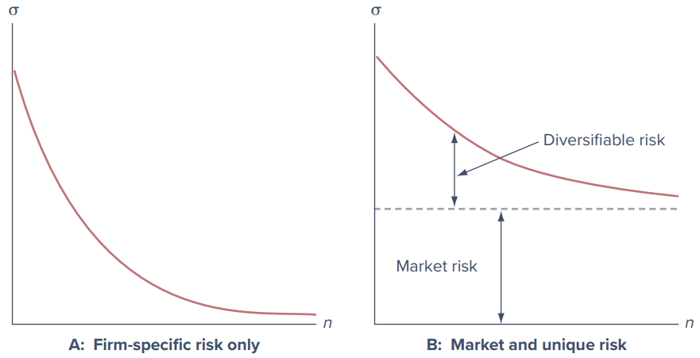{width="85%"}

-   **Panel A - all risk is firm-specific.** Diversification can reduce risk to arbitrarily low levels. With all risk sources independent, and with investment spread across many securities, exposure to any particular source of risk is negligible. This is an application of the **law of large numbers**. Risk reduction by spreading exposure across many independent risk sources is called the **insurance principle**.
-   **Panel B - market and unique risk.** When a common source of risk affects all firms, even extensive diversification cannot eliminate all risk. Portfolio standard deviation falls as the number of securities increases, but it is not reduced to zero.

**Two kinds of risk:**

-   **Market risk** (also called **systematic risk** or **nondiversifiable risk**): the risk that remains even after diversification; risk attributable to marketwide risk sources.
-   **Unique risk** (also called **firm-specific risk**, **nonsystematic risk**, or **diversifiable risk**): the risk that *can* be eliminated by diversification.

## Figure 6.2 - Empirical evidence

This distinction is well borne out empirically. Figure 6.2 shows the average standard deviations of equally weighted portfolios constructed by selecting stocks at random as a function of the number of stocks in the portfolio.

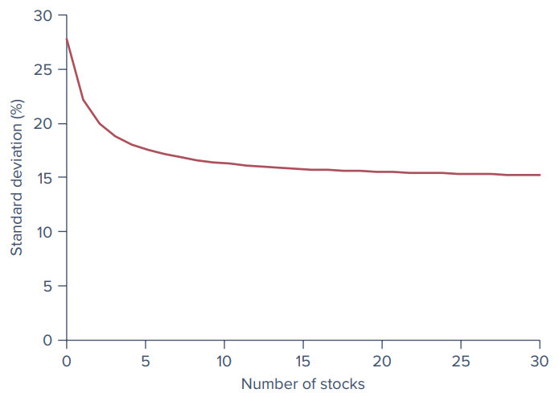{width="70%"}

On average, portfolio risk does fall with diversification, but **the power of diversification to reduce risk is limited by common sources of risk**. (Per the PowerPoint's description of the figure, the curve starts near 27.5% for a one-stock portfolio, falls to about 17% at five stocks, and then levels out at roughly 15-16%.)

## On the Market Front: Dangerous 401(k) Plans

For many individuals, the 401(k) plan is the major source of retirement savings. The employee puts aside a given percentage of wages, sheltering income from current taxation, and the employer commonly matches some fraction of that contribution (for example, 6% of salary from the employee plus an additional 3% from the employer). In many plans the savings are invested in shares of the company stock. It sounds like a win-win arrangement. **What could go wrong? Plenty.** Concentrating your portfolio in your company stock increases risk in two ways:

1.  **Excess volatility.** Focusing your investments in any single company rather than a diversified portfolio almost never makes sense. A single stock typically has more than double the volatility of a diversified portfolio, and much of that volatility does not even translate to higher average returns.
2.  **Doubling down on one firm.** If your company implodes, you can lose your source of earnings income at the same time that your investment portfolio is decimated. The employees of Lehman Brothers, whose 401(k) plans entailed massive positions in the company stock, saw their plans wiped out along with their jobs when Lehman failed.

## International diversification

General macroeconomic conditions in the United States do not move in lockstep with those in other countries. **International diversification** may further reduce portfolio risk, but here too, global economic and political factors affecting all countries to various degrees will limit the extent of risk reduction.

------------------------------------------------------------------------

# 6.2 Asset Allocation with Two Risky Assets

The last section considered naive diversification using equally weighted portfolios. It is time now to tackle **efficient diversification**, whereby we construct portfolios that provide the **lowest possible risk for any given level of expected return**.

Portfolios of two risky assets are relatively easy to analyze, and they illustrate the principles and considerations that apply to portfolios of many assets. So we begin with a two-asset risky portfolio, where the two assets are a **bond fund** and a **stock fund**. Once we understand these, we reintroduce the risk-free asset. This will complete the asset allocation problem across the three key asset classes: **stocks, bonds, and T-bills**. Constructing efficient portfolios of many risky securities is a straightforward extension of this stripped-down exercise.

## 6.2.1 Covariance and Correlation

To optimally construct a portfolio from risky assets, we need to understand how the uncertainties of asset returns interact. **Portfolio risk depends crucially on the extent to which the returns on the two assets vary either in tandem or in opposition.** A simple scenario analysis shows why.

### Scenario analysis (Spreadsheet 6.1)

The scenario analysis posits four possible scenarios for the economy: a severe recession, a mild recession, normal growth, and a boom.

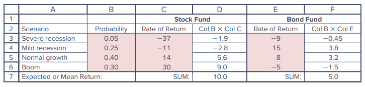{width="85%"}

-   **Stocks** follow the broad economy, returning −37%, −11%, 14%, and 30% in the four scenarios.
-   **Bonds** perform best in a mild recession, returning 15% (falling interest rates result in capital gains), and in normal growth, returning 8%. They suffer from defaults in a severe recession (−9%) and from inflation, which leads to higher nominal interest rates, in the boom scenario (−5%).
-   Bonds outperform stocks in both recession scenarios; stocks outperform bonds in both normal growth and boom.

The **expected return** on each fund equals the probability-weighted average of the outcomes in the four scenarios: the **stock fund's expected return is 10%** and the **bond fund's is 5%**.

As seen in Chapter 5, the **variance** is the probability-weighted average of the squared deviations of actual returns from the expected return; the **standard deviation** is the square root of the variance. These values are computed in Spreadsheet 6.2.

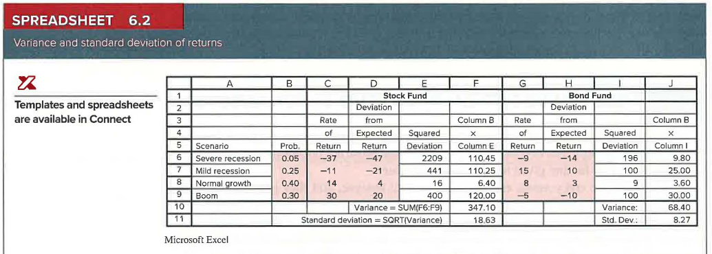{width="100%"}

| Fund  | Variance | Standard Deviation |
|-------|----------|--------------------|
| Stock | 347.10   | 18.63%             |
| Bond  | 68.40    | 8.27%              |

### A portfolio of the two funds (Spreadsheet 6.3)

What about portfolios constructed by mixing the stock and bond funds? Consider a portfolio with **40% in stocks and 60% in bonds**. The portfolio return is the weighted average of the returns on each fund, with weights equal to the proportion of the portfolio invested in each fund. For example:

$$\text{Portfolio return in mild recession} = 0.40 \times (-11\%) + 0.60 \times 15\% = 4.6\%$$

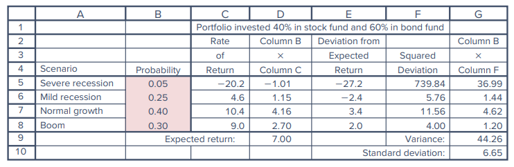{width="85%"}

Notice that while the portfolio's expected return (7.00%) is just the weighted average of the expected returns of the two assets, **portfolio volatility is actually lower than that of either component fund**: the standard deviation of the diversified portfolio, **6.65%**, is considerably smaller than that of stocks (18.63%) and even smaller than that of bonds (8.27%).

The low risk of the portfolio is due to the **inverse relationship** between the performances of the stock and bond funds. In a mild recession, stocks fare poorly, but this is offset by the large positive return of the bond fund. Conversely, in the boom scenario, bond prices fall, but stocks do very well. Portfolio risk is reduced because variations in the returns of the two assets are generally offsetting.

### Measuring co-movement: covariance and correlation

The natural question is how to **measure the tendency of the returns on two assets to vary either in tandem or in opposition** to each other. The statistics that provide this measure are the **covariance** and the **correlation coefficient**.

Covariance is calculated in a manner similar to the variance. But instead of squaring the deviation of an asset return from its expected value, we multiply it by the deviation of the *other* asset's return from *its* expectation. The sign and magnitude of this product depend on whether deviations from the mean move together (both positive or both negative in the same scenarios) and whether they are small or large at the same time.

Spreadsheet 6.4 starts with the deviation of each fund's return from its expected value. The product of deviations is positive if both asset returns exceed their respective means or both fall short of them, and negative if one asset exceeds its mean when the other falls short. In a mild recession, the stock fund return falls short of its expected value by 21% while the bond fund return exceeds its mean by 10%, so the product of deviations is −21 × 10 = −210, a negative value because one asset (stocks) performs poorly while the other (bonds) performs well.

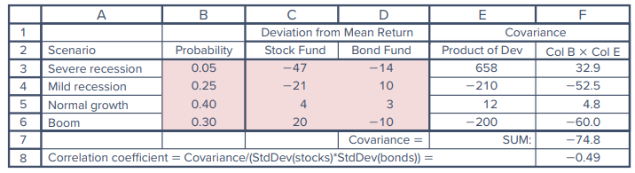{width="85%"}

The probability-weighted average of the products is the **covariance**, which measures the average tendency of the asset returns to vary in tandem (to co-vary). Each scenario is "indexed" by $i$, which ranges from 1 to $n$ (here, $n = 4$), and the probability of each scenario is $p(i)$.

**Equation 6.1 - Covariance**

$$\text{Cov}(r_S, r_B) = \sum_{i=1}^{n} p(i)\,[r_S(i) - E(r_S)]\,[r_B(i) - E(r_B)]$$

The covariance of the stock and bond funds is **−74.8**. The negative value indicates that the two assets, on average, vary inversely: when one performs well, the other tends to perform poorly.

Like variance, the unit of covariance is percent squared, which makes its magnitude hard to interpret. An easier statistic to interpret is the **correlation coefficient** (Greek letter rho, $\rho$), the covariance divided by the product of the standard deviations of the returns on each fund.

**Equation 6.2 - Correlation coefficient**

$$\rho_{SB} = \frac{\text{Cov}(r_S, r_B)}{\sigma_S \sigma_B} = \frac{-74.8}{18.63 \times 8.27} = -0.49$$

Correlation is a pure number and ranges from **−1 to +1**:

-   **−1:** one asset's return varies perfectly inversely with the other's; you could predict 100% of the variability of one asset's return if you knew the return on the other.
-   **+1:** perfect positive correlation.
-   **0:** the returns on the two assets are unrelated.

The correlation of −0.49 confirms the tendency of the stock and bond fund returns to vary inversely.

Whenever the covariance is called for in a calculation, we can replace it with an expression using the correlation coefficient:

**Equation 6.3**

$$\text{Cov}(r_S, r_B) = \rho_{SB}\,\sigma_S\,\sigma_B$$

We are now ready to derive the risk and return features of portfolios of risky assets.

::: {.callout-tip title="Concept Check 6.1"}
Suppose the rates of return of the bond portfolio in the four scenarios of Spreadsheet 6.1 are −10% in a severe recession, 10% in a mild recession, 7% in a normal period, and 2% in a boom. The stock returns in the four scenarios are −37%, −11%, 14%, and 30%. What are the covariance and correlation coefficient between the rates of return on the two portfolios?

**Solution (as printed in the text):** Recalculating Spreadsheets 6.1 and 6.4 shows that the **covariance is now −5.80** and the **correlation coefficient is −0.07**.
:::

## 6.2.2 The Three Rules of Two-Risky-Assets Portfolios

Suppose a proportion $w_B$ is invested in the bond fund and the remainder, $1 - w_B$, denoted $w_S$, is invested in the stock fund. The properties of the portfolio are determined by three rules governing combinations of random variables.

**Rule 1: The rate of return on a portfolio is the weighted average of returns on the component securities, with the portfolio proportions as weights.**

**Equation 6.4**

$$r_P = w_B r_B + w_S r_S$$

**Rule 2: The expected rate of return on a portfolio is similarly the weighted average of the expected returns on the component securities, with the portfolio proportions as weights.**

**Equation 6.5**

$$E(r_P) = w_B E(r_B) + w_S E(r_S)$$

Rules 1 and 2 say that a portfolio's actual return and its expected return are both **linear** functions of the component security returns and portfolio weights. This is *not* so for portfolio variance, as the third rule shows.

**Rule 3: The variance of the rate of return on a two-risky-assets portfolio is:**

**Equation 6.6**

$$\sigma_P^2 = (w_B \sigma_B)^2 + (w_S \sigma_S)^2 + 2(w_B \sigma_B)(w_S \sigma_S)\rho_{BS}$$

where $\rho_{BS}$ is the correlation coefficient between the returns on the stock and bond funds. Notice that Equation 6.3 implies we may replace the last term with $2 w_B w_S \text{Cov}(r_B, r_S)$.

**Interpreting Rule 3.** The variance of a portfolio is the *sum* of the contributions of the component-security variances *plus* a term that involves the correlation coefficient (and, hence, covariance) between the returns on the component securities. When the correlation between the component securities is small or negative, there is a greater tendency for returns on the two assets to offset each other, which reduces portfolio risk. **Equation 6.6 tells us that portfolio variance is lower when the correlation coefficient is lower.**

The formula for portfolio variance is more complicated than the one for portfolio return, but this complication has a virtue: **a tremendous potential for gains from diversification.**

## 6.2.3 The Risk-Return Trade-Off with Two-Risky-Assets Portfolios

We can assess the benefit from diversification by using Rules 2 and 3 to compare the risk and expected return of a better-diversified portfolio to a less-diversified benchmark. Suppose an investor estimates the following input data:

| Input                    | Value |
|--------------------------|-------|
| $E(r_B)$                 | 5%    |
| $\sigma_B$               | 8%    |
| $E(r_S)$                 | 10%   |
| $\sigma_S$               | 19%   |
| $\rho_{BS}$              | 0.2   |

Currently, all funds are invested in the bond fund, but the investor ponders a portfolio invested **40% in stocks and 60% in bonds**.

-   **Expected return (Rule 2):** $E(r_P) = 0.4 \times 10\% + 0.6 \times 5\% = 7\%$, an increase of 2% compared to a bond-only investment.
-   **Standard deviation (Rule 3):**

$$\sigma_P = \sqrt{(0.4 \times 19)^2 + (0.6 \times 8)^2 + 2(0.4 \times 19)(0.6 \times 8)(0.2)} = 9.76\%$$

This is less than the weighted average of the component standard deviations: $0.4 \times 19 + 0.6 \times 8 = 12.40\%$. The difference of **2.64%** reflects the benefits of diversification. This benefit is **cost-free** in the sense that diversification allows us to experience the full contribution of the stock's higher expected return, while keeping the portfolio standard deviation below the average of the component standard deviations.

::: {.callout-note title="Example 6.1 - Benefits from Diversification"}
Suppose we invest **85% in bonds and only 15% in stocks**. This portfolio has an expected return greater than bonds, $(0.85 \times 5) + (0.15 \times 10) = 5.75\%$, and, at the same time, a standard deviation less than bonds. Using Equation 6.6, the portfolio variance is:

$$(0.85 \times 8)^2 + (0.15 \times 19)^2 + 2(0.85 \times 8)(0.15 \times 19)(0.2) = 62.1$$

and the portfolio standard deviation is $\sqrt{62.1} = 7.88\%$, which is less than the standard deviation of either bonds or stocks alone. **Taking on a more volatile asset (stocks) actually reduces portfolio risk!** Such is the power of diversification.
:::

### The minimum-variance portfolio

We can find investment proportions that reduce portfolio risk even further. The **risk-minimizing proportions are 90.8% in bonds and 9.2% in stocks**. With these proportions, the portfolio standard deviation is **7.80%** and the portfolio's expected return is **5.46%**.

The formula for the weight in bonds in the minimum-variance (and hence minimum standard deviation) portfolio (footnote 1 of the text) is:

$$w_B = \frac{\sigma_S^2 - \sigma_B \sigma_S \rho_{BS}}{\sigma_S^2 + \sigma_B^2 - 2\sigma_B \sigma_S \rho_{BS}}, \qquad w_S = 1 - w_B$$

When the correlation is zero, the variance-minimizing weight simplifies to the ratio of stock variance to the sum of the variances of stocks and bonds: $w_B = \dfrac{\sigma_S^2}{\sigma_S^2 + \sigma_B^2}$.

Is this portfolio preferable to the one in Example 6.1, with 15% in the stock fund? **That depends on how the investor trades off risk against return**, because the portfolio with the lower variance also has a lower expected return.

### The investment opportunity set

What the analyst can and should do is show investors the entire **investment opportunity set**: the set of all attainable combinations of risk and return offered by portfolios formed using the available assets in differing proportions. We find it using Spreadsheet 6.5. Columns A and B set out several different proportions for investments in the stock and bond funds. The next columns present the portfolio expected return and standard deviation corresponding to each allocation. These risk-return combinations are plotted in Figure 6.3.

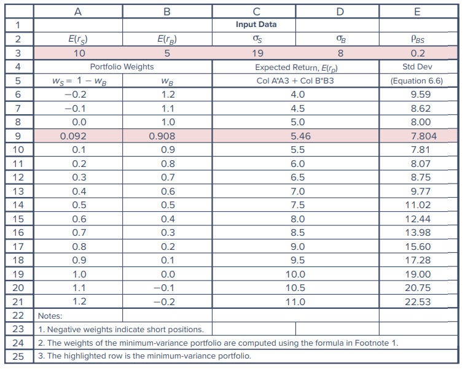{width="85%"}

## 6.2.4 The Mean-Variance Criterion

Investors desire portfolios that lie to the **"northwest"** in Figure 6.3: portfolios with high expected returns (toward the "north") and low volatility (to the "west"). These preferences mean we can compare portfolios using the **mean-variance criterion**:

> Portfolio A is considered superior to portfolio B if it has higher mean return and lower volatility (variance or standard deviation):
>
> $E(r_A) \ge E(r_B)$ and $\sigma_A \le \sigma_B$

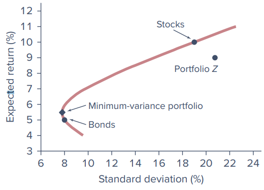{width="70%"}

Graphically, portfolio A will lie to the northwest of B, and given a choice between them, **all investors would choose A**. For example, the stock fund in Figure 6.3 **dominates** portfolio Z.

**Efficient vs. inefficient portions of the curve:**

-   Portfolios that lie **below the minimum-variance portfolio** can be rejected out of hand as **inefficient**. Any portfolio on the downward-sloping portion of the curve (including the bond fund) is "dominated" by the portfolio that lies directly above it on the upward-sloping portion, because that portfolio has higher expected return and equal standard deviation.
-   The best choice among portfolios on the **upward-sloping** portion is not as obvious because, in this region, higher expected return is accompanied by greater risk. (This more challenging question is taken up later in the chapter.)

### The role of correlation

So far we have assumed a correlation of 0.2 between stock and bond returns. Diversification is less effective when correlations are higher.

**Perfect positive correlation ($\rho_{BS} = 1$).** Equation 6.6 simplifies by "completing the square":

$$\sigma_P^2 = w_B^2\sigma_B^2 + w_S^2\sigma_S^2 + 2w_B\sigma_B w_S\sigma_S = (w_B\sigma_B + w_S\sigma_S)^2$$

$$\sigma_P = w_B\sigma_B + w_S\sigma_S$$

In this special case the portfolio standard deviation is a weighted average of the component security standard deviations. In this (and *only* this) circumstance, **there are no gains to be had from diversification**. The opportunity set is a straight line through the component securities (Figure 6.4), no portfolio can be discarded as inefficient, and the choice among portfolios depends only on risk aversion.

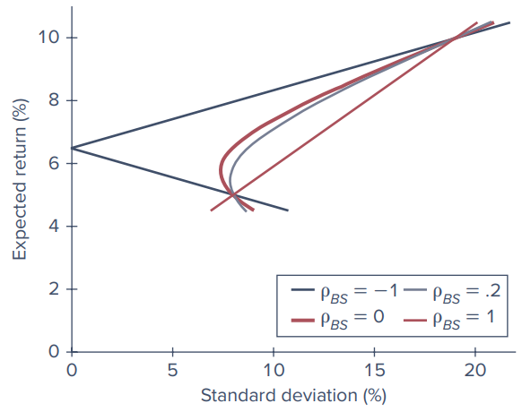{width="70%"}

Perfect positive correlation is the **only** case in which there is no benefit from diversification. Whenever $\rho < 1$, the portfolio standard deviation is less than the weighted average of the standard deviations of the component securities. Therefore, **there are benefits to diversification whenever asset returns are less than perfectly positively correlated.**

A realistic correlation coefficient between stocks and bonds based on historical experience is around **0.20**, which is why Figure 6.4 includes a graph for $\rho_{BS} = 0.2$. As the figure illustrates, $\rho_{BS} = 0.2$ is a lot better for diversification than perfect positive correlation and a bit worse than zero correlation.

**Perfect negative correlation ($\rho_{BS} = -1$).** Negative correlation delivers even greater diversification benefits. Substituting $\rho_{BS} = -1$ in Equation 6.6 and completing the square gives $\sigma_P^2 = (w_B\sigma_B - w_S\sigma_S)^2$, and therefore:

**Equation 6.7**

$$\sigma_P = \text{ABS}[w_B\sigma_B - w_S\sigma_S]$$

The right-hand side is the absolute value of $w_B\sigma_B - w_S\sigma_S$ because standard deviation cannot be negative. With perfect negative correlation, the benefits from diversification stretch to the limit: Equation 6.7 can be solved for the proportions that reduce the portfolio standard deviation **all the way to zero**. The proportion in bonds that does this when $\rho = -1$ (footnote 2 of the text) is:

$$w_B = \frac{\sigma_S}{\sigma_B + \sigma_S}$$

With our data this happens when $w_B = 70.37\%$. While exposing us to zero risk, investing 29.63% in stocks (rather than all in bonds) still increases the portfolio expected return from 5% to 6.48%. Of course, we can hardly expect results this attractive in reality.

### Spreadsheet 6.6 - Opportunity sets for various correlations

Spreadsheet 6.6 enumerates some of the points on the various opportunity sets in Figure 6.4.

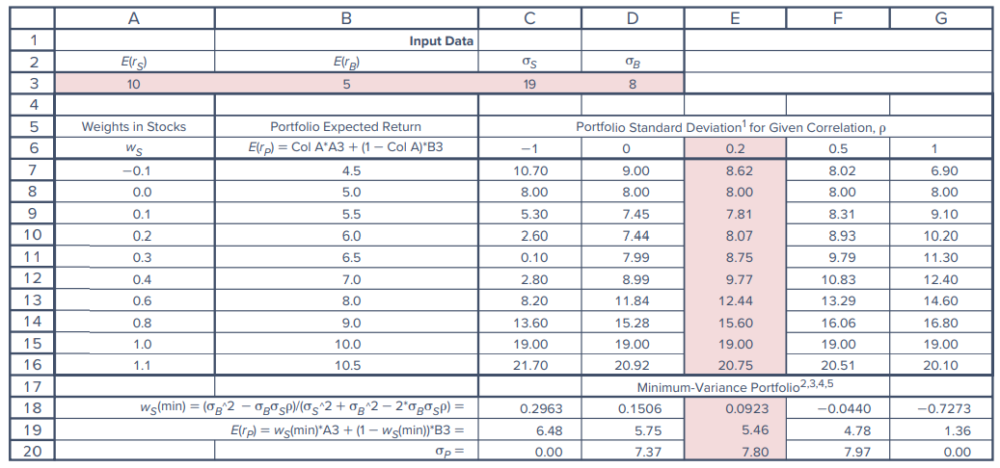{width="100%"}

Notes accompanying the spreadsheet:

-   As the correlation coefficient grows, the minimum-variance portfolio requires a smaller position in stocks (even a negative position for higher correlations), and the performance of this portfolio becomes less attractive.
-   With a correlation of 0.5 or higher, minimum variance is achieved with a **short position in stocks**. The standard deviation is lower than that of bonds, but the mean is lower as well.
-   With perfect positive correlation, you can drive the standard deviation to zero by taking a large short position in stocks. The mean return is then as low as 1.36%.

::: {.callout-tip title="Concept Check 6.2"}
Suppose that for some reason you are required to invest 50% of your portfolio in bonds and 50% in stocks. Use the assumed values for mean returns and standard deviations in Spreadsheet 6.5 to answer the following questions.

a.  If the standard deviation of your portfolio is 10%, what must be the correlation coefficient between stock and bond returns?
b.  What is the expected rate of return on your portfolio?
c.  Now suppose that the correlation between stock and bond returns is 0.22 instead of the value you found in part (a) but that you are free to choose whatever portfolio proportions you desire. Are you likely to be better or worse off than you were in part (a)?

**Solution (as printed in the text):**

a.  Using Equation 6.6 with $\sigma_B = 8$, $\sigma_S = 19$, $w_B = 0.5$, and $w_S = 0.5$: $10^2 = (0.5 \times 8)^2 + (0.5 \times 19)^2 + 2(0.5 \times 8)(0.5 \times 19)\rho_{BS}$, which yields $\rho = -0.0822$.
b.  Using Equation 6.5: $E(r_P) = (0.5 \times 5) + (0.5 \times 10) = 7.5\%$.
c.  On the one hand, you should be happier with a correlation of 0.17 than with 0.22 because the lower correlation implies greater benefits from diversification and means that, for any level of expected return, there will be lower risk. On the other hand, the constraint that you must hold 50% of the portfolio in bonds represents a cost to you as it prevents you from choosing the risk-return trade-off most suited to your tastes. Unless you would choose to hold about 50% of the portfolio in bonds anyway, you are better off with the slightly higher correlation but with the ability to choose your own portfolio weights.
:::

## 6.2.5 Using Historical Data

We have seen that portfolio risk and return depend on the means and variances of the component securities as well as on the covariance between their returns. Scenario analysis (Spreadsheets 6.1-6.4) is one way to estimate these inputs. An alternative approach is to **estimate them from historical data**. The rationale is that **variability and covariability change slowly over time**, so if we estimate these statistics from recent data, our estimates will provide useful predictions for the near future.

-   The estimate of **variance** based on historical returns is the average value of the squared deviations around the sample average.
-   The estimate of the **covariance** is the average value of the cross-product of deviations.
-   As in scenario analysis, the focus for risk is on **deviations of returns from their average value**. Instead of mean returns from scenario analysis, we use average returns during the sample period.

::: {.callout-note title="Example 6.2 - Using Historical Data to Estimate Means, Standard Deviations, Covariance, and Correlation"}
Consider 10 annual returns for two mutual funds. Although this sample period is far shorter than most analysts would use, for the sake of illustration we pretend it is adequate to estimate mean returns and relevant risk statistics with acceptable precision. In practice, analysts would use higher-frequency data (e.g., monthly or even daily data) to estimate risk coefficients and might, as well, supplement historical data with fundamental analysis to forecast future returns.

The spreadsheet starts with the raw return data in columns B and C. Standard Excel functions give average returns, standard deviation, covariance, and correlation (`AVERAGE`, `STDEV.P`, `COVAR`, `CORREL`). Cell F14 confirms that covariance is the average value of the cross-product of the two assets' deviations from their mean returns.

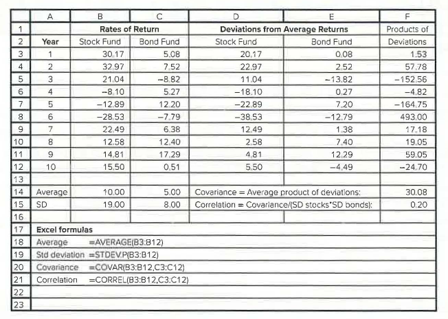{width="90%"}

The average returns and standard deviations are similar to those from the scenario analysis (stock fund: average 10.00%, SD 19.00%; bond fund: average 5.00%, SD 8.00%; covariance 30.08). However, the **correlation between stock and bond returns is low but positive (0.20)**, which is more consistent with historical experience than the strongly negative correlation of −0.49 implied by the scenario analysis.
:::

### Two comments on Example 6.2

1.  **Degrees of freedom.** When variance is estimated from a sample of $n$ observed returns, it is common to divide the squared deviations by $n - 1$ rather than by $n$. This is because we take deviations from an estimated average return rather than the true (but unknown) expected return; this procedure is said to adjust for a "lost degree of freedom." In Excel, `STDEV.P` divides by $n$, while `STDEV.S` uses $n - 1$. Excel's covariance and correlation functions both use $n$. Example 6.2 ignored this fine point and divided by $n$ throughout. The correction is negligible when there are plentiful observations; for example, with 60 returns (five years of monthly data), dividing by 60 versus 59 affects variance or covariance by a multiple of only 1.017.
2.  **Reliability of historical estimates.** Estimates of variance and covariance from past data are generally reliable forecasts (at least for the short term). However, **averages of past returns typically provide highly noisy (imprecise) forecasts of future expected returns.** The example uses past averages from small samples because the objective is to demonstrate the methodology. In practice, professional investors spend most of their resources on macroeconomic and security analysis to improve their estimates of mean returns.

::: {.callout-tip title="Concept Check 6.3"}
The text presents returns on various pairs of stocks in several periods. In part A, a scatter diagram of the returns on the first pair of stocks is shown. Draw (or prepare in Excel) similar scatter diagrams for cases B through E. Match up your diagrams (A-E) to the following list of correlation coefficients by choosing the correlation that best describes the relationship between the returns on the two stocks: $\rho = -1, 0, 0.2, 0.5, 1.0$.

**Solution (as printed in the text):**

-   **Diagram A:** an exact mirror image between the pattern of points 1, 2, 3 versus 3, 4, 5, so the correlation coefficient is **zero**.
-   **Diagram B:** perfect positive correlation (**+1**).
-   **Diagram C:** perfect negative correlation (**−1**).
-   **Diagrams D and E:** both show a general positive correlation, but scatter D is tighter. Therefore D is associated with a correlation of about **0.5** (the exact correlation is 0.54), and E with a correlation of about **0.2** (the exact correlation is 0.23).
:::

------------------------------------------------------------------------

# 6.3 The Optimal Risky Portfolio with a Risk-Free Asset

Now we expand the asset allocation problem to include a **risk-free asset**. When choosing their capital allocation between risky and risk-free portfolios, investors naturally want to work with the risky portfolio that offers the greatest reward for assuming risk. This is the portfolio with the highest **reward-to-volatility, or Sharpe, ratio**. The higher the Sharpe ratio, the greater is the expected return corresponding to any level of volatility. Therefore, our next step is to construct a risky portfolio combining the major asset classes (in our example, a bond fund and a stock fund) that provides the **highest possible Sharpe ratio**.

We continue to use the input data from Spreadsheet 6.5, but now suppose we can also invest in **T-bills yielding 3%**. When we add the risk-free asset to a risky portfolio constructed from stocks and bonds, the resulting opportunity set is the straight line called the **CAL (capital allocation line)** in Chapter 5. We now consider various CALs constructed from risk-free bills and a variety of possible risky portfolios, each formed by combining the stock and bond funds in alternative proportions.

## Comparing two CALs

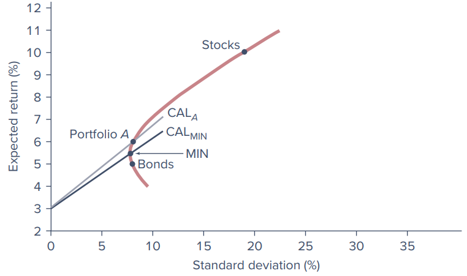{width="80%"}

We start in Figure 6.5 with the opportunity set of risky assets constructed only from the bond and stock funds. The lowest-variance risky portfolio is labeled **MIN** (the minimum-variance portfolio). $\text{CAL}_{MIN}$ is drawn through it and shows the risk-return trade-off with various positions in T-bills and portfolio MIN. It is immediately evident that we could do better (obtain a higher Sharpe ratio) by using portfolio **A** instead of MIN as the risky portfolio. $\text{CAL}_A$ dominates $\text{CAL}_{MIN}$ in the sense that it offers a higher expected return for any level of volatility.

**The slope of the CAL corresponding to a risky portfolio $P$ is the Sharpe ratio of that portfolio, that is, the ratio of its expected excess return to its standard deviation:**

**Equation 6.8 - Sharpe ratio**

$$S_P = \frac{E(r_P) - r_f}{\sigma_P}$$

With a T-bill rate of 3%, the Sharpe ratios of portfolios A and MIN can be found and compared. Portfolio A, with a weight in the stock fund of 0.2, offers an expected return of 6% with a standard deviation of 8.07%.

**Equation 6.9**

$$S_{MIN} = \frac{5.46 - 3}{7.80} = 0.32 \qquad S_A = \frac{6 - 3}{8.07} = 0.37$$

The higher ratio for portfolio A compared to MIN measures the improvement it offers in the risk-return trade-off.

## The optimal risky portfolio

But why stop at portfolio A? We can continue to ratchet the CAL upward until it reaches the ultimate point of **tangency** with the investment opportunity set. This produces the CAL with the **highest feasible Sharpe ratio**. The tangency portfolio is the **optimal risky portfolio** (denoted portfolio $O$) to mix with T-bills; in general, the optimal risky portfolio is the one that generates the **steepest CAL**.

To find the composition of $O$, we search for weights in the stock and bond funds that maximize the portfolio's Sharpe ratio. With only two risky assets, we can solve for the optimal weights using the following formula (the text notes that it can be obtained using calculus: write the Sharpe ratio as a function of $w_B$ and $w_S = 1 - w_B$, set the derivative with respect to $w_B$ equal to zero, and solve for the optimal $w_B$):

**Equation 6.10**

$$w_B = \frac{[E(r_B) - r_f]\sigma_S^2 - [E(r_S) - r_f]\sigma_B\sigma_S\rho_{BS}}{[E(r_B) - r_f]\sigma_S^2 + [E(r_S) - r_f]\sigma_B^2 - [E(r_B) - r_f + E(r_S) - r_f]\sigma_B\sigma_S\rho_{BS}}$$

$$w_S = 1 - w_B$$

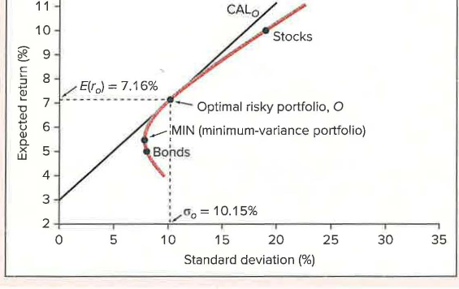{width="80%"}

Using the risk premiums of the stock and bond funds, their standard deviations, and the correlation between their returns in Equation 6.10:

| Result                          | Value                            |
|---------------------------------|----------------------------------|
| Weight in bonds, $w_B(O)$       | 0.568                            |
| Weight in stocks, $w_S(O)$      | 0.432                            |
| Expected return, $E(r_O)$       | 7.16%                            |
| Standard deviation, $\sigma_O$  | 10.15%                           |
| Sharpe ratio, $S_O$             | $\dfrac{7.16 - 3}{10.15} = 0.41$ |

The Sharpe ratio of the optimal portfolio (0.41) is significantly higher than those provided by either the bond or stock portfolios alone.

## The complete portfolio

In the last chapter, we saw that the preferred **complete portfolio** formed by combining a risky portfolio with a risk-free asset depends on **risk aversion**. More risk-averse investors prefer low-risk portfolios despite the lower expected return, while more risk-tolerant investors choose higher-risk, higher-expected-return portfolios. **Both types of investors, however, will choose portfolio $O$ as their risky portfolio**, as it provides the highest return *per unit of risk* (the steepest CAL). Investors differ only in their allocation of investment funds between portfolio $O$ and the risk-free asset.

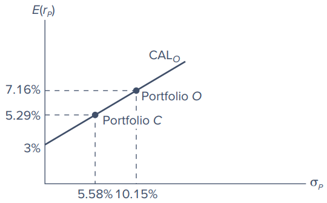{width="60%"}

Figure 6.7 shows one possible choice for the preferred complete portfolio, $C$. The investor places **55% of wealth in portfolio $O$ and 45% in Treasury bills**. The rate of return and volatility are:

$$E(r_C) = 3\% \times 0.45 + 7.16\% \times 0.55 = 5.29\%$$

$$\sigma_C = 0.55 \times 10.15\% = 5.58\%$$

Because portfolio $O$ is a mix of the bond fund and stock fund with weights of 56.8% and 43.2%, the overall asset allocation of the complete portfolio is:

| Asset                | Calculation        | Weight      |
|----------------------|--------------------|-------------|
| Weight in risk-free asset |                    | 45.00%      |
| Weight in bond fund  | 0.568 × 55% =      | 31.24       |
| Weight in stock fund | 0.432 × 55% =      | 23.76       |
| **Total**            |                    | **100.00%** |

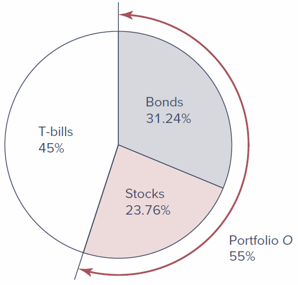{width="55%"}

Figure 6.8 depicts the overall asset allocation. The allocation reflects considerations of both **efficient diversification** (the construction of the optimal risky portfolio, $O$) and **risk aversion** (the allocation of funds between the risk-free asset and the risky portfolio $O$ to form the complete portfolio, $C$).

::: {.callout-tip title="Concept Check 6.4"}
A universe of securities includes a risky stock ($X$), a stock-index fund ($M$), and T-bills. The data for the universe are:

| Security | Expected Return | Standard Deviation |
|----------|-----------------|--------------------|
| $X$      | 15%             | 50%                |
| $M$      | 10              | 20                 |
| T-bills  | 5               | 0                  |

The correlation coefficient between $X$ and $M$ is −0.2.

a.  Draw the opportunity set of securities $X$ and $M$.
b.  Find the optimal risky portfolio ($O$) and its expected return, standard deviation, and Sharpe ratio. Compare with the Sharpe ratios of $X$ and $M$, each taken individually.
c.  Find the slope of the CAL generated by T-bills and portfolio $O$.
d.  Suppose an investor places 2/9 (i.e., 22.22%) of the complete portfolio in the risky portfolio $O$ and the remainder in T-bills. Calculate the composition of the complete portfolio and its expected return, standard deviation, and Sharpe ratio.

**Solution (as printed in the text):**

a.  Implementing Equations 6.5 and 6.6 generates the data for the graph (Spreadsheet 6.7 and Figure 6.14 in the text).

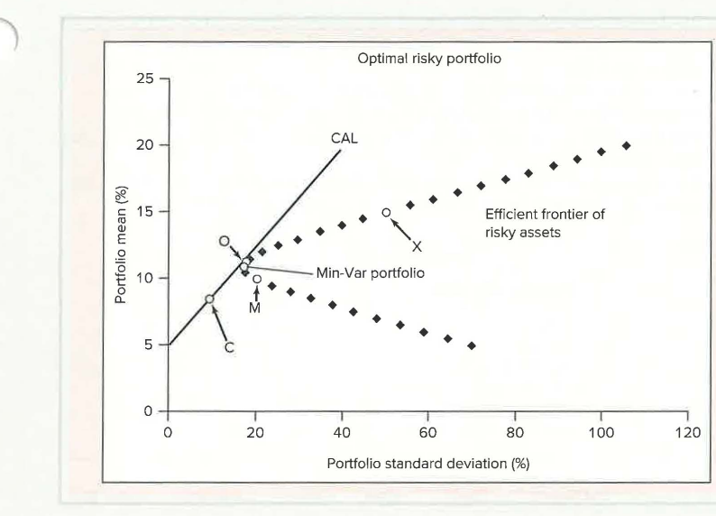{width="65%"}

b.  Implementing the formulas of Spreadsheet 6.6 generates the optimal risky portfolio ($O$) and the minimum-variance portfolio. The optimal risky portfolio has **weights of about 0.26 in $X$ and 0.74 in $M$**, with an **expected return of 11.28%** and a **standard deviation of 17.59%**.
c.  The slope of the CAL equals the risk premium of the optimal risky portfolio divided by its standard deviation: $(11.28 - 5)/17.59 = 0.357$.
d.  The mean of the complete portfolio is $0.2222 \times 11.28 + 0.7778 \times 5 = 6.395\%$, and its standard deviation is $0.2222 \times 17.58 = 3.91\%$. Sharpe ratio $= (6.395 - 5)/3.91 = 0.357$. The composition of the complete portfolio is $0.2222 \times 0.26 = 0.06$ (6%) in $X$, $0.2222 \times 0.74 = 0.16$ (16%) in $M$, and **78% in T-bills**.
:::

------------------------------------------------------------------------

# 6.4 Efficient Diversification with Many Risky Assets

We extend the two-risky-assets methodology to many risky assets in **three steps**:

1.  Generalize the two-risky-assets opportunity set to allow for many assets.
2.  Determine the optimal risky portfolio, $O$, that supports the steepest CAL, that is, maximizes the Sharpe ratio.
3.  Choose a complete portfolio on $\text{CAL}_O$ based on risk aversion by mixing the risk-free asset with the optimal risky portfolio.

## 6.4.1 The Efficient Frontier of Risky Assets

To get a sense of how additional risky assets can improve investment opportunities, look at Figure 6.9. Points **A, B, and C** represent the expected returns and standard deviations of three stocks.

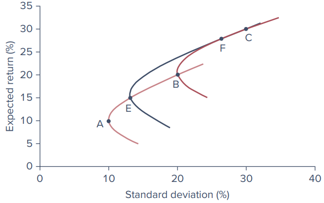{width="70%"}

-   The curve passing through A and B shows the risk-return combinations of portfolios formed from those two stocks. Similarly, the curve through B and C shows portfolios formed from those two stocks.
-   Point **E** is on the AB curve and point **F** is on the BC curve; these are two portfolios chosen from the AB and BC combinations.
-   The curve passing through E and F represents portfolios constructed from portfolios E and F. Because E and F are themselves constructed from A, B, and C, this curve shows some of the portfolios constructed from these *three* stocks. Curve EF **extends the investment opportunity set to the northwest**, which is the desired direction.

We can continue to take other points (each representing portfolios) from these curves and further combine them into new portfolios, shifting the opportunity set even farther to the northwest. This process would work even better with more stocks. The boundary, or "envelope," of all the curves thus developed will lie quite away from the individual stocks in the northwesterly direction, as shown in Figure 6.10.

### The Markowitz model

The analytical technique to derive the efficient set of risky assets was developed by **Harry Markowitz** and is often referred to as the **Markowitz model**. The first step is to determine the **risk-return opportunity set**. The aim is to construct from the universe of available securities the **northwestern-most portfolios** in terms of expected return and standard deviation. The input data are the **expected returns and standard deviations of each asset** in the universe, along with the **correlation coefficients between each pair of assets**. The plot that connects all the northwestern-most portfolios is called the **efficient frontier** of risky assets. It represents the set of portfolios offering the highest possible expected rate of return for each level of portfolio standard deviation. These portfolios may be viewed as *efficiently diversified*.

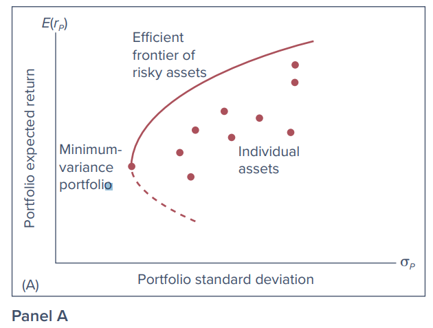{width="65%"}

### Two equivalent ways to produce the frontier (Figure 6.10, Panels B and C)

The PowerPoint lists **three methods** for finding the efficient frontier: (1) maximize the risk premium for any level of standard deviation, (2) minimize the standard deviation for any level of risk premium, and (3) maximize the Sharpe ratio (discussed under Section 6.4.2). The text illustrates the first two in Panels B and C of Figure 6.10.

**Method 1 - Maximize expected return for any level of risk (Panel B).** Choose a target value for standard deviation, for example SD = 12%, and search for the portfolio with the highest possible expected return consistent with this level of volatility. The optimization software is given an assignment to maximize expected return subject to two constraints:

1.  The portfolio weights must sum to 1 (the **feasibility constraint**, because any legitimate portfolio must have weights that sum to 100%).
2.  The portfolio SD must match the targeted value, $\sigma = 12\%$.

The software searches over all portfolios with $\sigma = 12\%$ and finds the highest feasible portfolio on the vertical line drawn at $\sigma = 12\%$; that portfolio is at the top of the vertical arrow rising from SD = 12%. The horizontal tracer line indicates that for this portfolio $E(r) = 10\%$. This is one point on the efficient frontier. Repeat for other target levels of volatility and "connect the dots" to draw the frontier.

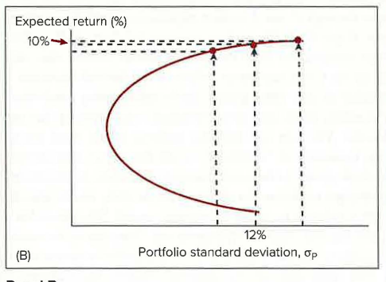{width="65%"}

**Method 2 - Minimize volatility for any level of expected return (Panel C).** Draw a few *horizontal* lines above the **global minimum-variance portfolio $G$** (portfolios lying below $G$ are inefficient because they offer a *lower* expected return and *higher* variance than $G$). In Panel C, the first horizontal line is at an expected return of 10%. The software's assignment is now to minimize the SD subject to the feasibility constraint, but with the constraint on SD replaced by a constraint on the portfolio's expected return: $E(r) = 10\%$. So we seek the portfolio farthest to the left along the horizontal line at 10%, the one with the lowest SD consistent with an expected return of 10%. From Panel B, this portfolio must be at $\sigma = 12\%$. Repeat with other expected returns, then connect the dots to get the frontier of Figure 6.10.

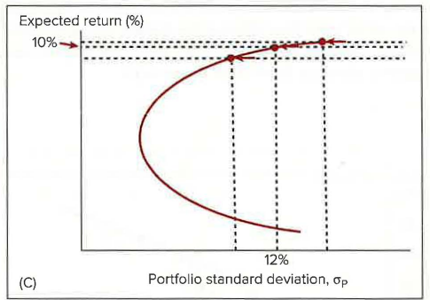{width="65%"}

### Constraints in practice

In practice, various additional constraints may preclude an investor from choosing portfolios on the efficient frontier:

-   **Short-sale restrictions.** If an institution is prohibited from taking short positions in any asset, the manager must add constraints to the optimization program that rule out negative (short) positions: all asset weights in the optimal portfolio must be greater than or equal to zero.
-   **Minimum dividend yield.** Input data must include a set of expected dividend yields, and the program is given the constraint that the expected portfolio dividend yield will equal or exceed the desired level.
-   **Socially responsible investing (SRI).** SRI rules out investments in firms engaged in businesses deemed objectionable (for example, tobacco or arms production); SRI would constrain portfolio weights on such firms to be zero.
-   **ESG (environmental, social, and governance-focused) investing.** A similar orientation to SRI (see Chapter 1). While the two overlap considerably, SRI investors tend to impose more absolute restrictions on portfolio choice to reflect their ethical concerns, whereas ESG investors tend to be comparatively more focused on long-term sustainable business prospects that might be enhanced by environmentally and socially sound practices.

In principle, portfolio managers can tailor an efficient frontier to meet any particular objective. Of course, **any constraint carries a price tag**: an efficient frontier subject to additional constraints will offer a *lower* Sharpe ratio. Deriving and graphing the efficient frontier with any number of assets and any set of constraints is quite straightforward, and for a not-too-large number of assets it can be computed and graphed even with a spreadsheet program.

## 6.4.2 Choosing the Optimal Risky Portfolio

The second step of the optimization plan involves the **risk-free asset**. Using the risk-free rate, we search for the capital allocation line with the highest Sharpe ratio (the steepest slope), just as in Figures 6.5 and 6.6.

The CAL formed from the optimal risky portfolio ($O$) will be **tangent to the efficient frontier** of risky assets. Because this CAL lies above all other feasible CALs, portfolio $O$ is the optimal risky portfolio.

There is yet another way to find the best risky portfolio. Because the optimal portfolio is the one that maximizes the Sharpe ratio, rather than solving for the entire efficient frontier, we can proceed directly: ask the optimization program to **maximize the Sharpe ratio subject only to the feasibility constraint** (that portfolio weights sum to 1). The portfolio providing the highest possible Sharpe ratio is the optimal portfolio $O$. While this last approach does not produce the entire minimum-variance frontier, in many applications only the optimal risky portfolio is necessary.

## 6.4.3 The Preferred Complete Portfolio and a Separation Property

Finally, each investor chooses the appropriate mix between the optimal risky portfolio ($O$) and T-bills, exactly as in Figure 6.7.

A portfolio manager will offer the **same risky portfolio ($O$) to all clients**, no matter what their degrees of risk aversion. Risk aversion comes into play only when clients select their desired point on the CAL. This result is called a **separation property**, introduced by **James Tobin (1958)**. Its name reflects the fact that portfolio choice can be separated into two independent tasks:

1.  **Determining the optimal risky portfolio ($O$)** is purely *technical*. Given the input data, the best risky portfolio is the same for all clients regardless of risk aversion.
2.  **Constructing the complete portfolio** from bills and portfolio $O$ is *personal* and depends on risk aversion. Here the client is the decision maker.

In practice, optimal risky portfolios for different clients may vary because of constraints on short sales, dividend yield, tax considerations, or other client preferences. Our analysis, though, suggests that **a few portfolios may be sufficient to serve the demands of a wide range of investors**. We see here the theoretical basis of the **mutual fund industry**.

**Where the real competition is.** The (computerized) optimization technique is the easiest part of portfolio construction. When different managers use different input data, they develop different efficient frontiers and offer different "optimal" portfolios. Therefore, the real arena of competition among portfolio managers is in the **sophisticated security analysis that produces the input estimates**. The rule of **GIGO (garbage in-garbage out)** applies fully to portfolio selection. If the quality of security analysis is poor, a passive portfolio such as a market-index fund will yield better results than an active portfolio tilted toward seemingly favorable securities.

::: {.callout-tip title="Concept Check 6.5"}
Two portfolio managers work for competing investment management houses. Each employs security analysts to prepare input data for the construction of the optimal portfolio. When all is completed, the efficient frontier obtained by manager A dominates that of manager B in that A's optimal risky portfolio lies northwest of B's. Is the more attractive efficient frontier asserted by manager A evidence that she really employs better security analysts?

**Solution (as printed in the text):** Efficient frontiers derived by portfolio managers depend on forecasts of the rates of return on various securities and estimates of risk (standard deviations and correlation coefficients). The forecasts themselves do not control outcomes. Thus, to prefer a manager with a rosier forecast (northwesterly frontier) is tantamount to rewarding the bearers of good news and punishing the bearers of bad news. What the investor wants is to reward bearers of *accurate* news. Investors should monitor forecasts of portfolio managers on a regular basis to develop a track record of their forecasting accuracy. Portfolio choices of the more accurate forecasters will, in the long run, outperform the field.
:::

## 6.4.4 Constructing the Optimal Risky Portfolio: An Illustration

To illustrate how the optimal risky portfolio might be constructed, suppose an analyst wished to construct an **efficiently diversified global portfolio** using the stock market indices of **six countries** (U.S., U.K., France, Germany, Japan, and China).

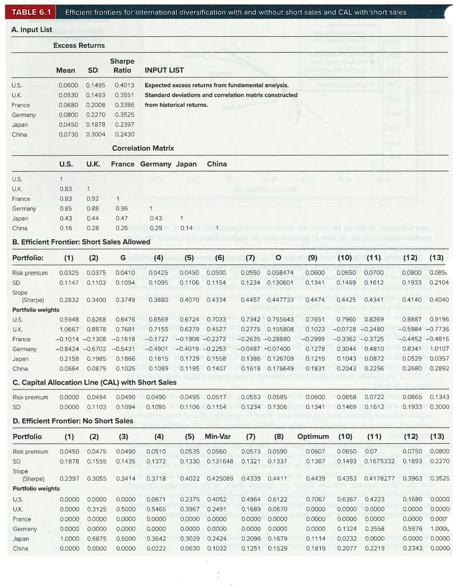{width="100%"}

**Panel A of Table 6.1 - the input list.** The standard deviations and the correlation matrix are estimated from historical data, while forecasts of risk premiums are generated from fundamental analysis. The U.S. index portfolio has the highest Sharpe ratio (0.4013). Given this, one might be tempted to conclude that U.S. investors would not have benefited much from international diversification. But even in this sample period, **diversification is beneficial**.

**Panel B - the efficient frontier (short sales allowed).** First the **global minimum-variance portfolio $G$** is generated by minimizing the standard deviation (SD) with just the feasibility constraint; then portfolio $O$ is found by maximizing the Sharpe ratio subject only to the same constraint. To fill out the curve, more risk premiums are chosen and, for each, portfolio volatility is minimized. In all, there are 13 points used to draw the graph in Figure 6.11, one of which is the maximum-Sharpe-ratio portfolio, $O$.

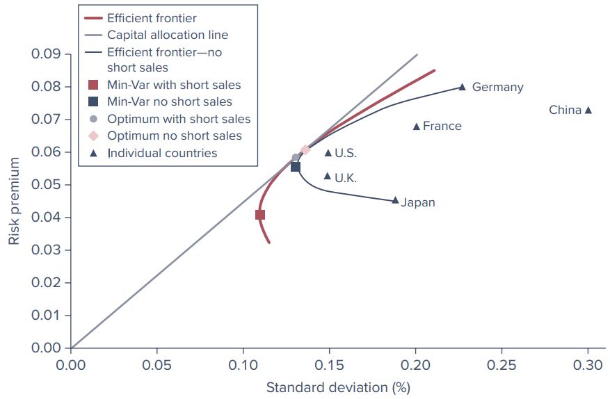{width="85%"}

The results are striking:

-   **Portfolio $G$.** The SD of the global minimum-variance portfolio, **10.94%**, is far lower than that of the lowest-variance country (the U.K., SD of 14.93%). $G$ is formed by taking **short positions in Germany and France**, as well as a large position in the relatively low-risk U.K. The Sharpe ratio of this portfolio is higher than that of all countries but the U.S. Still, even this portfolio will be rejected in favor of the highest Sharpe-ratio portfolio.
-   **Portfolio $O$.** It attains a Sharpe ratio of **0.4477**, compared to the U.S. ratio of 0.4013, a significant improvement that can be verified from the CAL shown in Panel C.

**Panel C - the CAL.** The points are selected to have the same SD as those of the efficient frontier portfolios, so the risk premium for each equals the SD times the Sharpe ratio of portfolio $O$ (footnote 4: because $S = \text{risk premium}/\text{SD}$, we can rearrange to show that $\text{SD} = \text{risk premium}/S_O$; the CAL has the same slope everywhere, equal to the Sharpe ratio of portfolio $O$ that supports it). Portfolio (9) on the CAL has the same risk premium as the U.S., 6%, but an SD of **13.41%**, fully 1.5% less than the 14.95% SD of the U.S. All this is achieved while still investing **76.51% of the portfolio in the U.S.**, although it does require a **large short position in France (−29.99%)**.

**Panel D - no short sales.** Many institutional investors are prohibited from taking short positions, and individuals may be averse to large short positions because the unlimited upward potential of stock prices implies unlimited potential losses on short sales. Panel D shows the efficient frontier when an additional constraint is applied to each portfolio: **all weights must be nonnegative**.

**Comparing the two frontiers in Figure 6.11.** The no-short-sale frontier is clearly **inferior on both ends**. This is because both very-low-return and very-high-return frontier portfolios will typically entail short positions:

-   At the **low-return/low-volatility end**, efficient portfolios take short positions in stocks with a high correlation and low-risk premium that can reduce variance with low impact on expected return.
-   At the **high expected return end**, we find short positions in low-risk-premium stocks in favor of larger positions in high-risk-premium stocks.

Therefore, the short-sale-constrained efficient frontier diverges further from the unconstrained frontier for extreme risk premiums.

------------------------------------------------------------------------

# 6.5 A Single-Index Stock Market

We started this chapter with the distinction between systematic and firm-specific risk. **Systematic risk** is macroeconomic, affecting all securities, while **firm-specific risk** factors affect only one particular firm or, at most, a cluster of firms. **Index models** are statistical tools designed to estimate these two components of risk for a particular security or portfolio. The first to use an index model to explain the benefits of diversification was another Nobel Prize winner, **William F. Sharpe (1963)**. (His major work, the capital asset pricing model, is introduced in the next chapter.)

**Why index models? Practicality.** To construct the efficient frontier from a universe of 100 securities, we would need to estimate:

-   100 expected returns,
-   100 variances, and
-   $100 \times 99/2 = 4{,}950$ covariances.

And a universe of 100 securities is actually quite small. A universe of 1,000 securities would require $1{,}000 \times 999/2 = 499{,}500$ covariances, as well as 1,000 expected returns and variances. **The index model asserts that one common systematic factor is responsible for all the covariability of stock returns, with all other variability due to firm-specific factors.** This assumption dramatically simplifies the analysis.

## The intuition: U.S. Steel against the market

The intuition can be seen in Figure 6.12. We begin with a historical sample of paired observations of **excess returns** on the market index and shares in a particular security, here U.S. Steel. Figure 6.12 has 60 pairs of monthly excess returns, one for each month in a five-year sample. Each dot represents the pair of returns in one particular month. For example, in June 2019, U.S. Steel's excess return was 29.92% while the market's was 6.93%.

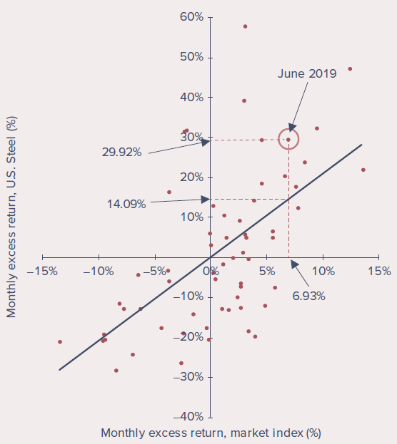{width="65%"}

To describe the typical relation between the return on U.S. Steel and the return on the market index, we fit a straight line through the **scatter diagram**. This "line of best fit" shows a **positive relation** between the company's return and the market's, evidence of the importance of broad market conditions on the performance of U.S. Steel's stock.

-   The **slope** of the line reflects the sensitivity of the company's return to market conditions. A steeper line implies that its rate of return is more responsive to the market return.
-   The **scatter of points around the line** shows that market conditions are not the entire story. If returns perfectly tracked those of the market, all return pairs would lie exactly on the line. The scatter is evidence that **firm-specific events** also have a significant impact on the stock return.

## The index model equation

We use $R_i$ to denote an **excess return**, so the market index $M$ has an excess return of $R_M = r_M - r_f$, and (using U.S. Steel's ticker symbol, $X$) the company's excess return is $R_X = r_X - r_f$. We estimate the line using a **single-variable linear regression**: regress U.S. Steel's excess return on the excess return of the index, $R_M$. More generally, for any stock $i$, with $R_i(t)$ the excess return in month $t$ and $R_M(t)$ the market index excess return, the index model is the following regression equation:

**Equation 6.11 - The index model**

$$R_i(t) = \alpha_i + \beta_i R_M(t) + e_i(t)$$

-   **Alpha ($\alpha_i$)** - the intercept. It is the security's expected excess return when the market excess return is zero (the vertical intercept in Figure 6.12). It can also be thought of as the expected excess return on the stock beyond the return that can be attributed to the performance of the broad stock market.
-   **Beta ($\beta_i$)** - the slope (the security's beta coefficient). It is the amount by which the security return tends to increase or decrease for every 1% increase or decrease in the return on the index, and therefore measures the security's sensitivity to marketwide economic shocks. **Beta is a natural measure of systematic risk.**
-   **Residual ($e_i(t)$)** - the zero-mean, firm-specific surprise in the security return in month $t$. The greater the residuals (positive or negative), the wider the scatter of returns around the line. This scatter reflects the impact of **firm-specific, or residual, risk**. Both residual risk and systematic risk contribute to the total volatility of returns.

*Why excess returns?* We use excess returns rather than total returns in both Equation 6.11 and Figure 6.12 because we treat risk-free T-bills as an alternative parking place for the investor's funds. You will be happy to have moved funds from the risk-free asset to a risky alternative only if the *excess* return turns out to be positive. Nevertheless, practitioners often use a "modified" index model that uses total rather than excess returns, most commonly with daily data, where the daily rate of return on bills (about 0.01% per day) makes total and excess returns almost indistinguishable.

For U.S. Steel, the estimated regression is:

**Equation 6.12 - U.S. Steel's security characteristic line (SCL)**

$$R_X(t) = -0.33 + 2.0805\,R_M(t) + e_i(t)$$

This regression line "best fits" the data in the scatter diagram, and is called U.S. Steel's **security characteristic line (SCL)**. It tells us that, on average, the company stock rose an additional **2.0805%** for every additional 1% return in the stock market index. The average value of the residual is zero, but the intercept is negative, so in a month when the market was "flat" (excess return of zero), U.S. Steel's excess return would be predicted to be **−0.33%**.

## Why investors care about alpha

Investors naturally are attracted to stocks with **positive alphas**, as positive values imply higher average excess returns (risk premiums) without the "cost" of any additional exposure to market risk. For example, $\alpha$ may be large if you think a security is underpriced and therefore offers an attractive expected return. The next chapter shows that when security prices are in equilibrium, such attractive opportunities ought to be competed away, in which case $\alpha$ will be driven to zero. But for now, assume that security analysts come up with their own estimates of alpha. If managers believe they can do a superior job of security analysis, they will be confident in their ability to find stocks with nonzero alphas.

## Beta of the market and average beta

There is little "theory" in the index model so far; it is merely a way to *describe* the typical relation between market returns and returns on particular firms.

-   The average beta of all stocks in the economy is 1; the average response of a stock to changes in a market index composed of all stocks must be 1-for-1. (Footnote 6: only the *weighted* average of betas, using market values as weights, will be 1, because the market index is value-weighted. The simple average of betas of individual securities against a value-weighted index such as the S&P 500 will be greater than 1, pushed up by the general tendency of smaller firms to have higher betas.)
-   The beta of the market index is, by definition, **1**.
-   **Cyclical** or **aggressive** stocks have higher-than-average sensitivity to the broad economy and betas **greater than 1**.
-   **Defensive** stocks have betas **less than 1**; their returns respond less than 1-for-1 to market returns.

While the index model is mostly descriptive, it helps address two important theoretical questions: (1) What relation might we expect between a stock's beta and its expected return? and (2) What value for alpha should we expect to observe when markets are in equilibrium? The text takes these up in the next chapter.

## The three components of excess return

The index model separates the realized rate of return on a security into **macro (systematic)** and **micro (firm-specific)** components. The excess rate of return on each security is the sum of three components:

| Component | Symbol |
|-----------------------------------------------|-----------------|
| 1\. The component of excess return due to movements in the overall market (as represented by the index $R_M$); $\beta_i$ is the security's responsiveness to the market | $\beta_i R_M$ |
| 2\. The component attributable to unexpected events that are relevant only to this security (firm-specific) | $e_i$ |
| 3\. The stock's expected excess return if the market factor is neutral, that is, if the market index excess return is zero | $\alpha_i$ |

Because the firm-specific component of the stock return is uncorrelated with the market return, the variance of the excess return of the stock can be written as:

**Equation 6.13 - Decomposition of variance**

$$\begin{aligned}
\text{Variance}(R_i) &= \text{Variance}(\alpha_i + \beta_i R_M + e_i) \\
&= \text{Variance}(\beta_i R_M) + \text{Variance}(e_i) \\
&= \beta_i^2 \sigma_M^2 + \sigma^2(e_i) \\
&= \text{Systematic risk} + \text{Firm-specific risk}
\end{aligned}$$

(Footnote 7: the covariance between $R_M$ and $e$ is zero. Also, because $\alpha_i$ is not random, it has no bearing on the variance of $R_i$.)

Therefore, the total variance of the rate of return of each security is a sum of two components:

1.  **The variance attributable to the uncertainty of the entire market.** This depends on both the variance of $R_M$, denoted $\sigma_M^2$, *and* the beta of the stock.
2.  **The variance of the firm-specific return, $e_i$,** which is independent of market performance.

## 6.5.1 Statistical Interpretation of the Single-Index Model

Equation 6.11 may be interpreted as a **single-variable regression equation** of $R_i$ on the market excess return $R_M$:

-   The excess return on the security ($R_i$) is the **dependent variable** to be explained by the regression.
-   The **intercept** is $\alpha_i$.
-   The **regression (slope) coefficient** is $\beta_i$, multiplying the **independent (explanatory) variable** $R_M$.
-   The **residual** (unexplained) return is $e_i$.

However, the regression line does not represent *actual* returns; points on the scatter diagram almost never lie exactly on the line. Rather, the line represents **average tendencies**: it shows the *expectation* of U.S. Steel's excess return, $R_X$, given the market's excess return, $R_M$.

**Equation 6.14 - The regression line**

$$E(R_X \mid R_M) = \alpha_X + \beta_X R_M$$

This reads: the expectation of $R_X$ given a value of $R_M$ equals the intercept plus the slope coefficient times the value of $R_M$.

**Worked example (June 2019).** When the market excess return was 6.93%, we would have predicted U.S. Steel's excess return to be $-0.33\% + 2.0805 \times 6.93\% = 14.09\%$. In fact, its actual excess return was 29.92%, resulting in a large positive **residual of 15.83%**, as shown in Figure 6.12. The firm must have had very good firm-specific news in that month.

### R-square

The dispersion of the scatter of actual returns about the regression line is measured by the variance of the residuals, $\sigma^2(e)$. The magnitude of this firm-specific risk varies across securities. One way to measure the relative importance of systematic risk is the ratio of systematic variance to total variance, called the **R-square** of the regression line (the PowerPoint denotes this ratio $\rho^2$):

**Equation 6.15**

$$R\text{-square} = \frac{\text{Systematic (or explained) variance}}{\text{Total variance}} = \frac{\beta_X^2 \sigma_M^2}{\sigma_X^2} = \frac{\beta_X^2 \sigma_M^2}{\beta_X^2 \sigma_M^2 + \sigma^2(e_X)}$$

-   R-square is the proportion of total variance that can be attributed to market fluctuations. When residual variance is lower, R-square is higher.
-   In the limit, if $\sigma^2(e)$ were zero, R-square would be 1.0: with no firm-specific risk at all, the market index excess return would fully explain the excess return on the stock.
-   In general, the R-square is the **square of the correlation coefficient** between the market and stock returns.
-   If beta is *negative*, when the market goes up the stock is more likely to go down (a negative correlation). Nevertheless, knowing the market return conveys information about the stock's return, so the R-square is still above zero.
-   At either extreme, for a correlation coefficient of 1 or −1, the return on the security is fully determined by the return on the market index, R-square is 1, and all points of the scatter diagram lie exactly on the line of best fit.

**Interpretation.** A **high R-square** (equivalently, a correlation coefficient with high absolute value) tells us that **systematic factors dominate firm-specific factors** in determining the return on the stock. **Low R-squares** imply that the market plays a relatively unimportant part in explaining the variance of the stock's return; in this case, **firm-specific factors dominate**.

### Various scatter diagrams (Figure 6.13)

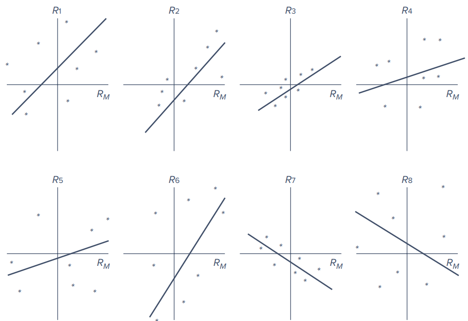{width="85%"}

::: {.callout-tip title="Concept Check 6.6"}
Interpret the eight scatter diagrams of Figure 6.13 in terms of systematic risk, diversifiable risk, and the intercept.

**Solution (as printed in the text):**

a.  **Beta** (the slope coefficient of the security on the factor): Securities $R_1$-$R_6$ have a positive beta. These securities move, on average, in the same direction as the market ($R_M$). $R_1$, $R_2$, $R_6$ have large betas, so they are "aggressive" in that they carry more systematic risk than $R_3$, $R_4$, $R_5$, which are "defensive." $R_7$ and $R_8$ have a negative beta; these are **hedge assets** that carry negative systematic risk.
b.  **Intercept** (the expected excess return when the market is neutral): $R_1$, $R_4$, $R_8$ have a positive intercept, while $R_2$, $R_3$, $R_5$, $R_6$, $R_7$ have negative intercepts. To the extent that one believes these intercepts will persist, a positive value is preferred.
c.  **Residual variance** (the nonsystematic risk): $R_2$, $R_3$, $R_7$ have a relatively low residual variance. With sufficient diversification, residual risk eventually will be eliminated, and, hence, the difference in the residual variance is of little economic concern.
d.  **Total variance** (the sum of systematic and nonsystematic risk): $R_3$ has a low beta and low residual variance, so its total variance will be low. $R_1$, $R_6$ have high betas and high residual variance, so their total variance will be high. But $R_4$ has a low beta and high residual variance, while $R_2$ has a high beta with a low residual variance. In sum, **total variance often will misrepresent systematic risk, which is the part that matters.**
:::

### Diversification in a single-index market (PowerPoint)

The PowerPoint adds how diversification works within the single-index framework. In a portfolio of $n$ securities with weights $w_i$ (where $\sum w_i = 1$), each security has nonsystematic risk $\sigma^2_{e_i}$. The nonsystematic portion of the portfolio return and the portfolio's nonsystematic variance are:

$$e_P = \sum_{i=1}^{n} w_i e_i \qquad\qquad \sigma^2_{e_P} = \sum_{i=1}^{n} w_i^2 \sigma^2_{e_i}$$

## 6.5.2 Learning from the Index Model

Example 6.3 illustrates how to use a spreadsheet to estimate the single-index model from historical data.

::: {.callout-note title="Example 6.3 - Estimating the Index Model Using Historical Data"}
The spreadsheet sets up a regression analysis to estimate the parameters of the index model regression. Twelve months of hypothetical returns for two stocks (ABC and XYZ) and the market index are entered, along with the risk-free rate, and excess rates of return are calculated in columns G through I. Then, in Excel, go to the **Data** tab, click **Data Analysis**, and choose the **Regression** tool. The tool asks for the range for the left-hand side variable (the Y range), the right-hand side variable (the X range), and the location for the regression output. For stock ABC, the Y range is H4:H15 and the X range is G4:G15.

The regression output includes **R-square** (cell D22), the **standard deviation of the regression residuals** (called *standard error*, cell D24), the estimated **alpha** and **beta** (cells D29 and D30), and measures of the precision of those estimates (standard error of the coefficients, t-statistic, and p-value).

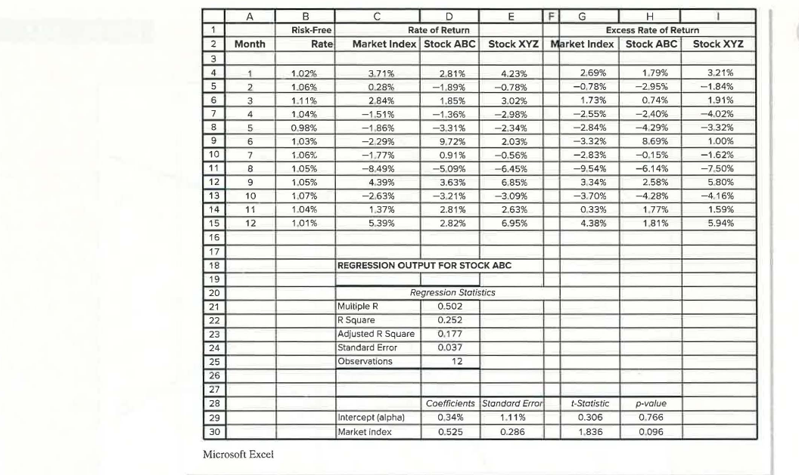{width="100%"}

**ABC has low systematic risk, with a beta of only 0.525.** Its R-square is 0.252, indicating that only 25.2% of the variance in its returns was driven by movements in the market index. (Alpha is 0.34%.)
:::

::: {.callout-tip title="Concept Check 6.7"}
a.  What is the regression line of XYZ in Example 6.3?
b.  Does ABC or XYZ have greater systematic risk?
c.  What proportion of the variance of XYZ is firm-specific risk?

**Solution (as printed in the text):**

a.  To obtain the characteristic line of XYZ, continue the spreadsheet of Example 6.3 and run a regression of the excess return of XYZ on the excess return of the market-index fund. The regression output shows a slope coefficient of 0.992 and an intercept of 0.83%; hence, the characteristic line is $R_{XYZ} = 0.83 + 0.992\,R_{Market}$.
b.  The beta of ABC is 0.525, less than XYZ's 0.992, implying that **ABC has less systematic risk**.
c.  The regression of XYZ on the market index shows an R-square of 0.845. Hence, the proportion of variance that is firm-specific (nonsystematic) is 0.155, or **15.5%**.
:::

### Regressions for well-known companies (Table 6.2)

In Example 6.3, index model regressions were estimated in Excel by collecting a sample of monthly observations of excess returns on each firm and the market index, then fitting the "best" straight line through the scatter. The slope is the estimate of the firm's beta; the intercept is its alpha; and the scatter of residuals around the line reflects the standard deviation of the firm-specific (residual) risk. Table 6.2 shows index model regressions for a sample of well-known companies.

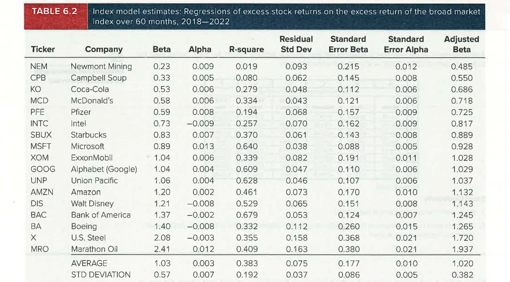{width="100%"}

What the table shows:

-   **Betas.** The average beta of the firms is **1.03**, almost identical to the expected value of 1.0, so the model seems to provide reasonable estimates of systematic risk. Firms with high exposure to the state of the macroeconomy (e.g., U.S. Steel, Marathon Oil, and Boeing) have betas greater than 1. Firms whose business is less sensitive to the macroeconomy (e.g., Newmont Mining, Campbell Soup, and Coca-Cola) have betas less than 1. In almost all cases, the regression beta is far greater than twice its standard error, so the *t*-statistic for beta is far above 2 and we can easily reject the hypothesis that the true beta is zero: there is strong evidence that returns on these stocks are driven in part by the performance of the broad market.
-   **Alphas.** Alpha for this sample ranged from −0.9% per month to 1.3% per month, but the average alpha was close to zero. Because this nonmarket risk premium was about zero, these firms, on average, were neither underpriced nor overpriced. Some did better than expected at the beginning of the period and others did worse, but there was no obvious systematic tendency to out- or underperform initial expectations. Moreover, the alpha estimates were generally small compared to the statistical uncertainty surrounding their true values: in only one firm was the estimate of alpha more than twice its standard error. The alpha estimates, by and large, are **not statistically significant**, and one generally could not reject the hypothesis that the true values were zero.
-   **Firm-specific risk.** The *Residual Standard Deviation* column measures firm-specific risk, and it is high, **averaging 7.5% per month**. Anyone who concentrates a portfolio in just one or a few securities bears an enormous amount of volatility that can easily be diversified.
-   **R-square.** On average, only **38.3%** of return variance is due to the market, implying that **62.7%** is due to firm-specific factors. Diversified portfolios will have far lower residual standard deviations and far higher R-squares (a point the text returns to in the next chapter).

### Excel Applications: Estimating the Index Model

The chapter's Excel Applications box provides a spreadsheet of monthly returns for three stocks (Ford, Walmart, and Bank of America), the market index, and the T-bill rate over the three-year period 2007-2009, which spans the financial crisis. It poses two questions: (1) What were the betas of each of these firms? (2) In light of each firm's exposure to the financial crisis, do the relative sizes of the betas make intuitive sense?

### Predicting betas

As an empirical rule, betas exhibit a statistical property called **mean reversion**: high-$\beta$ securities ($\beta > 1$) tend to exhibit a lower $\beta$ in the future, while low-$\beta$ securities ($\beta < 1$) exhibit a higher $\beta$ in future periods. Researchers who desire predictions of future betas often adjust beta estimates from historical data to account for regression toward 1.

A simple way to account for mean reversion is to forecast beta as a weighted average of the sample estimate and the average beta, which must be 1. A common back-of-the-envelope weighting scheme is **⅔ on the sample estimate and ⅓ on the value 1**. For example, if past data yield a beta estimate of 0.65:

$$\text{Adjusted beta} = \tfrac{2}{3} \times 0.65 + \tfrac{1}{3} \times 1 = 0.77$$

The final forecast of beta is closer to 1 than the sample estimate. The last column of Table 6.2 shows the adjusted beta for each firm.

A more sophisticated adjustment would base the weight on the sample beta's statistical quality (a more precise estimate would get a higher weight). However, statistical estimates of beta from past data are generally **not precise** because there is a lot of "noise" in the data due to firm-specific events. The problem is less severe with portfolios because diversification reduces firm-specific variance. Longer time series of returns are not a solution because **betas change over time** and old data can provide a misleading guide to current betas.

## 6.5.3 Using Security Analysis with the Index Model

Imagine that you are a portfolio manager in charge of the endowment of a small charity. Absent the resources to engage in security analysis, you would choose a **passive portfolio** comprising an index fund and T-bills. Denote the index portfolio as $M$. You estimate its standard deviation as $\sigma_M$ and acquire a forecast of its risk premium as $R_M$. Now suppose you have the resources to perform fundamental analysis on **just one stock, say Google**. You forecast Google's risk premium as $R_G$ and estimate its beta ($\beta_G$) and residual SD, $\sigma(e_G)$. How should you proceed?

**Treynor and Black (1973)** proposed an elegant solution using estimates from the index model. The investor is viewed as mixing **two risky securities**: the passive index, $M$, and the single analyzed stock, Google. The goal is to find the mix that yields the **highest possible Sharpe ratio**. Equation 6.10 already gives an expression for the optimal weights, but the index model allows a simpler one.

Your forecast of $R_G$ implies that Google's alpha is $\alpha_G = R_G - \beta_G R_M$. Two key statistics, $\alpha_G/\sigma^2(e_G)$ and $R_M/\sigma_M^2$, are used to find the position of Google in the optimal risky portfolio in two steps.

**Step 1.**

**Equation 6.16**

$$w_G^0 = \frac{\alpha_G/\sigma^2(e_G)}{R_M/\sigma_M^2}$$

**Step 2** - adjust the value from Equation 6.16 for the beta of Google:

**Equation 6.17**

$$w_G^* = \frac{w_G^0}{1 + w_G^0(1 - \beta_G)}; \qquad w_M^* = 1 - w_G^*$$

The Sharpe ratio of this portfolio ($S_O$) exceeds that of the passive portfolio $M$ ($S_M$) according to:

**Equation 6.18**

$$S_O^2 - S_M^2 = \left[\frac{\alpha_G}{\sigma(e_G)}\right]^2$$

### Interpreting the results

-   **Equation 6.16** says the optimal position in Google entails a **trade-off between alpha and potentially diversifiable risk**. If Google seems underpriced, offering a positive alpha, it becomes attractive to add it. But by concentrating the portfolio in Google, the investor incurs a higher-than-necessary level of otherwise diversifiable risk. The higher the ratio of alpha to residual risk, the more Google the investor will be willing to hold.
-   **Equation 6.18** says the improvement to the risky portfolio's Sharpe ratio compared to the purely passive market index portfolio is a function of the ratio $\alpha_G/\sigma(e_G)$, which is called Google's **information ratio**. (Footnote 8: some writers define the information ratio as excess return per unit of nonsystematic standard deviation and use *appraisal ratio* for the ratio of alpha to nonsystematic risk. The text consistently defines the information ratio as the ratio of alpha to the standard deviation of residual returns, but usage varies.)

### More than one analyzed stock: the active portfolio

The value of the Treynor-Black model can be dramatic when you analyze **more than one stock**. The diversifiable risk of the active portfolio falls as it comprises more securities, thus improving its information ratio and allowing investors to comfortably assume greater exposure to it. In the previous example, Google alone comprises the entire **active portfolio**. If you analyze several stocks, a portfolio of these stocks makes up your active portfolio, which is then mixed with the passive index. You use the alpha, beta, and residual SD of the *active portfolio* in Equations 6.16, 6.17, and 6.18 to obtain the weights of the optimal portfolio, $O$, and its Sharpe ratio. The only remaining task is to determine the exact composition of the active portfolio, as well as its alpha, beta, and residual standard deviation.

Suppose that, in addition to analyzing Google, you analyze Digital's stock ($D$) and estimate its alpha, beta, and residual variance. The sum of the alpha-to-residual-variance ratios over all stocks in the active portfolio is:

**Equation 6.19**

$$\sum_i \alpha_i/\sigma^2(e_i) = \alpha_G/\sigma^2(e_G) + \alpha_D/\sigma^2(e_D)$$

Treynor and Black showed that the optimal weights of Google and Digital in the active portfolio, $A$, are:

**Equation 6.20**

$$w_{GA} = \frac{\alpha_G/\sigma^2(e_G)}{\sum_i \alpha_i/\sigma^2(e_i)}; \qquad w_{DA} = \frac{\alpha_D/\sigma^2(e_D)}{\sum_i \alpha_i/\sigma^2(e_i)}$$

Again the active portfolio entails **two offsetting considerations**: a stock with a higher alpha calls for a high weight to take advantage of its attractive expected return, but a high residual variance leads us to temper the position to avoid bearing firm-specific risk.

The alpha and beta of the active portfolio are weighted averages of each component stock's alpha and beta, and the residual variance is the weighted sum of each stock's residual variance, using the *squared* portfolio weights:

**Equation 6.21**

<!-- Note: the printed Equation 6.21 uses the subscripts GA and DA on the alphas/betas (alpha_GA, beta_GA, etc.); here they are written as each stock's own alpha and beta (alpha_G, alpha_D, beta_G, beta_D), consistent with the sentence in the text and Table 6.3. Flag for instructor review. -->

$$\alpha_A = w_{GA}\alpha_G + w_{DA}\alpha_D; \qquad \beta_A = w_{GA}\beta_G + w_{DA}\beta_D$$

$$\sigma^2(e_A) = w_{GA}^2\sigma^2(e_G) + w_{DA}^2\sigma^2(e_D)$$

Given these parameters, Equations 6.16-6.18 determine the weight of the active portfolio in the optimal portfolio and the Sharpe ratio it achieves.

::: {.callout-note title="Example 6.4 - The Treynor-Black Model"}
Suppose your benchmark passive position is the **S&P 500 Index**. The input list in Panel A of Table 6.3 includes the data for the passive index as well as the two stocks, Google and Digital. Both stocks have positive alpha values, so you would expect the optimal portfolio to be tilted toward these stocks. However, the tilt will be limited to avoid excessive exposure to otherwise diversifiable firm-specific risk. The optimal trade-off maximizes the Sharpe ratio, and the Treynor-Black model accomplishes this task.

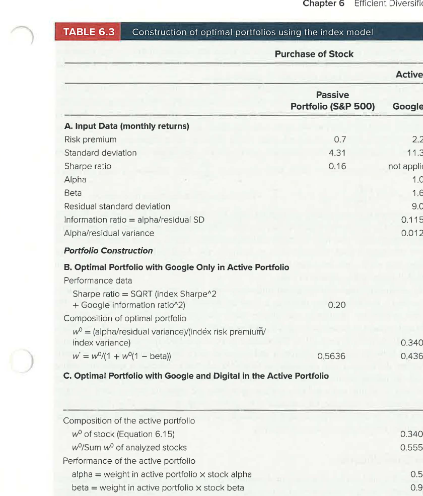{width="100%"}

**Panel B - Google only in the active portfolio.** Google has an information ratio of $1.04/9.01 = 0.115$. This "portfolio" is combined with the passive index to form the optimal risky portfolio using Equations 6.16-6.18. The optimal portfolio achieves a **Sharpe ratio of 0.20**, compared with **0.16** for the passive index. It is invested **43.64% in Google and 56.36% in the S&P 500**.

**Panel C - Google and Digital in the active portfolio.** The optimal weights of each stock in the active portfolio are **55.53% in Google and 44.47% in Digital**. This gives the active portfolio an information ratio of **0.14**, which improves the Sharpe ratio of the optimal portfolio to **0.24**. The optimal portfolio invests **91.73% in the active portfolio and 8.27% in the index**. This large tilt is acceptable because the residual standard deviation of the active portfolio (6.28%) is far less than that of either stock. Finally, the optimal portfolio weight in Google is **50.94%** and in Digital **40.79%**. Notice that the weight in Google is now *larger* than its weight without Digital! This, too, is a result of diversification within the active position that allows a larger tilt toward Google's large alpha.
:::

<!-- Note: the printed text of Example 6.4 says "The calculations in Table 6.2 show..."; the calculations are in Table 6.3. Flag for instructor review. -->

------------------------------------------------------------------------

# 6.6 Risk Pooling, Risk Sharing, and Time Diversification

So far, portfolio investment has been envisioned for "one period," without saying how long that period may be. It might seem that we can take it to be of any length, so that the analysis applies equally to short-term and long-term investments. Yet many contend that investing over long periods provides **"time diversification"**: even though the market index may underperform bills in any particular year, the law of averages implies that, because of its positive risk premium, the market will surely outperform bills over long investment periods. Therefore, they argue, longer-horizon investors can prudently allocate higher proportions of their portfolios to the market.

**Is this a valid argument? Not necessarily.** The question brings up subtle questions about how diversification works. This section reconsiders the arguments underlying how diversification brings about risk reduction and then shows why the notion of time diversification is based on a misinterpretation of the theory of portfolio diversification.

## Risk pooling: the insurance company

Consider an insurance company selling many identical fire insurance policies. The payoff on any particular policy is a random amount, \$$x$, where the variance of $x$ is $\sigma^2$. The company's total payout equals the sum of the payout on each individual policy, $\sum_{i=1}^{n} x_i$. One might think that if the firm sold $n$ uncorrelated policies, it would diversify away practically all risk. But this argument is not quite right.

When the risk of a fire across different policyholders is uncorrelated, the variance of total payouts is just the sum of the individual policy variances (all covariance terms are zero):

**Equation 6.22**

$$\text{Var}\left(\sum_{i=1}^{n} x_i\right) = n\sigma^2$$

In contrast, the variance of the *average* payoff across policies is:

**Equation 6.23**

$$\text{Var}\left(\frac{1}{n}\sum_{i=1}^{n} x_i\right) = \frac{1}{n^2} \times n\sigma^2 = \frac{\sigma^2}{n}$$

The standard deviation of the average payoff is $\sigma/\sqrt{n}$. As the firm writes more and more policies, $n$ increases and the uncertainty in the **average** payoff becomes progressively smaller, eventually approaching zero.

**But is the insurance company's profit really getting safer?** A few seconds of thought should convince you that this cannot possibly be the case. How can assuming exposure to an additional uncorrelated risky policy reduce risk? That would be like saying that a gambler who returns to the roulette table for one more spin is reducing risk by diversifying across many bets. The *average* payoff per bet may become more predictable, but the *total amount* won or lost will necessarily be more uncertain. Likewise, while the variance of the average insurance policy payoff decreases with the number of policies (Equation 6.23), the variance of the **total** payoff actually becomes *more* uncertain (Equation 6.22).

Thus, **risk pooling** (pooling together many independent sources of risk) is only part of the business model of the insurance industry. An additional, essential part of the strategy is **risk sharing**.

## Risk sharing

Suppose the insurance company sells $n$ policies. Now the firm goes public and sells shares to investors. Say there are $n$ investors, each purchasing one share so that each owns $1/n$ of the firm. As $n$ increases, each investor's investment is unchanged: while there are more policies, that larger risk pool is dispersed across additional shareholders. With total payouts of $\sum x_i$, the variance of each investor's exposure is:

$$\text{Var}\left(\frac{1}{n}\sum_{i=1}^{n} x_i\right) = \frac{1}{n^2} \times n\sigma^2 = \frac{\sigma^2}{n}$$

which **does** approach zero as $n$ increases.

**Risk sharing is the key complement to risk pooling.** As more and more policies are pooled together, they are shared by ever-more investors, preventing any individual's total risk from growing with the number of policies. As more policies are added to the insured pool, each investor's exposure to any single policy shrinks. **The law of averages does work, but you must make sure not to inadvertently scale up your bet as you "diversify" across many sources of risk.**

## Application to stock portfolios

This argument is crucial for understanding diversification of stock portfolios. **Diversifying a portfolio means dividing a *fixed* investment budget across many assets.** Throughout the chapter, we specified a (fixed) size of investor wealth and focused only on how to apportion that wealth across different assets.

If a portfolio of \$100,000 exclusively invested in Microsoft is to be diversified, that fixed \$100,000 must be divided between shares of Microsoft and shares of (say) Amazon as well as many other firms. An investor who currently has \$100,000 invested in Microsoft would *not* reduce total risk by adding another \$100,000 investment in Amazon. That would put more money at risk, just as selling more policies without spreading the exposure across more investors would increase, not decrease, the variance of insurance company returns. **True diversification requires that a given investment budget be allocated across a large number of different assets, thus limiting the exposure to any one security.**

## 6.6.1 Time Diversification

What does this analysis imply about time diversification and the risk of long-term investments? Think about a **one-year investment in a stock index as analogous to a firm that sells one insurance policy**. Extending your horizon to a second year is like selling a second policy. What does this do to your risk? Your *average* return per year may be more predictable, but by putting your money at risk for an additional year, the uncertainty of your *cumulative* return surely increases. This is like an insurance company that engages in risk pooling, but not risk sharing. As it piles on more bets, risk must increase. **Longer horizons alone do not reduce risk.**

True diversification means holding fixed the total funds put at risk, and then spreading exposure across multiple sources of uncertainty. In the context of extending the time horizon, this would require that a two-year investor place only *half* as much in the stock market each year as a one-year investor. This halves the exposure to each year's uncertain events, just as risk sharing with another investor would reduce each investor's exposure to each policy by half.

### The fallacy of time diversification: a concrete example

Assume that:

-   Market returns are **independent from year to year**, with a **mean annual return of 5%** and a **standard deviation of 30%**.
-   The **risk-free rate is zero**, so the question of whether stocks outperform bills is equivalent to whether the stock return is positive.
-   Returns are **continuously compounded**, so the total (cumulative) return after $n$ years is just the sum of the year-by-year continuously compounded returns.

Then the variance of the cumulative return is $n$ times the annual variance, and the standard deviation is $\sqrt{n}$ times the one-year standard deviation. On the other hand, the standard deviation of the *average* return is $1/\sqrt{n}$ times the one-year standard deviation. These are effectively the same relations found in Equations 6.22 and 6.23.

The PowerPoint frames this as "Why the Unending Confusion?": the vast majority of financial advisers believe stocks are less risky if held for the long run. Over a horizon of $T$ years, the **risk premium grows at the rate of the horizon, $T$**; the **standard deviation grows at $\sqrt{T}$**; and the **Sharpe ratio, $S_1\sqrt{T}$, grows with the investment horizon** (where $S_1$ is the one-year Sharpe ratio).

### Table 6.4 - Investment risk for different horizons

| Investment Horizon (years) | 1 | 10 | 30 | Comment |
|----------------------|--------|--------|--------|----------------------------|
| 1\. Mean of average return | 0.050 | 0.050 | 0.050 | = 0.05 |
| 2\. Mean of total return | 0.050 | 0.500 | 1.500 | = 0.05\*T |
| 3\. Std Dev of total return | 0.300 | 0.949 | 1.643 | = 0.30$\sqrt{T}$ |
| 4\. Std Dev of average return | 0.300 | 0.095 | 0.055 | = 0.30/$\sqrt{T}$ |
| 5\. Prob(return \> 0) | 0.566 | 0.701 | 0.819 | From normal distribution |
| 6\. 1% VaR total return | −0.648 | −1.707 | −2.323 | Continuously compounded cumulative return |
| 7\. Cumulative loss at 1% VaR | 0.477 | 0.819 | 0.902 | = 1 − exp(cumulative return from line 6) |
| 8\. 0.1% VaR total return | −0.877 | −2.432 | −3.578 | Continuously compounded return |
| 9\. Cumulative loss at 0.1% VaR | 0.584 | 0.912 | 0.972 | = 1 − exp(cumulative return from line 7) |

<!-- Note: the printed textbook Table 6.4 shows 0.050 for line 2 at the 10-year horizon; the PowerPoint shows 0.500, which is consistent with the "= 0.05*T" comment, and is the value used above. Also, the printed comment on line 9 refers to "line 7" (the PowerPoint repeats this); the calculation appears to use line 8. Flag both for instructor review. -->

**Reading the table:**

-   The mean return per year is 0.05 (line 1), so the expected total (cumulative) return is 0.05 times the time horizon (line 2).
-   The standard deviation of **cumulative** returns *increases* in proportion to the square root of the investment horizon, while the standard deviation of the **average** return *falls* with the square root of the horizon (lines 3 and 4).
-   Because expected return is positive while the standard deviation of the average return falls with the horizon, **the probability that the average return will be positive increases as the time horizon extends**. Assuming normally distributed returns, that probability can be calculated exactly (line 5), and it approaches 100% as the horizon gets ever longer. This is the essence of the argument that time diversification reduces risk.

**But probabilities do not tell the entire story.** We also need to ask *how bad performance can be* if it falls in the left tail of the distribution. Because the standard deviation of the total return increases with investment horizon (line 3), the magnitude of underperformance in the event of underperformance is progressively worse. For example:

-   The **1% VaR (value at risk)** for the one-year horizon entails a loss of **47.7%** of invested funds.
-   The 1% VaR at a **30-year horizon** is a catastrophic cumulative loss of **90.2%** (line 7).
-   Performance is even more extreme for the 0.1% VaR.

**Clearly, investment returns are not safer at long horizons, and time diversification is only an illusion.**

------------------------------------------------------------------------

# Chapter Summary

-   The **expected rate of return** of a portfolio is the weighted average of the component-asset expected returns with the investment proportions as weights.
-   The **variance** of a portfolio is the sum of the contributions of the component-security variances *plus* terms involving the covariance among assets.
-   Even if correlations are positive, the portfolio standard deviation will be less than the weighted average of the component standard deviations, as long as the assets are not *perfectly* positively correlated. Thus, portfolio diversification reduces risk as long as assets are less than perfectly correlated.
-   The contribution of an asset to portfolio variance depends on its correlation with the other assets in the portfolio as well as on its own variance. An asset that is perfectly negatively correlated with a portfolio can be used to reduce the portfolio variance to zero. Thus, it can serve as a perfect hedge.
-   The **efficient frontier** shows the set of portfolios that maximizes portfolio expected return for a given level of portfolio standard deviation. Rational investors will choose a portfolio on the efficient frontier.
-   A portfolio manager identifies the efficient frontier by first establishing estimates for the expected returns and standard deviations and determining the correlations among them. The input data are then fed into an optimization program that produces the investment proportions, expected returns, and standard deviations of the portfolios on the efficient frontier.
-   In practice, portfolio managers will identify different efficient portfolios because of differences in the methods and quality of security analysis. Managers compete on the quality of their security analysis relative to their management fees.
-   If a risk-free asset is available and input data are identical, all investors will choose the same portfolio on the efficient frontier, the one that is tangent to the CAL. This is the risky portfolio with the highest Sharpe ratio. All investors with identical input data will hold the identical risky portfolio, differing only in how much each allocates to this optimal portfolio versus to the risk-free asset. This result is characterized as the **separation principle** of portfolio selection.
-   The **single-index model** expresses the excess return on a security as a function of the market excess return: $R_i = \alpha_i + \beta_i R_M + e_i$. This equation can also be interpreted as a regression of the security excess return on the market index excess return. The regression line has intercept $\alpha_i$ and slope $\beta_i$ and is called the **security characteristic line**.
-   In a single-index model, the variance of the rate of return on a security or portfolio can be decomposed into systematic and firm-specific risk. The systematic component of variance equals $\beta^2$ times the variance of the market excess return. The firm-specific component is the variance of the residual term in the index-model equation.
-   The **information ratio** is the ratio of alpha to the standard deviation of firm-specific risk. Shares with higher alphas are more attractive, as they provide a higher expected return for any level of systematic risk. But tilting portfolios toward individual firms exposes the investor to higher levels of residual (firm-specific) risk that could be diversified. A share with a higher information ratio offers a better risk-return trade-off and calls for a larger weight in an active portfolio. The **Treynor-Black model** uses the index model to form optimal active positions.
-   **Time diversification** is the notion that longer time horizons provide diversification across different investment periods and therefore reduce risk. This notion is based on a misinterpretation of how diversification works. Longer horizons make cumulative investment results *more*, not less, risky.

------------------------------------------------------------------------

# Key Formulas

| Concept | Formula |
|-------------------------|-----------------------------------------------|
| Expected rate of return on a portfolio | $E(r_P) = w_B E(r_B) + w_S E(r_S)$ |
| Variance of the return on a portfolio | $\sigma_P^2 = (w_B\sigma_B)^2 + (w_S\sigma_S)^2 + 2(w_B\sigma_B)(w_S\sigma_S)\rho_{BS}$ |
| Sharpe ratio of a portfolio | $S_P = \dfrac{E(r_P) - r_f}{\sigma_P}$ |
| Portfolio weights that maximize the Sharpe ratio (two risky assets, $B$ and $S$, and a risk-free asset) | $w_B = \dfrac{[E(r_B) - r_f]\sigma_S^2 - [E(r_S) - r_f]\sigma_B\sigma_S\rho_{BS}}{[E(r_B) - r_f]\sigma_S^2 + [E(r_S) - r_f]\sigma_B^2 - [E(r_B) - r_f + E(r_S) - r_f]\sigma_B\sigma_S\rho_{BS}}$, $\quad w_S = 1 - w_B$ |
| The index-model equation | $R_i = \alpha_i + \beta_i R_M + e_i$ |
| Decomposition of variance based on the index-model equation | $\text{Var}(R_i) = \beta_i^2\sigma_M^2 + \sigma^2(e_i)$ |
| Percent of security variance explained by the index return | $R\text{-square} = \dfrac{\text{Systematic (or explained) variance}}{\text{Total variance}} = \dfrac{\beta_i^2\sigma_M^2}{\sigma_i^2} = \dfrac{\beta_i^2\sigma_M^2}{\beta_i^2\sigma_M^2 + \sigma^2(e_i)}$ |
| Optimal position in the active portfolio, $A$ | $w_A^* = \dfrac{w_A^0}{1 + w_A^0(1 - \beta_A)}$, $\quad w_M^* = 1 - w_A^*$, $\quad w_A^0 = \dfrac{\alpha_A/\sigma^2(e_A)}{R_M/\sigma_M^2}$ |
| Optimal weight of a security, $G$, in the active portfolio, $A$ | $w_{GA} = \dfrac{\alpha_G}{\sum_i \alpha_i/\sigma^2(e_i)}$ (as printed in the Key Formulas list; see Equation 6.20 for the full form with $\sigma^2(e_G)$ in the numerator) |

<!-- Note: the printed Key Formulas list shows the numerator of w_GA as alpha_G only (no residual variance), whereas Equation 6.20 in the chapter body shows alpha_G / sigma^2(e_G). Flag for instructor review. -->

------------------------------------------------------------------------

# Key Terms

The following terms are listed at the end of Chapter 6, with the definitions given in the textbook margins (page numbers in parentheses).

**active portfolio** (181)\
The portfolio formed by optimally combining analyzed stocks.

**alpha** (174)\
A stock's expected excess return beyond that consistent with its beta and the market's excess return.

**beta** (174)\
The sensitivity of a security's return to the return on the market index.

**diversifiable risk** (152)\
Risk that can be eliminated by diversification. *(Textbook margin definition shared with unique risk, firm-specific risk, and nonsystematic risk.)*

**efficient frontier** (167)\
Graph representing a set of portfolios that maximizes expected return at each level of portfolio volatility.

**excess return** (174)\
Rate of return in excess of the risk-free rate.

**firm-specific risk** (152)\
Risk that can be eliminated by diversification. *(Shared margin definition; see also **firm-specific or residual risk**, p. 174, below.)*

**firm-specific or residual risk** (174)\
Component of return variance that is independent of the market factor.

**index model** (173)\
Model that relates stock returns to returns on both a broad market index and firm-specific factors.

**information ratio** (181)\
Ratio of alpha to the standard deviation of the residual.

**investment opportunity set** (158)\
Set of available portfolio risk-return combinations.

**market risk** (152)\
Risk factors common to the whole economy. *(Textbook margin definition shared with systematic risk and nondiversifiable risk.)*

**nondiversifiable risk** (152)\
Risk factors common to the whole economy. *(Shared margin definition with market risk and systematic risk.)*

**nonsystematic risk** (152)\
Risk that can be eliminated by diversification. *(Shared margin definition with unique risk, firm-specific risk, and diversifiable risk.)*

**optimal risky portfolio** (164)\
The best combination of risky assets to be mixed with safe assets when forming the complete portfolio.

**residual risk** (174)\
Component of return variance that is independent of the market factor. *(See **firm-specific or residual risk**.)*

**security characteristic line (SCL)** (174)\
Plot of a security's predicted excess return given the excess return of the market.

**separation property** (170)\
The property that implies portfolio choice can be separated into two independent tasks: (1) determination of the optimal risky portfolio, which is a purely technical problem, and (2) the personal choice of the best mix of the risky portfolio and the risk-free asset.

**systematic risk** (152, 174)\
Risk factors common to the whole economy (p. 152, shared with market risk and nondiversifiable risk). Also defined on p. 174 as: The portion of risk common to the entire economy, also known as market risk or nondiversifiable risk.

**unique risk** (152)\
Risk that can be eliminated by diversification. *(Textbook margin definition shared with firm-specific risk, nonsystematic risk, and diversifiable risk.)*
