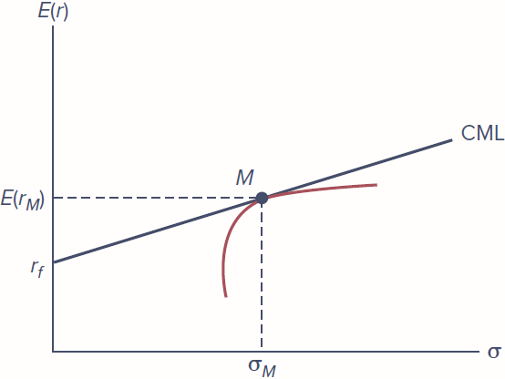
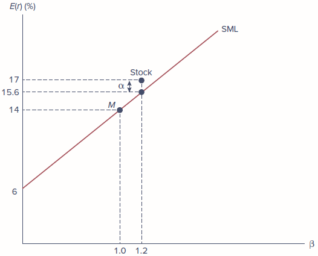
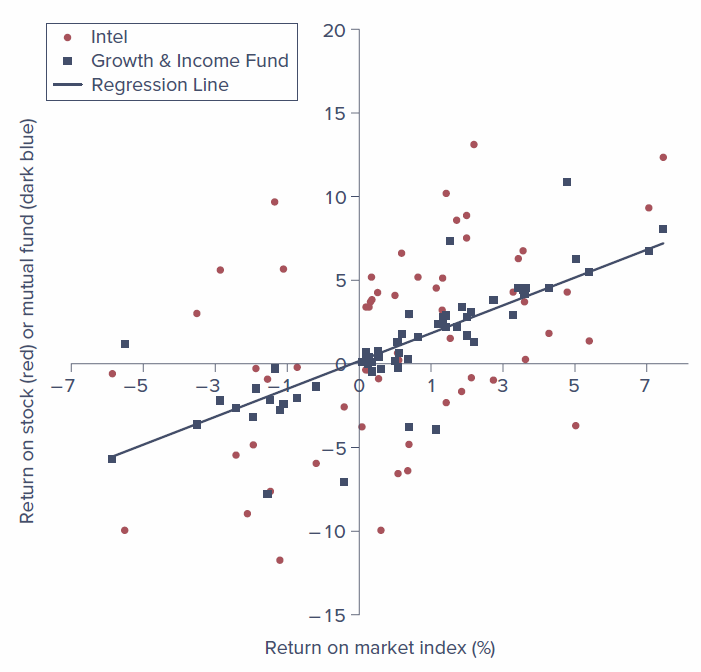
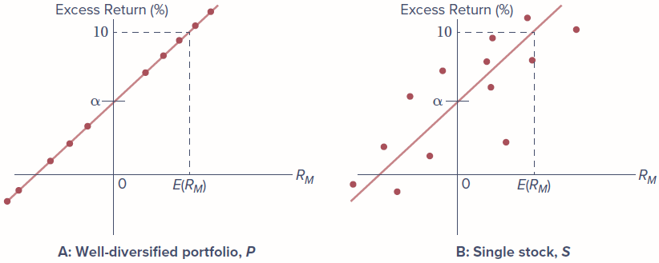

<!--
SOURCES: All content is drawn only from (1) Bodie, Kane & Marcus, Essentials of Investments (2024 Release), Chapter 7,
and (2) the publisher's Chapter 7 PowerPoint. Figures 7.1-7.4 are the publisher's PowerPoint images.
No new charts, graphs, or code have been created.

INSTRUCTOR NOTE: Table 7.2 t-statistics for the single-index model differ between the textbook and the PowerPoint
(slide 20). Textbook: intercept -0.159, market 5.655. PowerPoint: 0.371 and 6.468. The textbook values are used below.
-->

# Introduction

**Learning Objectives**

By the end of this chapter you should be able to:

-   **LO 7-1:** Use the implications of capital market theory to estimate security risk premiums.
-   **LO 7-2:** Construct and use the security market line.
-   **LO 7-3:** Specify and use a multifactor security market line.
-   **LO 7-4:** Take advantage of an arbitrage opportunity with a portfolio that includes mispriced securities.
-   **LO 7-5:** Use arbitrage pricing theory with more than one factor to identify mispriced securities.

The **capital asset pricing model**, almost always referred to as the **CAPM**, is a centerpiece of modern financial economics. The model predicts the relationship we should observe between the **risk of an asset** and its **expected return**. This relationship serves two vital functions:

1.  It provides a **benchmark rate of return** for evaluating possible investments. For example, a security analyst might want to know whether a stock's expected return is more or less than its "fair" return given its risk.
2.  It helps us make an educated guess as to the **expected return on assets that have not yet been traded** in the marketplace. For example, how do we price an initial public offering of stock? How will a major new investment project affect the return investors require on a company's stock?

Although the CAPM does not fully withstand empirical tests, it is widely used because of the insight it offers. **All generalizations of the model retain its central conclusion: only systematic risk will be rewarded with a risk premium.** The best way to measure that systematic risk can be subtle, but all the more complex cousins of the basic CAPM can be viewed as variations on this crucial theme.

The chapter also covers two extensions:

-   **Multifactor models**, which allow for multiple sources of risk and give richer descriptions of the risk-return relationship.
-   **Arbitrage pricing theory (APT)**, an alternative derivation of the risk-return relationship. *Arbitrage* is the exploitation of security mispricing to earn risk-free economic profits. The most basic principle of capital market theory is that prices ought to be aligned to eliminate risk-free profit opportunities. If actual prices allowed for arbitrage, the resulting trading would put strong pressure on security prices until equilibrium is restored. This **no-arbitrage principle** leads to a risk-return relationship like that of the CAPM, and the simple APT is easily extended to multiple sources of systematic risk.

## Chapter Roadmap {.unnumbered}

1.  **7.1 The Capital Asset Pricing Model** - assumptions, the market portfolio, the security market line, and applications
2.  **7.2 The CAPM and Index Models** - how to put the CAPM to an empirical test
3.  **7.3 How Well Does the CAPM Predict Risk Premiums?** - the evidence and its limits
4.  **7.4 Multifactor Models and the CAPM** - including the Fama-French three-factor model
5.  **7.5 Arbitrage Pricing Theory** - no-arbitrage pricing, well-diversified portfolios, and smart betas

------------------------------------------------------------------------

# 7.1 The Capital Asset Pricing Model

Historically, the CAPM was developed **before** the index model introduced in the previous chapter (Equation 6.11). The index model was widely adopted as a natural description of the stock market immediately after the CAPM because the CAPM's implications so neatly match the intuition underlying the model. So it makes sense to use the index model to help understand the lessons of the CAPM.

The index model describes the relationship between the excess return on an individual stock, $R_i$, and that of a broad market-index portfolio, $R_M$:

$$R_i = \alpha_i + \beta_i R_M + e_i$$

where $e_i$ is zero-mean "noise," or **firm-specific risk**. The expected excess return on a stock, given the market's excess return, is therefore:

$$E(R_i | R_M) = \beta_i R_M + \alpha_i$$

According to this equation, there are **two paths to a positive risk premium**:

1.  **Positive beta.** A stock with a positive beta "inherits" some of the market's risk premium. But there is a cost: the positive beta also means the stock is exposed to **systematic risk**. Higher betas imply higher risk premiums, but also higher market risk. This trade-off is "neutral": the higher reward that accompanies higher beta is exactly the same as one would realize by moving along the capital market line, shifting from bills into the market index. It is neither better nor worse than a **passive indexing strategy**.
2.  **Positive alpha.** Investing in stocks with positive alphas would be a **cost-free benefit**. Higher alphas imply higher expected returns *without* a corresponding increase in risk.

**What does this mean to portfolio managers?** Hunt for positive-alpha stocks, don't invest in negative-alpha stocks, and, better yet, sell short negative-alpha stocks if short sales are feasible.

But investor demand for a positive-alpha stock will increase its price. As the price rises, other things being equal, its expected return falls, reducing and ultimately eliminating the very alpha that created the excess demand. Conversely, the drop in demand for a negative-alpha stock will reduce its price, pushing its alpha back toward zero. In the end, buying and selling pressure will leave **most securities with zero alpha values most of the time**. Put another way, *unless and until your own analysis of a stock tells you otherwise, you should assume alpha is zero.*

When alphas are all zero, there is no reward from bearing firm-specific risk; the only way to earn a higher expected return than the bill rate is by bearing **systematic risk**. The equilibrium risk premium is determined solely by systematic risk, as measured by beta. With no reward to bearing diversifiable risk, the best portfolio is the one that completely eliminates it, which is an **indexed portfolio that mimics the broad market**. These are the conclusions of the CAPM.

## 7.1.1 The Model: Assumptions and Implications

The CAPM is based on **two sets of assumptions**, listed in Table 7.1.

-   The first set pertains to **investor behavior**. It lets us assume that investors are alike in most important ways: they are all mean-variance optimizers with a common time horizon and a common set of information, reflected in their use of an identical input list.
-   The second set pertains to **market structure**, asserting that markets are well-functioning with few impediments to trading.

**Table 7.1 The Assumptions of the CAPM**

| Category | Assumption |
|------------------------|------------------------------------------------|
| **1. Investor behavior** | **a.** Investors are rational, mean-variance optimizers. |
|  | **b.** Their common planning horizon is a single period. |
|  | **c.** Investors all use identical input lists, an assumption often termed *homogeneous expectations*. Homogeneous expectations are consistent with the assumption that all relevant information is publicly available. |
| **2. Market structure** | **a.** All assets are publicly held and trade on public exchanges. |
|  | **b.** Investors can borrow or lend at a common risk-free rate, and they can take short positions on traded securities. |
|  | **c.** No taxes. |
|  | **d.** No transaction costs. |

Even a cursory look at these assumptions shows that they are fairly strong, and one may justifiably wonder whether a theory derived from them will withstand empirical tests. Later in the chapter we turn to some generalizations of the model.

Still, the simple CAPM is a good place to start. While the appropriate quantification of risk and the exact risk-return trade-off may differ across more sophisticated variants, **its central implication, that risk premia will be proportional to systematic risk and independent of firm-specific risk, remains valid in all of its extensions.** In part because of this commonality, the simple CAPM remains in wide use despite its empirical shortcomings.

### Summary of the equilibrium {.unnumbered}

1.  **All investors will choose to hold the market portfolio (M)**, which includes all assets in the investable universe. (For simplicity, we refer to all assets as stocks.) The proportion of each stock in the market portfolio equals the market value of the stock (price per share times shares outstanding) divided by the total market value of all stocks.
2.  **The market portfolio will be on the efficient frontier.** Moreover, it will be the *optimal risky portfolio*, the tangency point of the capital allocation line (CAL) to the efficient frontier. As a result, the **capital market line (CML)**, the line from the risk-free rate through the market portfolio, is also the best attainable capital allocation line. All investors hold M as their optimal risky portfolio, differing only in the amount invested in it versus in the risk-free asset.
3.  **The risk premium on the market portfolio** will be proportional to the variance of the market portfolio and investors' typical degree of risk aversion:

    $$E(r_M) - r_f = A\sigma_M^2 \tag{7.1}$$

    where $\sigma_M$ is the standard deviation of the return on the market portfolio and $A$ represents the degree of risk aversion of the average investor.
4.  **The risk premium on individual assets** will equal the product of the risk premium on the market portfolio and the **beta coefficient** of the security on the market portfolio. Beta measures the extent to which returns respond to the market portfolio. In the index model, beta is the regression (slope) coefficient of the security return on the market return, representing sensitivity to fluctuations in the overall security market.

## 7.1.2 Why All Investors Would Hold the Market Portfolio

We begin by assuming that all investors optimize their portfolios using the **Markowitz model** of efficient diversification. Each investor uses an input list (expected returns, variances, and covariances) to draw an efficient frontier using all available risky assets and identifies the efficient risky portfolio, **P**, by drawing the tangent CAL to the frontier, as in Figure 7.1.

This framework uses Assumptions 1(a) (mean-variance optimizers), 2(a) (all assets trade and can be held in portfolios), and 2(b) (investors can borrow or lend at the risk-free rate and so can select portfolios along the CAL of the tangency portfolio).

The CAPM asks what would happen if all investors shared an identical investable universe and used the same input list. A common input list requires Assumption 1(c), but it also relies on Assumption 1(b) (a common investment horizon). It also implicitly assumes that investor choices will not be affected by differences in tax rates or trading costs (Assumptions 2[c] and 2[d]).

-   Investors derive **identical efficient frontiers** of risky assets.
-   Facing the same risk-free rate, they draw an **identical tangent CAL**, and all arrive at the **same risky portfolio, P**. All investors therefore choose the same set of weights for each risky asset.

**A key insight of the CAPM:** the market portfolio is the aggregation of all investors' risky portfolios, each of which is identical, so it too must have those same weights. (This relies on Assumption 2[a], because all assets must be tradable and included in investors' portfolios.) If all investors choose the same risky portfolio, it must be the **market portfolio**, the value-weighted portfolio of all assets in the investable universe. The proportion of each stock equals its market capitalization divided by the sum of the market capitalization of all stocks. For example, if Microsoft is 1% of each investor's common risky portfolio, then Microsoft also constitutes 1% of the market portfolio.

We conclude that the capital allocation line based on each investor's optimal risky portfolio is, in fact, also the **capital market line**, as depicted in Figure 7.1.

{width="60%" fig-align="center"}

*Source: Bodie, Kane & Marcus, Essentials of Investments (2024 Release), Figure 7.1.*

## 7.1.3 The Passive Strategy Is Efficient

The CAPM implies that a **passive strategy**, using the CML as the optimal CAL, is a powerful alternative to an active strategy.

-   The market portfolio proportions are the result of investors' buy and sell orders, which cease only when there is no more profit to be made.
-   In the simple world of the CAPM, **active investors use precious resources** to conduct security analysis. A **passive investor receives a "free ride"** by simply investing in the market portfolio and benefiting from the efficiency of that portfolio.
-   In the absence of private information (Assumption 1[c]), an investor whose risky portfolio is anything other than the market will end up on a CAL that is **inferior** to the CML used by passive investors.

This result is sometimes called the **mutual fund theorem**. It implies that only one mutual fund of risky assets, the market index fund, is sufficient to satisfy the investment demands of all investors. It is another incarnation of the **separation property** discussed in Chapter 6. If all investors would hold a market-index mutual fund, they would not object if all stocks were replaced with shares of a single mutual fund holding the market portfolio. We can therefore separate portfolio selection into two components:

1.  a **technical side**, in which an efficient mutual fund is created by professional managers, and
2.  a **personal side**, in which an investor's risk aversion determines the allocation of the complete portfolio between the mutual fund and the risk-free asset.

All investors agree that the mutual fund they want to hold is invested in the market portfolio.

**In reality**, different investment managers do create risky portfolios that differ from the market index, in part because of different input lists. Nevertheless, the practical significance of the mutual fund theorem is that a passive investor, even one who does not engage in security analysis, may view the market index as a **reasonable first approximation to an efficient risky portfolio**.

**Questions posed in the chapter PowerPoint:**

-   If a passive strategy is costless and efficient, why follow an active strategy?
-   If no one does security analysis, what brings about the efficiency of the market portfolio?

::: {.callout-tip title="Concept Check 7.1"}
If only some investors perform security analysis while all others hold the market portfolio, would the CML still be the efficient CAL for investors who do not engage in security analysis? Explain.

**Textbook solution:** The CML would still represent efficient investments. We can characterize the entire population by two representative investors. One is the "uninformed" investor, who does not engage in security analysis and holds the market portfolio, while the other optimizes using the Markowitz algorithm with input from security analysis. The uninformed investor does not know what input the informed investor uses to make portfolio purchases. The uninformed investor knows, however, that if the other investor is informed, the market portfolio proportions will be optimal. Therefore, to depart from these proportions would constitute an uninformed bet, which will, on average, reduce the efficiency of diversification with no compensating improvement in expected returns.
:::

## 7.1.4 The Risk Premium of the Market Portfolio

In Chapter 5 we showed how individual investors decide how much to invest in the risky portfolio when they also have access to risk-free assets. Now we ask: what can we deduce about the **equilibrium risk premium of portfolio M**?

Equation 7.1 states that the equilibrium risk premium of the market portfolio, $E(r_M) - r_f$, is proportional to the **degree of risk aversion of the average investor** and to the **risk of the market portfolio**, $\sigma_M^2$.

**Why?**

-   When investors purchase stocks, their demand drives up prices, thereby reducing expected rates of return and risk premiums.
-   When risk premiums fall, investors move some of their funds from the risky market portfolio into the risk-free asset.
-   In equilibrium, the risk premium on the market portfolio must be **just high enough to induce investors to hold the available supply of stocks**. If the risk premium is too high, there will be excess demand for securities and prices will rise; if it is too low, investors will not hold enough stock to absorb the supply and prices will fall.

::: {.callout-note title="Example 7.1 - Market Risk, the Risk Premium, and Risk Aversion"}
Suppose the risk-free rate is 3%, the average investor has a risk-aversion coefficient of $A = 2$, and the standard deviation of the market portfolio is 20%. (To use Equation 7.1, returns must be expressed in decimal form rather than as percentages.) The equilibrium market risk premium is:

$$A\sigma_M^2 = 2 \times 0.20^2 = 0.08$$

So the expected rate of return on the market must be:

$$E(r_M) = r_f + \text{Equilibrium risk premium} = 0.03 + 0.08 = 0.11 = 11\%$$

If investors were more risk averse, it would take a higher risk premium to induce them to hold shares. For example, if the average degree of risk aversion were 3, the equilibrium market risk premium would be $3 \times 0.20^2 = 0.12$, or 12%, and the expected return would be 15%.
:::

::: {.callout-tip title="Concept Check 7.2"}
Historical data for the S&P 500 Index indicates that the standard deviation of returns has been about 20%. If the coefficient of risk aversion were 3.5, what risk premium would have been consistent with this historical standard deviation?

**Textbook solution:** Equation 7.1 tells us that for the historical standard deviation and a coefficient of risk aversion of 3.5, the risk premium would be:

$$E(r_M) - r_f = A\sigma_M^2 = 3.5 \times 0.20^2 = 0.14 = 14\%$$
:::

## 7.1.5 Expected Returns on Individual Securities

The contribution of a single security to the systematic risk of a portfolio depends on its **beta** (Section 6.5, Equation 6.13). Beta tells us how strongly the security responds to market-wide shocks.

-   **Aggressive** stocks, with betas greater than 1, exaggerate the response of the portfolio to broad market movements.
-   **Defensive** stocks, with betas below 1, dampen the response.

As investors diversify, their exposure to the firm-specific risk of any individual security steadily diminishes, but their exposure to market-wide movements remains (the lesson of Figure 6.1 in the previous chapter). What matters to diversified investors is the **systematic risk of the portfolio** and the contribution each stock makes to that risk. Investors look for stocks with the best incremental reward (risk premium) compared to incremental systematic risk. In equilibrium, the **ratio of reward to risk should be equalized across all stocks**. Comparing one particular stock, Digital Computer, to the market index (with a beta of 1):

$$\frac{E(r_M) - r_f}{1} = \frac{E(r_D) - r_f}{\beta_D}$$

Rearranging gives the CAPM's **expected return-beta relationship**:

$$E(r_D) = r_f + \beta_D\left[E(r_M) - r_f\right] \tag{7.2}$$

In words, an asset's risk premium equals the asset's systematic risk measure (its beta) times the risk premium of the (benchmark) market portfolio. This is the most familiar expression of the CAPM.

-   The total expected rate of return is the sum of the **risk-free rate** (compensation for "waiting," i.e., the time value of money) plus a **risk premium** (compensation for "worrying" about investment returns).
-   The risk premium is the product of a benchmark risk premium (that of the broad market portfolio) and the relative risk of the particular asset, as measured by its beta.

**Notice what the risk premium does *not* depend on: the total volatility of the stock.** For example, a firm developing a new drug that may be a great success or a total failure may have extremely high variance, but investors in its shares will not, for that reason, demand a high expected return. The success of the firm is largely independent of macroeconomic risk and the return on the rest of their portfolio, so its contribution to overall portfolio risk is low and does not warrant a large risk premium. **The CAPM predicts that only systematic risk should be "priced," that is, command a risk premium; firm-specific risk should not be priced.**

::: {.callout-note title="Example 7.2 - Expected Returns and Risk Premiums"}
Suppose the risk premium of the market portfolio is 8%, and we estimate the beta of Digital as $\beta_D = 1.2$. The predicted risk premium for the stock is $1.2 \times 8\% = 9.6\%$. If the T-bill rate were 3%, the expected rate of return would be $3\% + 9.6\% = 12.6\%$, or, using Equation 7.2 directly:

$$E(r_D) = r_f + \beta_D[\text{Market risk premium}] = 3\% + 1.2 \times 8\% = 12.6\%$$

If Digital's beta were only 1.1, its required risk premium would be only 8.8%. Similarly, if the market risk premium were only 6% and $\beta_D = 1.2$, Digital's risk premium would be only 7.2%.
:::

### Active portfolios do not invalidate the CAPM {.unnumbered}

The fact that many investors hold active portfolios that differ from the market portfolio does not necessarily invalidate the CAPM. Any highly diversified portfolio can shed almost all firm-specific risk and will be subject only to systematic risk. Even if one does not hold the precise market portfolio, a well-diversified portfolio will be so highly correlated with the market that a stock's beta relative to the market is still a useful risk measure.

Researchers have also shown that **modified versions of the CAPM** hold despite differences among individuals that cause them to hold different portfolios. **Brennan (1970)** examines differences in investors' personal tax rates; **Mayers (1972)** looks at nontraded assets such as human capital (earning power). Both find that although the market portfolio is no longer each investor's optimal risky portfolio, a modified version of the mean-beta relationship still holds.

### Portfolio betas {.unnumbered}

If the mean-beta relationship holds for each individual asset, it must hold for any combination of assets. **The beta of a portfolio is the weighted average of the betas of the stocks in the portfolio**, using the portfolio proportions as weights. Beta therefore also predicts a portfolio's risk premium in accordance with Equation 7.2.

::: {.callout-note title="Example 7.3 - Portfolio Beta and Risk Premium"}
Consider the following portfolio:

| Asset | Beta | Risk Premium | Portfolio Weight |
|------------------------|--------------|-----------------|-----------------|
| Microsoft | 1.2 | 9.0% | 0.5 |
| American Electric Power | 0.8 | 6.0% | 0.3 |
| Gold | 0.0 | 0.0% | 0.2 |
| **Portfolio** | **0.84** | **?** | **1.0** |

If the market risk premium is 7.5%, the CAPM predicts that the risk premium on each stock is its beta times 7.5%, and the risk premium on the portfolio is $0.84 \times 7.5\% = 6.3\%$. This is the same result obtained by taking the weighted average of the risk premiums of the individual assets.
:::

### A word of caution {.unnumbered}

We often hear that a well-managed firm will provide a high rate of return. This is true when referring to the firm's **accounting return** on investments in plant and equipment. The CAPM, however, predicts returns on investments in the **securities** of the firm that trade in capital markets.

Say everyone knows a firm is well run. Its stock price will be bid up, and returns to investors who buy at that price will not be extreme. Security prices reflect public information about a firm's prospects, but only the risk of the company (as measured by beta) should affect expected returns. **In a rational market, investors receive high expected returns only if they bear systematic risk.**

::: {.callout-tip title="Concept Check 7.3"}
Suppose the risk premium on the market portfolio is estimated at 8% with a standard deviation of 22%. What is the risk premium on a portfolio invested 25% in GM with a beta of 0.8 and 75% in Digital with a beta of 1.2?

**Textbook solution:** $\beta_{Digital} = 1.2$, $\beta_{GM} = 0.8$. Given the investment proportions, the portfolio beta is

$$\beta_P = w_{Digital}\beta_{Digital} + w_{GM}\beta_{GM} = (0.75 \times 1.2) + (0.25 \times 0.8) = 1.1$$

and the risk premium of the portfolio will be

$$E(r_P) - r_f = \beta_P[E(r_M) - r_f] = 1.1 \times 8\% = 8.8\%$$
:::

## 7.1.6 The Security Market Line

The expected return-beta relationship, or mean-beta relationship, is a **reward-risk equation**. The beta of a security is the appropriate measure of its risk because beta determines the security's contribution to the variance of the efficiently diversified optimal risky portfolio.

The mean-beta relationship is represented by the **security market line (SML)** in Figure 7.2, where we assume a T-bill rate of 6% and a market expected return of 14%.

-   The **slope** of the SML is the market risk premium, 8%.
-   At the point where $\beta = 1$ (the beta of the market portfolio), we can read off the vertical axis the market's expected return.

{width="60%" fig-align="center"}

*Source: Bodie, Kane & Marcus, Essentials of Investments (2024 Release), Figure 7.2.*

### SML versus CML {.unnumbered}

| | **Capital Market Line (CML)** | **Security Market Line (SML)** |
|-----------------------|----------------------------|-----------------------|
| **Graphs** | Risk premiums of *efficient complete portfolios* (the market portfolio and the risk-free asset) | Risk premiums of *individual assets* (and portfolios) |
| **As a function of** | Portfolio standard deviation | Asset beta |
| **Why that risk measure?** | Standard deviation is a valid measure of risk for portfolios that are candidates for an investor's complete portfolio | The relevant risk of an individual asset held in a diversified portfolio is its beta, not its standard deviation |
| **Valid for** | Efficient complete portfolios | Both individual assets and portfolios |

The SML offers a **benchmark for evaluation of investment performance**. It provides the expected rate of return investors demand as compensation for both beta risk and the time value of money.

### Fairly priced, underpriced, and overpriced assets {.unnumbered}

Because the SML is the graphical representation of the mean-beta relationship:

-   **Fairly priced** assets plot exactly *on* the SML. Their expected returns are commensurate with their risk.
-   **Underpriced** stocks plot *above* the SML: given beta, their expected returns are greater than predicted by the CAPM.
-   **Overpriced** stocks plot *below* the SML.

The difference between the fair (equilibrium) and the actual expected rate of return on a stock is the **alpha**, denoted $\alpha$. The expected return on a mispriced security (one with a nonzero alpha) is:

$$E(r) = \alpha + r_f + \beta\left[E(r_M) - r_f\right]$$

The PowerPoint describes alpha as the abnormal rate of return on a security in excess of that predicted by an equilibrium model (the CAPM).

::: {.callout-note title="Example 7.4 - The Alpha of a Security"}
Continue to assume that the expected return on the market is 14% and the T-bill rate is 6%. If a stock has a beta of 1.2, the SML would predict an expected return of:

$$E(r) = r_f + \beta[E(r_M) - r_f] = 6 + 1.2(14 - 6) = 15.6\%$$

If one believes the stock's expected return is actually 17%, then its implied alpha would be **1.4%**, as shown in Figure 7.2. If instead the expected return were only 15%, the stock alpha would be negative, **-0.6%**.
:::

## 7.1.7 Applications of the CAPM

The CAPM has three main applications in the chapter.

**1. Investment management.** The SML provides a benchmark to assess the expected return commensurate with an asset's risk. Suppose a money manager uses security analysis to derive an independent assessment of expected return. (Here we depart from the simple CAPM world, in that active investors apply their own analysis to derive a private "input list.") If a stock is perceived to be a good buy, or underpriced, it will provide a **positive alpha**: an expected return in excess of the equilibrium return stipulated by the SML.

**2. Capital budgeting.** When a firm is considering a new project, the SML provides the **required return** demanded of the project. This is the cutoff internal rate of return (IRR), or **"hurdle rate,"** for the project.

::: {.callout-note title="Example 7.5 - The CAPM and Capital Budgeting"}
Silverado Springs Inc. is considering a new spring-water bottling plant. The business plan forecasts an internal rate of return of 14% on the investment. The beta of similar products is 1.3. If the risk-free rate is 4% and the market risk premium is estimated at 8%, the hurdle rate for the project should be:

$$4 + 1.3 \times 8 = 14.4\%$$

Because the IRR is less than the risk-adjusted discount or hurdle rate, the project has a negative net present value and ought to be rejected.
:::

**3. Utility rate-making.** The issue here is the rate of return a regulated utility should be allowed to earn on its investment in plant and equipment.

::: {.callout-note title="Example 7.6 - The CAPM and Regulation"}
Suppose shareholder equity invested in a utility is \$100 million and the equity beta is 0.6. If the T-bill rate is 2% and the market risk premium is 8%, then a fair annual profit will be $2 + (0.6 \times 8) = 6.8\%$ of \$100 million, or **\$6.8 million**. Because regulators accept the CAPM, they will allow the utility to set prices at a level expected to generate these profits.
:::

::: {.callout-tip title="Concept Check 7.4"}
**a.** Stock XYZ has an expected return of 12% and $\beta = 1$. Stock ABC is expected to return 13% with a beta of 1.5. The market's expected return is 11% and $r_f = 5\%$. According to the CAPM, which stock is a better buy? What is the alpha of each stock? Plot the SML and the two stocks. Show the alphas of each on the graph.

**b.** The risk-free rate is 2% and the expected return on the market portfolio is 10%. A firm considers a project with an estimated beta of 1.3. What is the required rate of return on the project? If the IRR of the project is 13%, what is the project alpha?

**Textbook solution:**

**a.** The alpha of a stock is its expected return in excess of that required by the CAPM:

$$\alpha = E(r) - \{r_f + \beta[E(r_M) - r_f]\}$$

$$\alpha_{XYZ} = 12 - [5 + 1.0(11 - 5)] = 1\%$$

$$\alpha_{ABC} = 13 - [5 + 1.5(11 - 5)] = -1\%$$

XYZ has a positive alpha and ABC a negative alpha. (The textbook also asks for a plot of the SML and the two stocks; no new graph is created here.)

**b.** The project-specific required rate of return is determined by the project beta coupled with the market risk premium and the risk-free rate. An acceptable expected rate of return for the project is:

$$r_f + \beta[E(r_M) - r_f] = 2 + 1.3(10 - 2) = 12.4\%$$

which becomes the project's **hurdle rate**. If the IRR of the project is 13%, then it is desirable. Any project (of similar beta) with an IRR less than 12.4% should be rejected.
:::

------------------------------------------------------------------------

# 7.2 The CAPM and Index Models

The CAPM has **two limitations**:

1.  It relies on the **theoretical market portfolio**, which includes all assets (including real estate, human capital, foreign stocks, etc.).
2.  It applies to **expected** as opposed to actual returns.

To implement and test the CAPM, we cast it in the form of an **index model** and use **realized** returns. The index model replaces the theoretical all-inclusive portfolio with an index such as the S&P 500 or the broader market index introduced in Chapter 5. The composition and rate of return of these indexes are unambiguous and widely published, and therefore provide a clear benchmark for performance evaluation.

### Testing the CAPM's central prediction {.unnumbered}

The central prediction of the CAPM is that **the market portfolio is mean-variance efficient**. An index model can be used to test this hypothesis by verifying that an index designed to represent the full market is mean-variance efficient. To test mean-variance efficiency of an index, we must show that its **Sharpe ratio is not surpassed by any other portfolio**. Tests of this question are examined in the next chapter.

The SML is the most common way to pose the implications of the CAPM: a stock's risk premium is the product of its beta and the market risk premium. This can also be tested using the index model from the last chapter, restated here as Equation 7.3:

$$r_{it} - r_{ft} = \alpha_i + \beta_i(r_{Mt} - r_{ft}) + e_{it} \tag{7.3}$$

| Symbol | Meaning |
|-------------------|-----------------------------------------------------|
| $r_{it}$ | Holding-period return (HPR) on asset *i* in period *t* (*i*: asset; *t*: period) |
| $\alpha_i$ | Intercept of the security characteristic line |
| $\beta_i$ | Slope of the security characteristic line |
| $r_{Mt}$ | Index return in period *t* (the index proxies for the market portfolio) |
| $e_{it}$ | Firm-specific effects (the firm-specific outcome for that period) |

Equation 7.3 states that the realized excess return on any stock is the sum of three pieces: the realized excess return due to marketwide factors, $\beta_i(r_{Mt} - r_{ft})$; a nonmarket risk premium, $\alpha_i$; and a firm-specific outcome for that period, $e_{it}$. Because the expectation of the firm-specific residual is zero, the expected excess return (risk premium) of stock *i* is given by Equation 7.4:

$$E(r_i) - r_f = \alpha_i + \beta_i[E(r_M) - r_f] \tag{7.4}$$

The CAPM's expected return-beta relationship, rearranged very slightly from Equation 7.2, states that in any period:

$$E(r_i) - r_f = \beta_i[E(r_M) - r_f] \tag{7.5}$$

**Comparing Equation 7.4 to Equation 7.5, the prediction of the CAPM is that for every stock, $\alpha_i = 0$.**

The logic of the CAPM is that the only reason for a stock to offer an expected return greater than the risk-free rate is that it imposes systematic risk for which the investor must be compensated. A positive alpha, however, promises reward without risk. Investors will relentlessly pursue positive-alpha stocks and bid up their prices; at those higher prices, expected rates of return will be lower. Symmetrically, investors will shun or short-sell negative-alpha stocks, driving down their prices and driving up their expected returns. This rebalancing continues until all alpha values are driven to zero. At that point, investors will be content to fully diversify and eliminate unique risk, that is, to hold the broadest possible market portfolio. **When all stocks have zero alphas, the market portfolio is the optimal risky portfolio.**

If you estimate the index model regression, Equation 7.3, you will find that in any particular sample period some firms will do better than investors initially expected and display positive alphas; others will disappoint and show negative alphas. **But if the CAPM is correct, average alphas should be zero.**

### Estimating the index model and the SCL (from the chapter PowerPoint) {.unnumbered}

-   The PowerPoint illustrates estimating the index model using Google's excess returns. The **residual** is the actual return minus the predicted return for Google.
-   **Security characteristic line (SCL):** the PowerPoint describes this as a plot of a security's expected excess return over the risk-free rate as a function of the excess return on the market. The chapter summary adds that, in a single-index security market, a security's beta can be estimated from a regression of the security's excess return on the index's excess return; this regression line is the SCL, and its intercept, alpha, represents the average excess return on the security when the index excess return is zero.
-   **Predicting betas (mean reversion):** betas move toward the mean over time. To predict future betas, adjust estimates from historical data to account for regression toward 1.0.

### A drawback: Roll's critique {.unnumbered}

Operationalizing the CAPM as an index model has a drawback. If intercepts of regressions of returns on an index differ substantially from zero, you cannot tell whether it is because you have chosen a **bad index to proxy for the market** or because the **theory is not useful**. This problem was first pointed out by **Richard Roll (1977)** and is called **Roll's critique**, discussed in the next section.

### Persistent positive alphas {.unnumbered}

In actuality, some instances of persistent, positive, significant CAPM alpha values have been identified (discussed in Chapter 8). Among these are:

1.  **Small versus large stocks**
2.  Stocks of companies that have **recently announced unexpectedly good earnings**
3.  Stocks with **high ratios of book value to market value**
4.  Stocks with **"momentum"** that have experienced recent advances in price

These results pose meaningful challenges to the model.

------------------------------------------------------------------------

# 7.3 How Well Does the CAPM Predict Risk Premiums?

In many ways, portfolio theory and the CAPM have become accepted tools in the practitioner community.

-   Many investment professionals think about the distinction between firm-specific and systematic risk and are comfortable with the use of **beta** to measure systematic risk.
-   One extensive survey (Graham and Harvey, 2001) found that about **three-quarters of financial managers use the CAPM** when estimating the cost of capital.
-   In the asset management industry, **alpha** is regularly computed.
-   On the other hand, compensation of portfolio managers is rarely based on alpha or other theoretically appropriate risk-adjusted measures (see Chapter 18).

Part of the problem derives from the **mixed success of the CAPM** in explaining variation in rates of return across assets.

### The evidence {.unnumbered}

| Study | Finding |
|------------------------|-----------------------------------------------|
| **Sharpe (1964)** | The CAPM was first published and "took the world of finance by storm." |
| **Black, Jensen, and Scholes (1972); Fama and MacBeth (1973)** | Early tests were *partially* supportive: average returns were higher for higher-beta portfolios, but the reward for beta risk was *less* than predicted by the simple CAPM. |
| **Roll (1977)**, "A Critique of Capital Asset Pricing Tests" | The **true market portfolio can never be observed**. The usual stock market indexes used as proxies actually exclude the majority of investor wealth: real estate, fixed-income securities, foreign investments, and the value of human capital. Without a good measure of the return on a broad measure of investor assets, the theory is necessarily untestable. This resulted in popular articles such as "Is Beta Dead?" |
| **Fama and French (1992)** | Dealt the CAPM an even harsher blow: certain characteristics of the firm, namely **size** and the **ratio of market to book value**, were far more useful in predicting future returns than beta. |
| **Amihud and Mendelson (1986)** | **Liquidity**, a different kind of risk factor, was ignored for a long time. It is difficult to measure and incorporate in portfolio management, but there is ample evidence that trading mechanisms on stock exchanges affect the liquidity of assets and significantly affect their market value. |

Although Roll is absolutely correct on theoretical grounds, more recent research suggests that the error introduced by using a broad market index as a proxy for the true, unobserved market portfolio is perhaps not even the greatest problem of the CAPM. It seems clear from the Fama-French and follow-up studies that **beta does not tell the whole story of risk**: there seem to be risk factors that affect security returns beyond beta's one-dimensional measurement of market sensitivity. The next section introduces a theory of risk premiums that explicitly allows for multiple risk factors.

### Beta is not dead {.unnumbered}

The CAPM is not a perfect model, and it will continue to be refined. Still, the logic of the model is compelling and captures the two key points made by all of its more sophisticated variants:

1.  The crucial distinction between **diversifiable risk** and **systematic risk** that cannot be avoided by diversification.
2.  Investors will demand a **premium for bearing nondiversifiable risk**.

The CAPM therefore provides a useful framework for thinking rigorously about the relationship between security risk and return.

**The CAPM and the real world (from the chapter PowerPoint):**

-   The CAPM is false based on the validity of its assumptions.
-   It is nonetheless a useful predictor of expected returns, but it is untestable as a theory.
-   Its principles are still valid: investors should diversify, systematic risk is the risk that matters, and a well-diversified risky portfolio can be suitable for a wide range of investors.

------------------------------------------------------------------------

# 7.4 Multifactor Models and the CAPM

The index model allows us to decompose stock variance into **systematic risk** and **firm-specific risk** that can be diversified in large portfolios. In the index model, the return on the market portfolio summarizes the aggregate impact of macroeconomic factors. In reality, however, systematic risk is not due to one source but derives from uncertainty in a number of economywide factors, such as **business-cycle risk, interest or inflation rate risk, energy price risk**, and so on. A more explicit representation of systematic risk, allowing stocks to exhibit different sensitivities to its various facets, would be a useful refinement of the single-factor model. **Merton (1973)** was the first to show how the CAPM could be extended to allow for multiple sources of systematic risk.

**Multifactor models** (models of security returns that respond to several systematic factors) can be expected to provide better descriptions of security returns. Merton's model results in a **multifactor security market line** in which extra-market risk factors capture the impact of important dimensions of systematic risk that investors wish to hedge.

### A two-factor illustration {.unnumbered}

Suppose the two most important macroeconomic sources of risk are:

1.  the state of the **business cycle**, reflected in returns on a broad market index, and
2.  **unanticipated changes in interest rates**, captured by returns on a Treasury-bond portfolio.

The return on any stock will respond both to sources of macro risk and to its own firm-specific influences. We can expand the single-index model (Equation 7.3) as follows, using uppercase *R* to denote excess returns:

$$R_{it} = \alpha_i + \beta_{iM}R_{Mt} + \beta_{iTB}R_{TBt} + e_{it} \tag{7.6}$$

where $\beta_{iTB}$ is the sensitivity of stock *i*'s excess return to that of the T-bond portfolio and $R_{TBt}$ is the excess return of the T-bond portfolio in period *t*.

A multifactor index model gives rise to a **multifactor security market line** in which the risk premium is determined by the exposure to each systematic risk factor and by a risk premium associated with each of those factors. In the two-factor economy of Equation 7.6, the expected rate of return on a security is the sum of three terms:

1.  The **risk-free rate** of return.
2.  The security's sensitivity to the market index (its **market beta**, $\beta_{iM}$) times the risk premium of the index, $[E(r_M) - r_f]$.
3.  The security's sensitivity to interest rate risk (its **T-bond beta**, $\beta_{iTB}$) times the risk premium of the T-bond portfolio, $[E(r_{TB}) - r_f]$.

This is the **two-factor security market line** for security *i*:

$$E(r_i) = r_f + \beta_{iM}\left[E(r_M) - r_f\right] + \beta_{iTB}\left[E(r_{TB}) - r_f\right] \tag{7.7}$$

Equation 7.7 is an expansion of the simple security market line. Once we generalize the single-index SML to multiple risk sources, each with its own risk premium, the insights are similar.

::: {.callout-note title="Example 7.7 - A Two-Factor SML"}
Northeast Airlines has a market beta of 1.2 and a T-bond beta of 0.7. Suppose the risk premium of the market index is 6%, while that of the T-bond portfolio is 3%. The overall risk premium on Northeast stock is the sum of the risk premiums required as compensation for each source of systematic risk.

-   Market risk: $1.2 \times 6\% = 7.2\%$
-   Interest rate risk: $0.7 \times 3\% = 2.1\%$
-   Total risk premium: $7.2 + 2.1 = 9.3\%$

If the risk-free rate is 4%, the expected return should be:

| Component | Amount |
|----------------------------------------|----------------------|
| Risk-free rate | 4.0% |
| \+ Risk premium for exposure to market risk | 7.2% |
| \+ Risk premium for exposure to interest rate risk | 2.1% |
| **Total expected return** | **13.3%** |

More concisely: $E(r) = 4\% + 1.2 \times 6\% + 0.7 \times 3\% = 13.3\%$
:::

::: {.callout-tip title="Concept Check 7.5"}
Suppose the risk premiums in Example 7.7 were $E(r_M) - r_f = 4\%$ and $E(r_{TB}) - r_f = 2\%$. What would be the equilibrium expected rate of return on Northeast Airlines?

**Textbook solution:** Use Equation 7.7 to find that $E(r) = 4\% + 1.2 \times 4\% + 0.7 \times 2\% = 10.2\%$.
:::

### Which additional factors? {.unnumbered}

The multifactor model gives us a richer way to think about risk exposures and compensation for those exposures. But what are the relevant additional systematic factors? Economic theory suggests factors that affect investor welfare in **three possible ways**:

1.  Factors correlated with **prices of important consumption goods**, such as housing or energy.
2.  Factors correlated with **future investment opportunities**, such as interest rates, return volatility, or risk premiums.
3.  Factors correlated with the **general state of the economy**, such as industrial production and employment.

Multifactor equations employing likely candidates for these theoretically plausible factors have **not produced sufficient improvement** over the explanatory power of the single-factor model. Instead, the most common approach to multifactor models today follows the work of **Eugene Fama and Kenneth French (1992)**, who proposed extra-market factors based on **empirical success in predicting excess returns**.

## 7.4.1 The Fama-French Three-Factor Model

Fama and French proposed a three-factor model to explain average returns that has become a standard tool for empirical studies of asset returns. In addition to the market index, they propose as return benchmarks portfolios formed on the basis of **firm size** and **book-to-market (B/M) ratio**. These factors are motivated by the observation that average returns on stocks of small firms and firms with high ratios of book value to market value of equity have been **higher than predicted by the CAPM**.

-   Firms with a **high** book-to-market ratio disproportionately include relatively mature firms, which derive a larger share of their market value from assets already in place rather than growth opportunities. This group is often called **value stocks**.
-   **Low-B/M** companies are viewed as **growth firms** whose market values derive from anticipated growth in future cash flows rather than from assets already in place.
-   Considerable evidence (reviewed in the following chapter) suggests that value stocks have offered a higher average rate of return than growth stocks; the differential is known as the **value premium**.

Fama and French do not view firm size or the book-to-market ratio as directly dictating a firm's risk premium. Instead, they view these factors as **proxies for more fundamental sources of risk** that are not fully captured by the security's CAPM beta. These extra-market factors may be interpreted as portfolios that provide exposure to fundamental risk factors, whatever they may be.

**Why might these factors capture systematic risk?**

-   **Book-to-market:** A high B/M ratio, which can result from large investments in fixed assets, may imply higher systematic risk than indicated by historically estimated beta. When the economy tanks, these assets cannot be used at full capacity, and a large share of their value may be lost.
-   **Size:** Shares of large firms may be less risky than those of small firms, other things being equal, because they are covered by more analysts and there is more accurate information about them. With better-informed investors, prices more accurately reflect true value and are less susceptible to systematic as well as firm-specific fluctuations. With deeper pockets and greater debt capacity, large firms can also better withstand economic downturns. On both counts, stock in small firms will command higher risk premiums than indicated by beta alone.

## 7.4.2 Estimating a Three-Factor SML

Fama and French measure the **size factor** as the difference in returns of firms with low market values (low-cap firms) versus those with high market values ("high-cap" firms), denoted **SMB (small minus big)**. Their proxy for the **value-versus-growth factor** is the difference in returns of stocks with high versus low ratios of book-to-market value, denoted **HML (high minus low)**.

Taking the difference in returns between two portfolios has an economic interpretation. The SMB return equals the return from a long position in small stocks, financed with a short position in large stocks. This is a portfolio that entails **no net investment**. (The profit on the overall position is measured per dollar invested in the small-cap firms, or equivalently per dollar shorted in the large-cap firms. The market excess return also corresponds to a zero-net-investment portfolio: every dollar invested in the market is financed with a short position in, that is, borrowing at, the risk-free rate.)

The chapter estimates a three-factor model for U.S. Steel (ticker symbol X) by generalizing regression Equation 7.3:

$$r_{Xt} - r_{ft} = \alpha_X + \beta_{XM}(r_{Mt} - r_{ft}) + \beta_{X,SMB}\,r_{SMB,t} + \beta_{X,HML}\,r_{HML,t} + e_{Xt} \tag{7.8}$$

The three betas measure U.S. Steel's sensitivities to the three hypothesized sources of systematic risk: the **market (M)**, the **value-versus-growth factor (HML)**, and the **size factor (SMB)**. This model is the **Fama-French three-factor model** (PowerPoint slide 19 notes three aspects of a successful specification: a higher adjusted R-square, a lower residual standard deviation, and a smaller value of alpha).

**Table 7.2 Estimates of Single-Index and Three-Factor Fama-French Regressions for U.S. Steel, Monthly Data, 5 Years Ending in 2022**

| | Single-Index: Coefficient | Single-Index: *t*-Statistic | Three-Factor: Coefficient | Three-Factor: *t*-Statistic |
|------------------|---------------|---------------|---------------|---------------|
| Intercept (alpha, %) | -0.328 | -0.159 | -0.111 | -0.055 |
| $r_M - r_f$ | 2.080 | 5.655 | 1.921 | 5.077 |
| SMB | | | 0.916 | 1.192 |
| HML | | | 0.799 | 1.745 |
| R-square | 0.355 | | 0.400 | |
| Residual std dev (%) | 15.830% | | 15.537% | |

*Source: Author's calculations (Bodie, Kane & Marcus, Table 7.2).*

The intercept in each regression is the estimate of (monthly) alpha over the sample period. The coefficient on the market index excess return is the estimate of U.S. Steel's market risk, while the coefficients on SMB and HML are estimates of the betas against the two extra-market risk factors.

**Interpreting the results.** The extra-market risk factors do not add much to U.S. Steel's risk profile.

-   U.S. Steel is only a moderately large firm. Its roughly \$5.5 billion market capitalization in early 2023 puts it between the 50th and 60th size percentile. Its beta against SMB is not even close to statistical significance.
-   Its book-to-market ratio, about 1.8, is quite high, in the top decile. Given that ratio, its positive beta on HML is not surprising, but it too is not statistically significant.
-   Adding the two factors neither increases the R-square meaningfully nor reduces the standard deviation of the unexplained residuals.
-   We conclude that for U.S. Steel, the standard market beta (highly significant, with a *t*-statistic above 5) is the primary determinant of systematic risk. Other firms will have their own unique configuration of exposures to the various risk factors.

### Using the three-factor model to estimate an expected return {.unnumbered}

Using the three-factor model to estimate expected returns requires **forecasts of the premiums on the two extra-market risk factors** as well as that on the market index. The chapter takes simple historical averages as estimates of factor risk premiums:

| Factor | Historical-average risk premium |
|-----------------------------|-------------------------------|
| Market index | 8.55% |
| SMB | 2.92% |
| HML | 4.44% |

If the risk-free rate is 2%, U.S. Steel's expected return using the estimates in Table 7.2 is:

$$E(r_X) = r_f + \beta_{X,M}[E(r_M) - r_f] + \beta_{X,SMB}E(r_{SMB}) + \beta_{X,HML}E(r_{HML})$$

$$= 2\% + 1.921 \times 8.55\% + 0.916 \times 2.92\% + 0.799 \times 4.44\% = 24.65\%$$

If, instead, we used the beta estimate from the single-index model, we would obtain a somewhat lower expected return:

$$r_f + \beta[E(r_M) - r_f] = 2\% + 2.080 \times 8.55\% = 19.79\%$$

The slightly lower beta against the market index in the three-factor model is more than offset by the positive betas against the two extra-market risk factors.

**Notes:**

-   In neither case do we add the regression estimate of alpha to the forecast of expected return. **Equilibrium expected returns depend only on risk; the expectation of alpha in market equilibrium must be zero.** A security may have outperformed its benchmark in a particular sample period (a positive alpha), but we would not expect that performance to continue. As an empirical matter, individual firm alphas show virtually no persistence over time.
-   When estimating Equation 7.8, we subtract the risk-free return from the market return but **not** from the returns on the SMB or HML portfolios. This is because the SMB and HML factors are *already* risk premiums, for size or book-to-market, respectively. The factor data are available from Kenneth French's website.

## 7.4.3 Multifactor Models and the Validity of the CAPM

The single-index CAPM fails empirical tests because its empirical representation, the single-index model, inadequately explains returns on too many securities. In short, **too many statistically significant alphas** (which the CAPM says should be zero) show up in single-index regressions. Despite this failure, it is still widely used in the industry.

Multifactor models such as the Fama-French model may also be tested by the prevalence of significant alpha values. **The three-factor model shows a material improvement over the single-index model** in that regard.

But the use of multi-index models comes at a price: they require **forecasts of the additional factor returns**. If forecasts of those additional factors are themselves subject to forecast error, these models can be less accurate than the theoretically inferior single-index model. Nevertheless, multifactor models have a definite appeal because it is clear that real-world risk is multifaceted.

The original Fama-French model has spawned a "cottage industry" generating new factor portfolios beyond SMB and HML, including, but not limited to, **momentum** or **liquidity** factors. These developments are surveyed in the next chapter.

------------------------------------------------------------------------

# 7.5 Arbitrage Pricing Theory

One reason for skepticism about the validity of the CAPM is the **unrealistic nature of its assumptions**. Most unappealing are Assumptions 1(a)-1(c), namely, that all investors are identical in every way but wealth and risk aversion. For this reason, as well as for its economic insights, an alternative approach to asset pricing called **arbitrage pricing theory (APT)** is of great interest.

**Arbitrage** is the act of exploiting mispricing of two or more securities to achieve risk-free profits. As a trivial example, consider a security that is priced differently in two markets. A long position in the cheaper market financed by a short position in the expensive market will lead to a sure profit. As investors avidly pursue this strategy, prices are forced back into alignment, so arbitrage opportunities vanish almost as quickly as they materialize.

The first to apply this concept to equilibrium security returns was **Ross (1976)**, who developed the APT. The APT depends on the observation that well-functioning capital markets preclude arbitrage opportunities. A violation of the APT's pricing relationships will cause extremely strong pressure to restore them even if only a limited number of investors become aware of the discrepancy. Ross's accomplishment was to derive the equilibrium rates of return that would prevail in a market where prices are aligned to obey the **"no-arbitrage rule."**

**PowerPoint summary of the key ideas:**

-   *Arbitrage:* relative mispricing creates riskless profit.
-   *APT:* risk-return relationships from no-arbitrage considerations in large capital markets.
-   *Well-diversified portfolio:* nonsystematic risk is negligible.
-   *Arbitrage portfolio:* a positive-return, zero-net-investment, risk-free portfolio.

## 7.5.1 Diversification in a Single-Index Security Market

Imagine a portfolio formed from securities whose returns follow the single-index model (Equation 7.3). What are the systematic and nonsystematic variances of this portfolio?

**Systematic risk.**

-   The beta of the portfolio is a simple average of the individual security betas; call that average beta $\bar{\beta}$. The **systematic variance** equals $\bar{\beta}^2\sigma_M^2$. The market variance and the beta of the portfolio determine its market risk.
-   The systematic component of each security's return, $\beta_i R_M$, is determined completely by the market factor and is therefore perfectly correlated with the systematic part of any other security's return. Hence **there are no diversification effects on systematic risk no matter how many securities are involved**. A single security has the same systematic risk as a diversified portfolio with the same beta. The number of securities makes no difference.

**Firm-specific (nonsystematic) risk.** It is quite different here. Consider a portfolio of *n* securities with weights $w_i$ in each. The nonsystematic portion of the portfolio return is:

$$e_P = \sum_{i=1}^{n} w_i e_i$$

Because the firm-specific terms, $e_i$, are uncorrelated, the portfolio nonsystematic variance is the weighted sum of the individual firm-specific variances:

$$\sigma^2(e_P) = \sum_{i=1}^{n} w_i^2 \sigma^2(e_i) \tag{7.9}$$

(Multiplying a random variable by a constant multiplies its variance by the square of the constant, and the variance of the sum equals the sum of the variances because, by assumption in the index model, all covariances are zero.)

Each individual nonsystematic variance is multiplied by the **square of the portfolio weight**. With diversified portfolios, the squared weights are very small. For example, if $w_i = 0.01$ (a portfolio with 100 securities), then $w_i^2 = 0.0001$. The sum in Equation 7.9 is therefore far less than the average firm-specific variance of the stocks in the portfolio. **The impact of nonsystematic risk becomes ever smaller as the number of securities grows and the portfolio becomes more diversified.**

Figure 7.3 shows this effect. The red dots are the monthly returns over a five-year period for a single stock, Intel, versus the return on the market index. The dark blue dots are for a diversified stock mutual fund, Vanguard's Growth & Income Fund. During the period, both the stock and the fund had virtually identical betas, but their nonsystematic risk differed considerably: the scatter of Intel's returns falls considerably further from the regression line than does the mutual fund's, for which diversification has virtually eliminated residual risk.

{width="70%" fig-align="center"}

*Source: Bodie, Kane & Marcus, Essentials of Investments (2024 Release), Figure 7.3.*

**In sum:** the number of securities in the portfolio has no bearing on systematic risk; only average beta matters. In contrast, firm-specific risk becomes increasingly irrelevant as the portfolio becomes more diversified. Risk premiums should depend only on systematic risk that cannot be diversified; firm-specific risk should not command a risk premium because it is easily eliminated. Risk premiums should therefore depend on the security's beta, not on its firm-specific risk. This is the basis of the APT's security market line.

## 7.5.2 Well-Diversified Portfolios

Equation 7.9 tells us that as diversification progresses, that is, as the weight in each security approaches zero, the nonsystematic variance of the portfolio approaches zero. We define a **well-diversified portfolio** as one for which each weight, $w_i$, is small enough that, for practical purposes, the nonsystematic variance, $\sigma^2(e_P)$, is negligible.

Because the expected value of $e_P$ for any well-diversified portfolio is zero, and its variance is also effectively zero, any realized value of $e_P$ will be virtually zero. For a well-diversified portfolio, we can therefore drop the residual term from the index model equation, which becomes:

$$r_P = r_f + \alpha_P + \beta_P(r_M - r_f) \tag{7.10}$$

The solid line in Figure 7.4, Panel A, plots the excess return of a well-diversified portfolio P with $E(r_P) - r_f = E(R_P) = 10\%$ and $\beta_P = 1$ for various realizations of the market excess return. Panel B is a similar graph for a single stock (S) with $\beta_S = 1$. The undiversified stock is subject to nonsystematic risk, seen in a **scatter of points around the line**. The well-diversified portfolio's return, in contrast, is **determined completely by the systematic factor**.

{width="85%" fig-align="center"}

*Source: Bodie, Kane & Marcus, Essentials of Investments (2024 Release), Figure 7.4.*

## 7.5.3 The Security Market Line of the APT

Suppose you form a well-diversified portfolio with a beta of 0.7. According to Equation 7.10, its return in any period would be $r_P = r_f + \alpha_P + 0.7(r_M - r_f)$.

Now consider another portfolio constructed by mixing the market index and T-bills with weights of 0.7 and 0.3. This is a **mimicking portfolio** because it duplicates the systematic exposure of portfolio P. Its return is $0.3r_f + 0.7r_M$, which can be rewritten as $r_f + 0.7(r_M - r_f)$.

Now suppose you buy \$1 of portfolio P and sell \$1 worth of the mimicking portfolio. Your net investment is **zero**, and your proceeds are **riskless**:

| Position | Return |
|----------------------------------|--------------------------------------|
| Long \$1 in portfolio P | $\$1 \times [r_f + \alpha_P + 0.7(r_M - r_f)]$ |
| Short \$1 in mimicking portfolio | $-\$1 \times [r_f + 0.7(r_M - r_f)]$ |
| **Net profit** | $\$1 \times \alpha_P$ |

-   If $\alpha_P$ were **positive**, investors would pursue this strategy (riskless, zero net investment) at an infinitely large scale and make an infinitely large profit.
-   If $\alpha_P$ were **negative**, investors would do the reverse, selling portfolio P and buying the mimicking portfolio, again clearing a risk-free profit.
-   These large-scale investments would continue until alpha was driven to zero. No matter what the beta of portfolio P, we could pursue this same strategy.

We conclude that $\alpha_P$ in Equation 7.10 must be zero if capital markets are to rule out easy arbitrage opportunities. Setting $\alpha_P = 0$ and taking expectations in Equation 7.10 gives the expected return on the portfolio:

$$E(r_P) = r_f + \beta_P\left[E(r_M) - r_f\right] \tag{7.11}$$

**This is the familiar expected return-beta relation of the CAPM!** Its message, that beta and not firm-specific risk should drive asset risk premiums, should not be surprising in light of our earlier conclusion that firm-specific risk can be eliminated through diversification. Equation 7.11 establishes that **the SML of the CAPM must also apply to well-diversified portfolios simply by virtue of the no-arbitrage requirement of the APT.**

## 7.5.4 Individual Assets and the APT

We have shown that if arbitrage opportunities are to be ruled out, each well-diversified portfolio's expected return must satisfy the SML predicted by the CAPM. Does this tell us anything about the expected returns on the component stocks? **If this relationship is to be satisfied by all well-diversified portfolios, it must be satisfied by almost all individual securities**, although a rigorous proof is somewhat difficult. The chapter illustrates the argument less formally:

1.  Suppose the expected return-beta relationship is violated for all single assets. Now create a well-diversified portfolio from these assets. The chances that the relationship holds for the portfolio, in spite of generally not holding for individual assets, are small (though perhaps the violations offset one another).
2.  Construct yet another well-diversified portfolio. The chances that *this* portfolio also fulfills the no-arbitrage relationship are smaller still.
3.  Continue with another well-diversified portfolio, and so on. If the relationship has to hold for each of these different well-diversified portfolios, it must be **virtually certain** that it holds for all but a small number of individual securities.

**Why "virtually certain" rather than "surely"?** To qualify as well diversified, a portfolio must have very small positions in all securities. If only one security violates the expected return-beta relationship, the effect on a well-diversified portfolio will be too small to be of importance, and meaningful arbitrage opportunities will not arise. But if *many* securities violate the relationship, it will no longer hold for well-diversified portfolios, and arbitrage opportunities will be available.

**Conclusion:** the no-arbitrage condition in a single-index security market implies the expected return-beta relationship for **all well-diversified portfolios** and for **all but possibly a small number of individual securities**.

## 7.5.5 Well-Diversified Portfolios in Practice

What is the effect of diversification on portfolio standard deviation in practice, where portfolio size is not unlimited? Consider the residual standard deviation of a 1,000-stock portfolio with equal weights on each component stock. If the annualized residual standard deviation for each stock is $\sigma(e_i) = 40\%$, the portfolio achieves a small but still not negligible standard deviation of:

$$\frac{40\%}{\sqrt{1{,}000}} = 1.26\%$$

What is a "large" portfolio? Many widely held ETFs or mutual funds hold hundreds of different shares, but few hold more than 1,000. For plausible portfolios, even broad diversification is not likely to achieve the risk reduction of the APT's "well-diversified" ideal. **This is a shortcoming in the model.** On the other hand, even the levels of residual risk attainable in practice should make the APT's security market line at the very least a good approximation to the risk-return relation.

## 7.5.6 The APT and the CAPM

The APT serves many of the same functions as the CAPM. It gives us a **benchmark for rates of return** that can be used in capital budgeting, security valuation, or investment performance evaluation. It also highlights the crucial distinction between **nondiversifiable risk**, which requires a reward in the form of a risk premium, and **diversifiable risk**, which does not.

| | **APT** | **CAPM** |
|------------------|-----------------------------|-----------------------------|
| **Basis** | Appeals to a more compelling **arbitrage strategy**; a rational capital market will preclude arbitrage opportunities | Relies on **marginal trade-offs between risk and return** in the mean-variance efficient portfolio |
| **Investor assumptions** | Does **not** require that almost all investors be mean-variance optimizers | Requires mean-variance optimizing investors (and the other assumptions in Table 7.1) |
| **Benchmark portfolio** | A **well-diversified, observable index portfolio**, rather than the elusive, impossible-to-observe market portfolio of all assets | The unobservable market portfolio of all assets. When it is replaced with a broad but observable index, we can no longer be sure the index is an adequate benchmark for the SML |
| **Which securities?** | The expected return-beta relationship holds for all well-diversified portfolios and **all but perhaps a small number of securities**. Because it is built on well-diversified portfolios, it cannot rule out a violation for any particular asset. Even large portfolios may have nonnegligible residual risk | An **unequivocal** statement on the expected return-beta relationship for **all** securities |

**In spite of the APT's apparent advantages, it does not fully dominate the CAPM.** In the end, it is noteworthy and comforting that despite the different paths they take, **both models arrive at the same security market line**. Most important, both highlight the distinction between firm-specific and systematic risk, which is at the heart of all modern models of risk and return.

## 7.5.7 Multifactor Generalization of the APT

So far we have examined the APT in a one-factor world. In reality, there are several sources of systematic risk, such as uncertainty in the business cycle, interest rates, and energy prices. Exposure to any of these factors will affect a stock's appropriate expected return, and the APT can be generalized to accommodate these multiple sources of risk in a manner much like the multifactor CAPM.

Expand the single-index model of Equation 7.3 to a **two-index model**:

$$r_{it} - r_{ft} = \alpha_i + \beta_{i1}(r_{M1,t} - r_{ft}) + \beta_{i2}(r_{M2,t} - r_{ft}) + e_{it} \tag{7.12}$$

where $r_{M1} - r_f$ and $r_{M2} - r_f$ are the excess returns on **"factor portfolios"** designed to track the two systematic factors. Factor 1 might be, for example, unanticipated changes in industrial production, while factor 2 might represent unanticipated changes in short-term interest rates.

We assume again that there are many securities available with any combination of betas. This implies that we can form **well-diversified factor portfolios** with a beta of 1 on one factor and 0 on all others. A factor portfolio with a beta of 1 on the first factor has a rate of return of $r_{M1}$; one with a beta of 1 on the second factor has a rate of return of $r_{M2}$; and so on. Factor portfolios serve as the benchmark portfolios for a multifactor generalization of the security market line relationship.

::: {.callout-note title="Example 7.8 - Multifactor SML"}
Suppose the two factor portfolios, here called portfolios 1 and 2, have expected returns $E(r_1) = 10\%$ and $E(r_2) = 12\%$. The risk-free rate is 4%. The risk premium on the first factor portfolio is therefore **6%**, while that on the second factor portfolio is **8%**.

Now consider an arbitrary well-diversified portfolio (P) with beta on the first factor $\beta_{P1} = 0.5$ and on the second factor $\beta_{P2} = 0.75$. Like the multifactor CAPM, the multifactor APT states that the portfolio risk premium must equal the sum of the risk premiums required as compensation for each source of systematic risk.

-   Factor 1: $\beta_{P1}[E(r_1) - r_f] = 0.5(10\% - 4\%) = 3\%$
-   Factor 2: $\beta_{P2}[E(r_2) - r_f] = 0.75(12\% - 4\%) = 6\%$
-   Total risk premium: $3 + 6 = 9\%$

| Component | Amount |
|----------------------------------------|----------------------|
| Risk-free rate | 4% |
| \+ Risk premium for exposure to factor 1 | 3% |
| \+ Risk premium for exposure to factor 2 | 6% |
| **Total expected return** | **13%** |
:::

### An arbitrage when the multifactor SML is violated {.unnumbered}

If the actual expected return on portfolio P in Example 7.8 were not 13%, there would be an arbitrage opportunity. Suppose portfolio P actually has an expected return of **15%**, and therefore a positive alpha of **2%**.

As before, the idea is to create a **mimicking portfolio** that duplicates P's systematic risk. Put weight $\beta_{P1}$ in factor portfolio 1, weight $\beta_{P2}$ in factor portfolio 2, and the remainder, $(1 - \beta_{P1} - \beta_{P2})$, in T-bills. The rate of return on the mimicking portfolio is:

$$\beta_{P1}r_{M1} + \beta_{P2}r_{M2} + (1 - \beta_{P1} - \beta_{P2})r_f = r_f + \beta_{P1}(r_{M1} - r_f) + \beta_{P2}(r_{M2} - r_f) \tag{7.13}$$

There is no residual risk term in Equation 7.13 because the mimicking portfolio is composed of well-diversified factor portfolios. Its expected return is $4\% + 0.5(10 - 4) + 0.75(12 - 4) = 13\%$. The mimicking portfolio therefore has exactly the same factor exposures as portfolio P, but its expected return is 13% rather than 15%, which is another way to see that $\alpha_P = 2\%$.

Given its higher return and identical factor exposure, **arbitrageurs will buy large amounts of portfolio P and sell equal amounts of the mimicking portfolio**. Their net investments are zero and their positions are risk-free because the factor exposures of P and the mimicking portfolio cancel out. This activity pushes up the price of portfolio P, driving down its expected rate of return until $\alpha_P$ is forced to zero. **In the absence of arbitrage opportunities, the multifactor SML must prevail.**

With two sources of systematic risk, factor portfolios M1 and M2, and betas of $\beta_1$ and $\beta_2$ on those portfolios, the **two-factor SML** for security *i* is:

$$E(r_i) = r_f + \beta_1\left[E(r_{M1}) - r_f\right] + \beta_2\left[E(r_{M2}) - r_f\right] \tag{7.14}$$

Just as the single-factor APT and CAPM give rise to the same SML, **the multifactor extensions of the two models also produce identical SMLs**.

::: {.callout-tip title="Concept Check 7.6"}
Using the factor portfolios of Example 7.8, find the fair rate of return on a security with $\beta_1 = 0.2$ and $\beta_2 = 1.4$.

**Textbook solution:** Using Equation 7.14, the expected return is $4\% + (0.2 \times 6\%) + (1.4 \times 8\%) = 16.4\%$.
:::

## 7.5.8 Smart Betas and Multifactor Models

Both the CAPM and the APT have multifactor generalizations. There are at least **two important implications**:

1.  Investors should be aware that their portfolios are subject to **more than one systematic source of risk**, and they need to think about how much exposure they wish to establish to each systematic factor.
2.  When they evaluate investment performance, they should be aware that risk premiums come from exposure to several risk factors, and that **alpha needs to be computed controlling for each of them**.

A product called **smart-beta ETFs** has important implications for both issues. They are analogous to index ETFs, but instead of tracking a broad market index using market-capitalization weights, they are funds designed to provide exposure to **specific characteristics** such as value, growth, or volatility. Prominent themes include the extra-market factors of the Fama-French three-factor model, **size (SMB)** and **value (HML)**. Other factors:

| Factor | Description |
|-----------------------|-------------------------------------------------|
| **Momentum (WML)** | Winners minus losers: the return on a portfolio that buys recent well-performing stocks and sells poorly performing ones |
| **Volatility** | Based on the standard deviation of stock returns |
| **Quality** | The difference in returns of firms with high versus low return on assets or similar measures of profitability |
| **Investment** | The difference between returns on firms with high versus low rates of asset growth |
| **Dividend yield** | Based on firms' dividend yields |

Smart-beta ETFs allow investors to tailor portfolio exposures **toward or away from** a range of extra-market risk factors using easy-to-trade index-like products. They are therefore well-suited to a multifactor environment. They also raise the question of appropriate performance evaluation: when investors can cheaply and effectively manage exposure to multidimensional sources of systematic risk, investment success is captured by a **multifactor alpha**, providing a clean measure of the success of security selection. This is the message of the multifactor SML in Equation 7.14.

------------------------------------------------------------------------

# Chapter Summary

-   The CAPM assumes investors are rational, single-period planners who agree on a common input list from security analysis and seek mean-variance optimal portfolios, in ideal security markets (no taxes, no transaction costs, all risky assets publicly traded, and unlimited borrowing and lending at a fixed risk-free rate). These assumptions mean that all investors hold identical risky portfolios. In equilibrium, the **market portfolio** is the unique mean-variance efficient tangency portfolio, so a **passive strategy is efficient**.
-   The market portfolio is **value-weighted**. Its risk premium is proportional to its variance, $\sigma_M^2$, and to the risk aversion of the average investor.
-   The CAPM implies that the risk premium on any individual asset or portfolio is the product of the market risk premium and the asset's **beta**. The **security market line** shows the return demanded by investors as a function of beta, and serves as a benchmark for evaluating performance, for capital budgeting discount rates, and in regulatory proceedings on the "fair" rate of return for regulated industries.
-   In a single-index market, beta can be estimated from a regression of the security's excess return on the index's excess return (the **security characteristic line**). The intercept is **alpha**, and the CAPM implies that alphas should average zero.
-   The CAPM is usually implemented as a single-factor model, but **multifactor generalizations** let the risk premium of any security depend on its sensitivity to each systematic risk factor and the risk premium associated with that factor. There are two general approaches to finding extra-market factors: one looks for factors **empirically associated with high average returns** (possible proxies for systematic risk); the other focuses on factors that are **plausibly important sources of risk** to wide segments of investors.
-   An **arbitrage opportunity** arises when the disparity between security prices enables investors to construct a zero-net-investment portfolio that yields a sure profit. Trading pressure continues until prices reach levels that preclude arbitrage (the **no-arbitrage condition**); only a few investors need to become aware of the opportunity to trigger this process, because of the large volume of trades in which they will engage.
-   **Well-diversified** portfolios have negligible residual risk. In a single-factor market, all well-diversified portfolios must satisfy the SML's expected return-beta relationship to satisfy the no-arbitrage condition; if they do, all but a small number of securities must as well.
-   The **APT** implies the same expected return-beta relationship as the CAPM without requiring that all investors be mean-variance optimizers. The price of this generality is that the APT does not guarantee the relationship for all securities at all times. The **multifactor APT** produces the same multifactor SML as the multifactor CAPM.

------------------------------------------------------------------------

# Key Terms

Definitions are the textbook's. Page numbers refer to Bodie, Kane & Marcus, *Essentials of Investments* (2024 Release), Chapter 7.

**alpha** (p. 206)\
A stock's expected excess return beyond that consistent with its beta and the market's excess return.

**arbitrage** (p. 214)\
Creation of riskless profits made possible by relative mispricing among securities.

**arbitrage pricing theory (APT)** (p. 214)\
A theory of risk-return relationships derived from no-arbitrage considerations in large capital markets.

**capital asset pricing model (CAPM)** (p. 200)\
A model that relates the required rate of return on a security to its systematic risk as measured by beta.

**expected return-beta relationship** (p. 204)\
Implication of the CAPM that security risk premiums should be proportional to beta.

**factor portfolio** (p. 218)\
A well-diversified portfolio constructed to have a beta of 1 on one factor and a beta of 0 on any other factor.

**market portfolio (M)** (p. 201)\
The portfolio for which each security is held in proportion to its total market value.

**multifactor models** (p. 210)\
Models of security markets positing that returns respond to several systematic factors.

**mutual fund theorem** (p. 203)\
States that all investors desire the same portfolio of risky assets and can be satisfied by a single mutual fund composed of that portfolio.

**security market line (SML)** (p. 205)\
Graphical representation of the expected return-beta relationship of the CAPM.

**well-diversified portfolio** (p. 216)\
A portfolio sufficiently diversified that nonsystematic risk is negligible.
