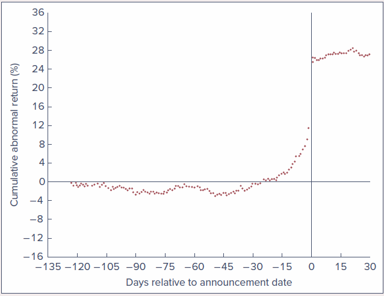
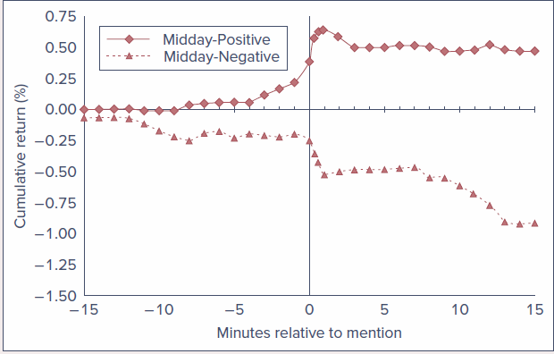
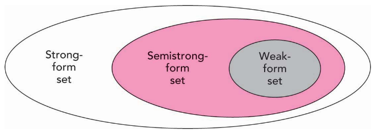
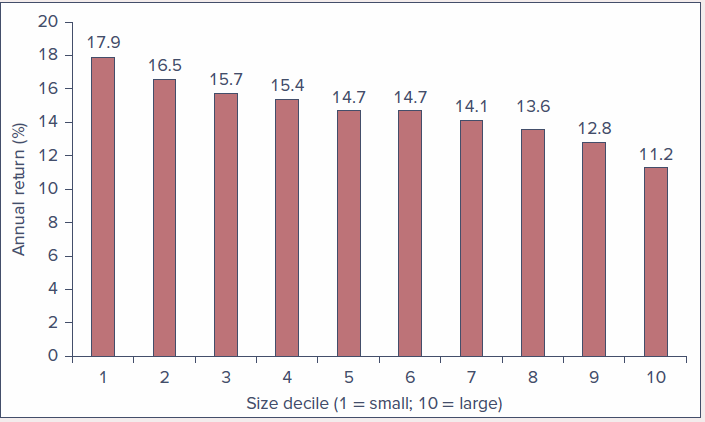
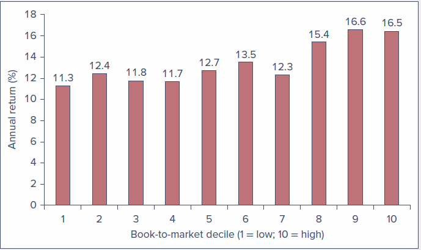
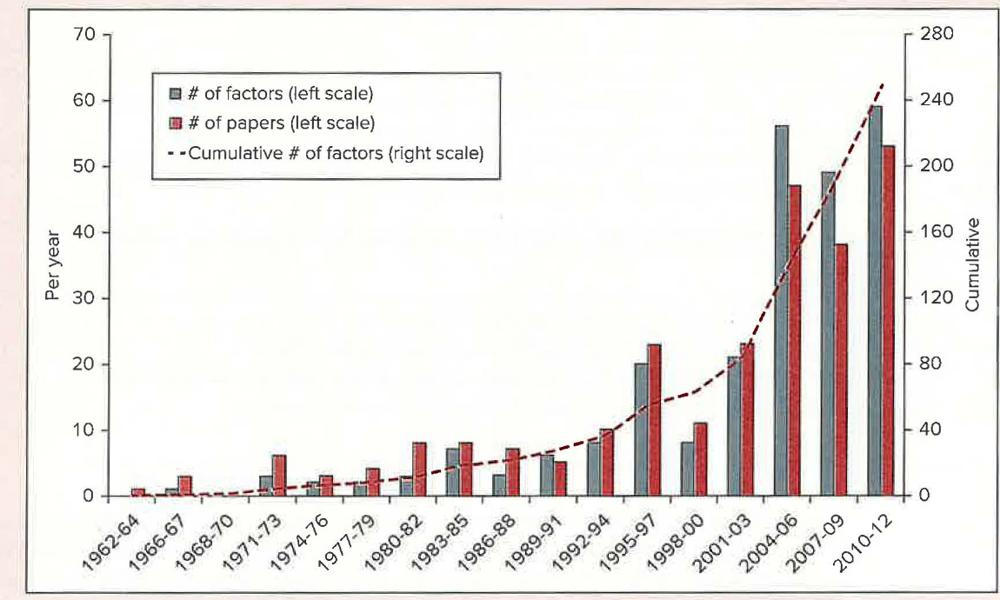
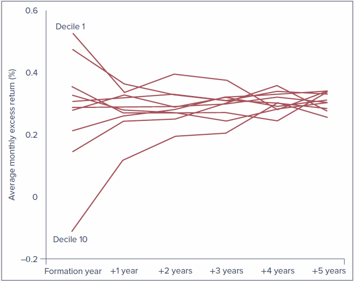
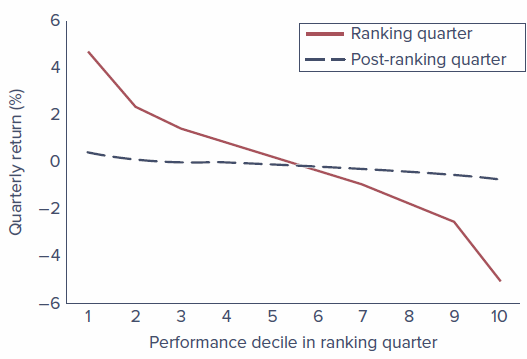

# Introduction

**Source:** Bodie, Kane, and Marcus, *Essentials of Investments* (2024 Release), Chapter 8.

In the 1950s, one of the early applications of computers in economics was to analyze economic time series. Business-cycle theorists believed that tracing several economic variables over time would clarify and predict the progress of the economy through boom and bust periods. A natural candidate for analysis was the behavior of stock prices over time. If stock prices reflect the prospects of the firm, then recurrent patterns of peaks and troughs in economic performance ought to show up in those prices.

When **Maurice Kendall (1953)** examined this proposition, he found to his great surprise that he could identify **no predictable patterns in stock prices**. Prices seemed to evolve randomly, apparently as likely to go up as to go down on any particular day, regardless of past performance.

At first, Kendall's results were disturbing to some financial economists. They seemed to imply that the stock market is dominated by erratic market psychology, or "animal spirits," and that it follows no logical rules. On further reflection, economists reversed their interpretation:

> **Random price movements indicate a well-functioning, or efficient, market, not an irrational one.**

This chapter explores the reasoning behind that surprising conclusion. It shows how competition among analysts leads naturally to market efficiency, examines the implications of the efficient market hypothesis (EMH) for investment policy, and considers the empirical evidence that supports and contradicts the notion of market efficiency.

## Learning Objectives {.unnumbered}

After this chapter, you should be able to:

-   **LO 8-1:** Demonstrate why security price changes should be essentially unpredictable in an efficient market.
-   **LO 8-2:** Cite evidence that supports and contradicts the efficient market hypothesis.
-   **LO 8-3:** Provide interpretations of various stock market "anomalies."
-   **LO 8-4:** Formulate investment strategies that make sense in informationally efficient markets.

## Chapter Roadmap {.unnumbered}

Four major sections:

1.  **Random Walks and Efficient Markets** - Why efficient markets imply unpredictable price changes, and the three versions of the EMH
2.  **Implications of the EMH** - What efficiency means for technical analysis, fundamental analysis, active versus passive management, and resource allocation
3.  **Are Markets Efficient?** - The issues in testing the EMH and the evidence from weak-form, semistrong-form, and strong-form tests
4.  **Mutual Fund and Analyst Performance** - Whether market professionals consistently beat a passive index

------------------------------------------------------------------------

## Random Walks and Efficient Markets

Suppose Kendall had discovered that changes in stock prices can be modeled and reliably predicted. Investors who could predict stock prices would reap unending profits simply by purchasing stocks that the model implied were about to increase in price and selling those about to fall.

This situation could not persist for long. Suppose a model predicts with great confidence that XYZ's stock price, currently **\$100** per share, will rise dramatically in three days to **\$110**. What would all investors do today?

-   They would place a great wave of buy orders to cash in on the imminent increase.
-   No one holding XYZ would be willing to sell.
-   The net effect is an **immediate jump in the stock price to \$110**, as the market digests and reflects the "good news" implicit in the forecast.

This example illustrates why Kendall's attempt to find recurrent patterns was likely to fail. **A forecast about favorable future performance leads instead to favorable current performance**, as market participants all try to get in on the action before the price increase.

More generally, any information that could be used to predict stock performance should already be reflected in stock prices. This point was made forcefully by Nobel laureate **Eugene Fama** in his pioneering exploration of market efficiency.

-   As soon as there is any information indicating that a stock is underpriced, investors flock to buy it and immediately bid up its price to a fair level, where only **ordinary rates of return** can be expected.
-   "Ordinary rates" are simply rates of return commensurate with the risk of the stock.
-   If prices are bid immediately to fair levels given currently available information, prices must increase or decrease **only in response to new information**.
-   New information, by definition, must be **unpredictable**; if it could be predicted, the prediction would already be part of today's information.
-   Therefore, stock prices that change in response to new information must also move unpredictably.

This is the essence of the argument that stock prices should follow a **random walk**: price changes should be random and unpredictable.

::: callout-important
## Randomness in price changes is not irrationality in price levels

Far from a proof of market irrationality, randomly evolving stock prices are the necessary consequence of intelligent investors competing to discover relevant information on which to buy or sell stocks before the rest of the market becomes aware of it. If prices are determined rationally, then only new information will cause them to change, so a random walk is the natural result of prices that always reflect all current knowledge.

Indeed, if stock price movements were predictable, that would be convincing **evidence of market inefficiency**, because the ability to predict prices would indicate that all available information was not already reflected in stock prices.
:::

The notion that stocks already reflect all available information is referred to as the **efficient market hypothesis (EMH)**.

::: callout-note
## Do not confuse two uses of "efficient"

Market efficiency should not be confused with the efficient portfolios introduced in Chapter 6. An **informationally efficient market** is one in which information is rapidly disseminated and reflected in prices. An **efficient portfolio** is one with the highest expected return for a given level of risk.
:::

### Evidence of rapid adjustment to new information {.unnumbered}

**Figure 8.1** illustrates the response of stock prices to new information in an efficient market. The graph plots the **cumulative abnormal return** (return in excess of what would have been expected given the market return) of a sample of companies that were **targets of takeover attempts**. In most takeovers, the acquiring firm pays a premium over current market prices, so news of a takeover should cause the target's stock price to jump.

-   Stock prices increase on the day the news becomes public.
-   There is **no further drift** after the announcement date, suggesting that prices reflect the new information, including the likely size of the takeover premium, by the end of the trading day.

{width="75%"}

Even more dramatic evidence of rapid response comes from **intraday prices**:

-   **Patel and Wolfson (1984)** show that most of the stock price response to corporate dividend or earnings announcements occurs **within 10 minutes** of the announcement.
-   **Busse and Green (2002)** track minute-by-minute stock prices of firms featured on CNBC's "Morning" or "Midday Call" segments. Minute 0 in **Figure 8.2** is the time the stock is mentioned on the midday show. The top line is the average price movement of stocks that receive positive reports; the bottom line is stocks with negative reports.
    -   The positive-report line levels off, indicating that the market has fully digested the news within **5 minutes**.
    -   The negative-report line levels off within about **12 minutes**.

{width="75%"}

### Competition as the Source of Efficiency

Why should we expect stock prices to reflect "all available information"? If you are willing to spend time and money gathering information, it might seem reasonable that you could turn up something overlooked by the rest of the investment community. When information is costly to uncover and analyze, one would expect investment analysis that calls for such expenditures to result in an increased expected return.

This point was stressed by **Grossman and Stiglitz (1980)**:

-   Investors have an incentive to spend time and resources to analyze and uncover new information **only if** such activity is likely to generate higher investment returns.
-   Thus, in market equilibrium, efficient information-gathering activity should be fruitful.
-   The **degree of efficiency may differ across markets**. Emerging markets that are less intensively analyzed than U.S. markets, or in which accounting disclosure requirements are less rigorous, may be less efficient. Small stocks that receive relatively little coverage by Wall Street analysts may be less efficiently priced than large ones.

So, while you cannot say you absolutely cannot come up with new insights, it makes sense to **consider and respect your competition**.

::: callout-tip
## Example 8.1 - Rewards for Incremental Performance

Consider an investment management fund currently managing a **\$5 billion** portfolio. Suppose the fund manager can devise a research program that could increase the portfolio rate of return by **one-tenth of 1% per year**, a seemingly modest amount.

$$\$5\text{ billion} \times 0.001 = \$5\text{ million}$$

The fund should be willing to spend up to **\$5 million per year** on that research. With such large rewards for even small increases in performance, it should not be surprising that professional portfolio managers spend large sums on industry analysts, technical support, and research. As a result, we should expect any obvious sources of information already to be exploited.
:::

Although it may not literally be true that "all" relevant information will be uncovered, there are likely many investigators hot on the trail of most leads that seem able to improve investment performance. Competition among these many well-backed and highly paid analysts ensures that, as a general rule, stock prices ought to reflect available information.

#### The competition for information {.unnumbered}

It is often said that the most precious commodity on Wall Street is information, and the competition for it is intense.

-   **Alternative data firms** uncover and sell information that might shed light on corporate prospects.
    -   Some use satellite imagery to estimate the number of cars parked outside big retailers such as Walmart, giving a sense of daily sales.
    -   Others use satellite imagery to estimate the height of oil tanks and thus the size of oil stocks.
    -   **Thasos** specializes in insights from cell phones. In 2018 it tracked pings from cell phones at a Tesla factory and concluded that the overnight shift had increased by 30%, evidence of a soon-to-be-announced production increase, which it sold to hedge fund clients. When the increase was formally announced, Tesla shares rose 9%.
-   Sometimes the quest for a competitive advantage tips over into a search for **illegal inside information**.
    -   In 2011, **Raj Rajaratnam**, head of the Galleon Group hedge fund (which once managed \$6.5 billion), was convicted for soliciting tips from a network of corporate insiders and traders.
    -   In 2014, **SAC Capital Advisors** paid \$1.8 billion to settle an insider trading probe.
    -   The line separating legitimate and prohibited means of acquiring information is often murky.

::: callout-note
## On the Market Front: Matchmakers for the Information Age

**Expert-network firms** connect (for a fee) investors to industry experts who can provide a unique perspective on a company. Experts range from doctors who help predict the release of blockbuster drugs, to meteorologists who forecast weather that can affect commodity prices, to business executives with specialized insight into companies and industries.

-   Expert firms are supposed to provide only public information, along with the expert's insights and perspective.
-   The risk is that experts may peddle prohibited inside information. In 2011, a consultant for Primary Global Research was convicted of selling information to the hedge fund SAC Capital Advisors; several other Primary Global employees were also charged with insider trading.
-   The SEC has raised concerns about the boundary between legitimate and illegal services. Expert firms now keep detailed records of who talked to whom, when, and what was discussed.
-   Even with safeguards, room for trouble remains: an investor may meet an expert through a legitimate network and then establish a consulting relationship on their own. "Where there is a will to cheat, there usually will be a way."
:::

### Versions of the Efficient Market Hypothesis

It is common to distinguish among three versions of the EMH. They differ by their notions of what is meant by "all available information."

| Version | What prices already reflect |
|:-----------------------|:-----------------------------------------------|
| **Weak-form EMH** | All information that can be derived by examining **market trading data**, such as the history of past prices, trading volume, or short interest |
| **Semistrong-form EMH** | **All publicly available information** regarding the prospects of a firm |
| **Strong-form EMH** | **All relevant information, including inside information** available only to company insiders |

{width="75%"}

#### Weak form {.unnumbered}

-   This version implies that **trend analysis is fruitless**.
-   Past stock price data are publicly available and virtually costless to obtain. If such data ever conveyed reliable signals about future performance, all investors would already have learned to exploit them.
-   Ultimately, signals lose their value as they become widely known, because a buy signal, for instance, would result in an immediate price increase.

#### Semistrong form {.unnumbered}

-   All publicly available information must already be reflected in the stock price.
-   Such information includes, in addition to past trading data, fundamental data on the firm's **product line, quality of management, balance sheet composition, patents held, earnings forecasts, and accounting practices**.
-   If investors have access to this information from public sources, one would expect it to be reflected in stock prices.

#### Strong form {.unnumbered}

-   This version is **quite extreme**. Few would argue with the proposition that corporate officers have access to pertinent information long enough before public release to enable them to profit from trading on it.
-   Much of the activity of the Securities and Exchange Commission (SEC) is directed toward preventing insiders from profiting by exploiting their privileged position.
-   **Rule 10b-5** of the Securities Exchange Act of 1934 sets limits on trading by corporate officers, directors, and substantial owners, requiring them to report trades to the SEC. These insiders, their relatives, and any associates who trade on information supplied by insiders are considered in violation of the law.
-   Defining insider trading is not always easy. Stock analysts are in the business of uncovering information not already widely known, and, as seen in Chapter 3 and the box above, the distinction between private and inside information is sometimes murky.

#### What all three versions have in common {.unnumbered}

All versions assert that **prices should reflect available information**. We do not expect traders to be superhuman or market prices to always be right. Sometimes prices will turn out in retrospect to have been outrageously high; at other times, absurdly low. The EMH asserts only that, at a given time and using current information, **we cannot be sure whether today's prices will ultimately prove to have been too high or too low**. If markets are rational, we can expect them to be correct on average.

::: callout-note
## Concept Check 8.1

a.  Suppose you observed that high-level managers make superior returns on investments in their company's stock. Would this be a violation of weak-form market efficiency? Would it be a violation of strong-form market efficiency?
b.  If the weak form of the EMH is valid, must the strong form also hold? Conversely, does strong-form efficiency imply weak-form efficiency?

**Solution:**

a.  A high-level manager might well have private information about the firm, so her ability to trade profitably on it is not surprising. This does **not** violate weak-form efficiency: the abnormal profits are not derived from an analysis of past price and trading data. It **does** violate strong-form efficiency: there is some private information that is not already reflected in stock prices.
b.  The weak-form information set includes only the history of prices and volumes. The semistrong-form set includes the weak-form set plus all other publicly available information. The strong-form set includes the semistrong set plus insiders' information (it is illegal to act on this incremental information). The direction of valid implication is:

    **Strong-form EMH ⇒ Semistrong-form EMH ⇒ Weak-form EMH**

    The reverse is not valid. For example, stock prices may reflect all past price data (weak-form efficiency) but may not reflect relevant fundamental data (semistrong-form inefficiency).
:::

------------------------------------------------------------------------

## Implications of the EMH

### Technical Analysis

**Technical analysis** is essentially the search for recurrent and predictable patterns in stock prices.

-   Technicians recognize the value of information about a firm's future economic prospects, but believe such information is not necessary for a successful trading strategy.
-   Whatever the fundamental reason for a change in stock price, if the price responds **slowly enough**, the analyst can identify a trend that can be exploited during the adjustment period.
-   The key to successful technical analysis is therefore a **sluggish response** of stock prices to fundamental supply-and-demand factors. This is diametrically opposed to the notion of an efficient market.
-   Technical analysts are sometimes called **chartists** because they study records or charts of past stock prices, hoping to find patterns they can exploit.

#### Relative strength {.unnumbered}

The chartist compares stock performance over a recent period to the performance of the market or other stocks in the same industry. A simple version takes the **ratio of the stock price to a market indicator** such as the S&P 500 Index. If the ratio increases over time, the stock is said to exhibit **relative strength**, because its price performance has been better than that of the broad market. Such strength presumably may continue long enough to offer profit opportunities.

#### Resistance and support levels {.unnumbered}

One of the most commonly heard components of technical analysis is the notion of resistance levels or support levels.

-   A **resistance level** is a price level above which it is supposedly unlikely for a stock or stock index to rise.
-   A **support level** is a price level below which it is supposedly unlikely for a stock or stock index to fall.
-   These levels are believed to be determined by market psychology.

::: callout-tip
## Example 8.2 - Resistance Levels

Consider stock XYZ, which traded for several months at a price of **\$72** and then declined to **\$65**. If the stock price eventually begins to increase, \$72 is considered a resistance level (according to this theory), because investors who bought originally at \$72 will be eager to sell their shares as soon as they can break even. At prices near \$72, a wave of selling pressure would exist. Such activity imparts a type of "memory" to the market that allows past price history to influence current prospects.
:::

#### The logical conundrum of resistance levels {.unnumbered}

If the market believed that \$72 truly were a resistance level, no one would be willing to purchase the stock at \$71.50, because it would have almost no room to increase in price but ample room to fall. But if no one would buy at \$71.50, then \$71.50 would become a resistance level. By similar analysis, no one would buy at \$71, or \$70, and so on.

The resolution: if the stock is ever to sell at \$71.50, investors must believe the price can as easily increase as fall. **The fact that investors are willing to purchase (or even hold) the stock at \$71.50 is evidence of their belief that they can earn a fair expected rate of return at that price.**

#### What the EMH implies for technical analysis {.unnumbered}

The EMH implies that technical analysis should be **fruitless**.

-   The past history of prices and trading volume is publicly available at minimal cost.
-   Any information that was ever available from analyzing past trading should already be reflected in stock prices.
-   As investors compete to exploit their common knowledge of a stock's price history, they drive prices to levels where expected rates of return are exactly commensurate with risk. At those levels, one cannot expect abnormal returns.

#### Self-destructing price patterns {.unnumbered}

An interesting question is whether a trading strategy that seems to work will continue to work once it becomes widely recognized. The real test of efficient markets is whether the rule itself becomes reflected in stock prices once its efficacy is discovered.

-   As many traders attempt to exploit a useful strategy and prices begin to reflect their activity, the approach becomes less and less profitable. In this sense, **price patterns ought to be self-destructing**.
-   The market dynamic is one of a continual search for profitable trading rules, followed by destruction by overuse of those rules found to be successful, followed by more search for yet-undiscovered rules.

::: callout-tip
## Example: Moneyball and the Efficient Market Hypothesis

In *Moneyball*, Michael Lewis explores an inefficient market, not a financial market but a sports market.

-   Baseball players at the turn of the century were systematically "mispriced" by team management and scouts, whose conventional wisdom led them to ignore better gauges of an athlete's "intrinsic value."
-   **Billy Beane**, manager of the Oakland Athletics, faced an extremely limited payroll compared to better-funded teams. He adopted **sabermetrics** (statistical analysis applied to baseball) to identify the best talent.
-   It was a resounding success: despite a salary payroll of only \$44 million in 2002 (compared to more than \$125 million for the New York Yankees), Oakland made it to the playoffs, setting an American League record with a 20-game win streak.
-   Success led to imitation. Other teams hired their own sabermetricians, player assessment across the league improved, and Oakland's analytical advantage dissipated.

This is the inevitable dynamic of a market groping its way to greater efficiency. Competition among market participants ultimately forced market prices to better reflect players' intrinsic value. Useful information may occasionally be ignored or poorly used, but once a better means of analysis is devised, it is rarely long before it spreads widely.
:::

::: callout-note
## Concept Check 8.2

If everyone in the market believes in resistance levels, why do these beliefs not become self-fulfilling prophecies?

**Solution:** The very fact that we observe stock prices near so-called resistance levels belies the assumption that the price can be a resistance level. If a stock is observed to sell at any price, then investors must believe a fair rate of return can be earned if the stock is purchased at that price. It is logically impossible for a stock to have a resistance level and offer a fair rate of return at prices just below the resistance level. If we accept that prices are appropriate, we must reject any presumption concerning resistance levels.
:::

### Fundamental Analysis

**Fundamental analysis** uses earnings and dividend prospects of the firm, expectations of future interest rates, and risk evaluation of the firm to determine proper stock prices. Ultimately, it is an attempt to determine the **present value of all the payments a stockholder will receive from each share of stock**. If that "intrinsic value" exceeds the stock price, the fundamental analyst would recommend purchasing the stock.

-   Fundamental analysts usually start with a study of past earnings and an examination of company financial statements.
-   They supplement this with further economic analysis, ordinarily including an evaluation of the quality of the firm's management, the firm's standing within its industry, and the prospects for the industry as a whole.
-   The hope is to gain insight into the firm's future performance that is not yet recognized by the rest of the market. (Chapters 12 through 14 provide a detailed discussion of the analyses that underlie fundamental analysis.)

#### What the EMH implies for fundamental analysis {.unnumbered}

The EMH predicts that **most fundamental analysis also is doomed to failure**.

-   If analysts rely on publicly available earnings and industry information, their evaluation of the firm's prospects is not likely to be significantly more accurate than that of their rivals.
-   There are many well-informed, well-financed firms conducting such market research, and in the face of such competition it will be difficult to uncover data not also available to other firms. Only those with **unique insight** will be rewarded.
-   Discovering good firms does an investor no good in and of itself if the rest of the market also knows those firms are good. If the knowledge is already public, the investor will be forced to pay a high price for those firms and will not realize a superior return.

> **The trick is not to identify firms that are good, but to find firms that are better than everyone else's estimate.** Similarly, troubled firms can be great bargains if their prospects are not quite as bad as their stock prices suggest.

It is not enough to do a good analysis of a firm; **you can make money only if your analysis is better than that of your competitors.**

### Active versus Passive Portfolio Management

Casual efforts to pick stocks are not likely to pay off. Competition among investors ensures that any easily implemented stock evaluation technique will be used widely enough that any insights will be reflected in stock prices. Only serious analysis and uncommon techniques are likely to generate the differential insight necessary to yield trading profits.

#### Scale matters {.unnumbered}

-   These techniques are feasible only for managers of **large portfolios**.
-   If you have only \$100,000 to invest, even a 1%-per-year improvement generates only **\$1,000** per year, hardly enough to justify herculean efforts.
-   The billion-dollar manager would reap extra income of **\$10 million** annually from the same 1% increment.
-   Small investors at a disadvantage in active management are better off investing in **mutual funds or exchange-traded funds (ETFs)**, which pool resources and gain from economies of scale.
-   Even so, can investors be sure that large funds have the ability or resources to uncover mispriced stocks? And will any mispricing be large enough to repay the costs of active management?

#### The passive alternative {.unnumbered}

Proponents of the EMH believe that active management is largely wasted effort and unlikely to justify the expenses incurred. They advocate a **passive investment strategy** that makes no attempt to outsmart the market.

-   A passive strategy aims only at establishing a **well-diversified portfolio** without attempting to find under- or overvalued stocks.
-   It is usually characterized by a **buy-and-hold** strategy. When prices are at fair levels, it makes no sense to buy and sell frequently, which generates trading costs without increasing expected performance.
-   A common approach is an **index fund**, a portfolio designed to replicate the performance of a broad-based index of stocks.
-   In short, **active management assumes market inefficiency**, while **passive management is consistent with semistrong-form efficiency**.

#### Index funds in practice {.unnumbered}

-   Vanguard's 500 Index Fund holds stocks in direct proportion to their weight in the S&P 500. Its Total Stock Market Index Fund holds an even broader portfolio that replicates the CRSP index of virtually all actively traded U.S. stocks. (CRSP is the Center for Research in Security Prices, originally established at the University of Chicago; in 2020 it was spun off as a profit-making enterprise and licenses its indexes to fund families such as Vanguard.)
-   Investors obtain broad diversification with **relatively low fees**, because the fund does not pay analysts to assess stock prospects and does not incur transaction costs from high turnover.
-   The typical annual **expense ratio** of an actively managed equity fund is almost **1%** of assets; the expense ratio of these two Vanguard funds is only **0.04%** for even moderately sized investors.
-   Scale of indexing: in 2023, Vanguard's Total Stock Market fund had about **\$1.4 trillion** under management and the 500 Index Fund another **\$850 billion**.
-   The share of equity mutual funds held in indexed portfolios rose from only **10% in 2001 to over 30% in 2023**. ETFs, which represent 20% of all assets managed by investment companies, are also primarily indexed products. In total, about **half** of the equity managed by investment companies is indexed.
-   Indexing is not limited to broad equity indexes. Other Vanguard funds track the Barclays Capital U.S. Aggregate Bond Index, the CRSP index of small-capitalization U.S. companies, and Financial Times indexes of the European and Pacific Basin equity markets, and the ETF industry offers indexes on a wide array of other indexes.

::: callout-note
## Concept Check 8.3

What would happen to market efficiency if all investors attempted to follow a passive strategy?

**Solution:** If everyone follows a passive strategy, sooner or later prices will fail to reflect new information. At this point there are profit opportunities for active investors who uncover mispriced securities. As they buy and sell these assets, prices again will be driven toward fair levels.
:::

### The Role of Portfolio Management in an Efficient Market

If the market is efficient, why not throw darts at *The Wall Street Journal* instead of trying to choose a stock portfolio rationally? This is a tempting conclusion, but it is far too facile. **There is a role for rational portfolio management even in perfectly efficient markets.**

1.  **Diversification.** Even if all stocks are priced fairly, each still poses firm-specific risk that can be eliminated through diversification. Rational security selection calls for an efficiently diversified portfolio providing the level of systematic risk the investor wants.
2.  **Taxes.** Tax considerations should be reflected in security choice. High-tax-bracket investors generally will not want the same securities as low-bracket ones.
    -   High-bracket investors find it advantageous to buy tax-exempt municipal bonds despite their low pretax yields, while those bonds are unattractive to low-bracket investors.
    -   High-bracket investors might tilt toward capital gains rather than interest income, because capital gains are taxed less heavily and the option to defer realization is more valuable the higher the current tax bracket.
    -   They also may be more attracted to investments whose returns are sensitive to tax benefits, such as real estate ventures.
3.  **The investor's particular risk profile.** A Toyota executive whose annual bonus depends on Toyota's profits generally should not invest additional amounts in auto stocks, because total compensation already depends on Toyota's well-being. Lehman Brothers employees learned this lesson with considerable pain in September 2008: roughly **30%** of the firm's shares were owned by its **24,000** employees, and their losses on those shares were around **\$10 billion**.
4.  **Age.** Older investors living off savings might avoid large equity investments, where market values fluctuate dramatically, because they require conservation of principal. Younger investors might be more inclined toward long-term inflation-indexed bonds, since the steady flow of real income locked in over long periods can matter more than preservation of principal for those with long life expectancies.

> **In an efficient market, the role of the portfolio manager is to tailor the portfolio to the investor's needs, rather than to beat the market.** Optimal positions vary according to factors such as age, tax bracket, risk aversion, and employment.

### Resource Allocation

The preceding sections focused on investment implications. Deviations from efficiency may offer profit opportunities to better-informed traders at the expense of the less-informed. But such deviations would also impose a large cost borne by all citizens: **inefficient resource allocation**.

-   In a capitalist economy, investments in real assets such as plant, equipment, and know-how are guided in large part by the prices of financial assets.
-   For example, if the value of telecommunication capacity reflected in stock prices exceeds the cost of installing that capacity, managers might justifiably conclude that telecom investments have positive net present value. In this way, **capital market prices guide the allocation of real resources.**
-   If securities are commonly mispriced, resources will be systematically misallocated. Corporations with overpriced securities will obtain capital too cheaply, and corporations with undervalued securities might forgo investment opportunities because the cost of raising capital is too high.
-   Inefficient capital markets would therefore diminish one of the most potent benefits of a market economy. The **dot-com bubble** of the late 1990s sent a strong but wildly overoptimistic signal about the prospects of Internet and telecommunication firms and ultimately led to substantial overinvestment in those industries.

::: callout-warning
## Efficient is not the same as perfect foresight

Before writing off markets as a means of guiding resource allocation, be reasonable about what can be expected from market forecasts. Do not confuse an **efficient market**, where all available information is reflected in prices, with a **perfect-foresight market**. "All available information" is still far from complete information, and generally rational market forecasts will sometimes be wrong, sometimes very wrong.
:::

------------------------------------------------------------------------

## Are Markets Efficient?

### The Issues

The EMH does not exactly elicit enthusiasm among professional portfolio managers. It implies that a great deal of their activity, the search for undervalued securities, is at best wasted effort and quite probably harmful, because it costs money and leads to imperfectly diversified portfolios. Consequently, the EMH has never been widely accepted on Wall Street, and debate continues over the degree to which security analysis can improve performance. Three issues imply that the debate probably never will be settled: the **magnitude issue**, the **selection bias issue**, and the **lucky event issue**.

#### The Magnitude Issue

An investment manager overseeing a \$5 billion portfolio who can improve performance by only 0.1% per year will increase earnings by 0.001 × \$5 billion = **\$5 million** annually. Yet can observers statistically discern this nontrivial contribution? Probably not.

-   A 0.1% annual contribution would be swamped by the volatility of the market.
-   Since 1926, the annual standard deviation of the highly diversified S&P 500 Index has been almost **20%**. Against such fluctuations, a small increase in performance would be hard to detect.
-   All might agree that stock prices are very close to fair values and that only managers of large portfolios can earn enough trading profits to make exploiting minor mispricing worth the effort. In this view, the actions of intelligent investment managers are the driving force behind the constant evolution of market prices to fair levels.

> Rather than ask the qualitative question, "Are markets efficient?" we should ask the quantitative question, **"How efficient are markets?"**

#### The Selection Bias Issue

Suppose you discover an investment scheme that could really make money. You can publish your technique in *The Wall Street Journal* to win fleeting fame, or keep it secret and use it to earn millions of dollars. Most investors would choose the latter.

-   Only investors who find that a scheme **cannot** generate abnormal returns will be willing to report their findings to the whole world.
-   Skeptics of efficient markets can therefore always disregard evidence that techniques do not work and argue that the techniques that do work simply are not being disclosed.
-   This is a problem of **selection bias**: the outcomes we are able to observe have been preselected in favor of failed attempts.

#### The Lucky Event Issue

In virtually any month we hear about some investor or investment company with fantastic performance over the recent past. Surely these examples disprove the EMH? Not necessarily.

-   Consider a contest to flip the most heads out of 50 trials using a fair coin. The expected outcome for any person is 50% heads and 50% tails.
-   If **10,000 people** compete, it would not be surprising if at least one or two flipped more than 75% heads. Elementary statistics says the expected number of contestants flipping 75% or more heads is **two**. It would be silly to crown them "head-flipping champions of the world"; they simply got lucky on the day.
-   If securities are fairly priced given all available information, any bet on a stock is a coin toss. If many investors using a variety of schemes make fair bets, statistically some of them will be lucky and win a great majority of the bets. For every big winner there may be many big losers, but we never hear of them.
-   After the fact, there will always have been at least one successful investment scheme. A doubter will call the results luck; the successful investor will call it skill. The **proper test** is whether successful investors can repeat their performance in another period, yet this approach is rarely taken.

::: callout-note
## On the Market Front: How to Guarantee a Successful Market Newsletter

Suppose you want to make your fortune publishing a market newsletter but have no talent. The solution is to **start eight newsletters**.

-   In year 1, four newsletters predict an up-market and four a down-market. In year 2, half of each group continues to predict up and the other half down. Continue in this manner.
-   After three years, there are 2^3^ = 8 possible market outcomes, and the eight newsletters cover all eight possibilities. No matter what the market has done, **one newsletter will have a perfect three-year track record**. A four-year record requires 2^4^ = 16 newsletters, a five-year record 32, and so on.
-   Drop the seven unsuccessful newsletters and market the eighth based on its perfect record.

**Warning:** this scheme is illegal. The point is that with hundreds of market newsletters, you can find one that has stumbled onto a remarkable string of successful predictions without any real skill. That is the person we read about in *The Wall Street Journal*; the others are forgotten.
:::

::: callout-note
## Concept Check 8.4

Legg Mason's Value Trust, managed by Bill Miller, outperformed the S&P 500 in each of the 15 years ending in 2005. Is Miller's performance sufficient to dissuade you from a belief in efficient markets? If not, would any performance record be sufficient to dissuade you? Now consider that in the next 3 years the fund dramatically underperformed the S&P 500; by the end of 2008, its cumulative 18-year performance was barely different from the index. Does this affect your opinion?

**Solution:** The answer depends on your prior beliefs about market efficiency. Miller's initial record was incredibly strong. On the other hand, with so many funds in existence, it is less surprising that some fund would appear to be consistently superior after the fact. Exceptional past performance of a small number of managers is possible by chance even in an efficient market. A better test is provided in "continuation studies": are better performers in one period more likely to repeat in later periods? Miller's record in the last three years fails the continuation or consistency criterion.
:::

With these caveats in mind, we turn to the empirical tests of the EMH.

### Weak-Form Tests: Patterns in Stock Returns

Early tests of efficient markets were tests of the weak form. Could speculators find trends in past prices that would enable them to earn abnormal profits? This is essentially a test of the efficacy of **technical analysis**.

#### Returns over short horizons

One way of discerning trends is by measuring the **serial correlation** of stock returns: the tendency for stock returns to be related to past returns.

-   **Positive serial correlation:** positive returns tend to follow positive returns (a **momentum** property).
-   **Negative serial correlation:** positive returns tend to be followed by negative returns (a **reversal** or "correction" property).

Findings:

-   **Conrad and Kaul (1988)** and **Lo and MacKinlay (1988)** examine weekly returns of NYSE stocks and find **positive serial correlation** over short horizons. However, the correlation coefficients of weekly returns are fairly small, at least for large stocks. These studies demonstrate weak price trends over short periods, but the evidence does not clearly suggest trading opportunities.
-   There is also evidence that share prices of **individual securities** (as opposed to broad indexes) are more prone to reversals than continuations at very short horizons (Lehmann 1990; Jegadeesh 1990). As Lehmann notes, this is probably best interpreted as due to liquidity problems after big price movements, as market makers adjust their positions.
-   At **intermediate horizons** (3- to 12-month holding periods), **Jegadeesh and Titman (1993)** found a **momentum effect**: good or bad recent performance of particular stocks continues over time. While the performance of individual stocks is highly unpredictable, portfolios of the best-performing stocks in the recent past appear to outperform other stocks with enough reliability to offer profit opportunities.

#### Returns over long horizons

Studies of long-horizon (multiyear) returns by **Fama and French (1988a)** and **Poterba and Summers (1988)** indicate pronounced **negative long-term serial correlation** in the performance of the aggregate market. This gave rise to the **"fads hypothesis,"** which asserts that the stock market might **overreact** to relevant news.

-   Overreaction leads to positive serial correlation (momentum) over short horizons.
-   Subsequent correction of the overreaction leads to longer-term poor performance following extended periods of good performance, and vice versa.

**Robert Shiller** (Nobel laureate) points out that overreaction followed by correction would cause prices to fluctuate around fair value and make asset prices **excessively volatile** compared to the volatility of intrinsic value. **Figure 8.3** illustrates his point.

-   The jagged line shows the actual level of the S&P index going back to 1871.
-   The two smoother lines show the present value of all dividends paid by the S&P portfolio from a given start date through 2013, plus the present value of a terminal payoff in 2013, computed from a constant-growth dividend discount model with two assumptions for the steady-state growth rate. This is an estimate of the **fundamental value** of the index. The discount rate is 7.6%, the historical average real market return since 1871.
-   The actual price oscillates around either estimate of fundamental value, consistent with a fads hypothesis in which prices overshoot the fundamental mark in both bull and bear markets before ultimately correcting.

{width="80%"}

Overshooting followed by reversion might seem to create price predictability that random walk tests would have detected. But Shiller argues that the common finding that price changes are largely unpredictable does **not** disprove his hypothesis. If pricing errors are persistent (that is, they dissipate only slowly), price *changes* at short horizons will be largely unpredictable even if price *levels* do not equal intrinsic value. Corrections would be discernible only at longer horizons. This is consistent with the **short-term momentum and longer-term price reversion** seen in the historical record.

**Caveats on long-horizon results.** Shiller's results are dramatic but not conclusive.

-   They need not be interpreted as evidence of fads. An alternative interpretation is that the **market risk premium varies over time**. When the risk premium and required return rise, prices fall; when the market then rises on average at this higher rate of return, the data convey the impression of a recovery. In this view, apparent overshooting and correction are a rational response of prices to changes in discount rates.
-   Shiller contends that even allowing for variation in risk premia does not eliminate overshooting, but "it is probably fair to say that the jury is still out on this controversy."

**Reversals in individual securities.** **De Bondt and Thaler (1985)** and **Chopra, Lakonishok, and Ritter (1992)** conclude that the stocks that performed best in the recent past underperform the market in following periods, while the worst past performers tend to offer above-average future performance.

-   In the De Bondt and Thaler study, stocks were rank-ordered by performance over a five-year period and grouped into portfolios. The base-period "loser" portfolio (the 35 worst performers) **outperformed** the "winner" portfolio (the top 35) by an average of **25% (cumulative return)** in the following three-year period.
-   This **reversal effect**, in which losers rebound and winners fade, suggests the stock market overreacts to relevant news. It implies that a **contrarian investment strategy**, investing in recent losers and avoiding recent winners, should be profitable, and the returns seem pronounced enough to be exploited profitably.

**Summary of weak-form evidence:** there may be **short-run momentum but long-run reversal** patterns in price behavior, both for the market as a whole and across sectors. One interpretation is that short-run overreaction (reflected in price momentum) may lead to long-term reversals when the market recognizes its past error.

### Predictors of Broad Market Returns

Several studies document the ability of easily observed variables to predict market returns:

-   **Fama and French (1988b):** the return on the aggregate stock market tends to be higher when the dividend/price ratio (the dividend yield) is **high**.
-   **Campbell and Shiller (1988):** the **earnings yield** can predict market returns.
-   **Keim and Stambaugh (1986):** bond market data, such as the **spread between yields on high- and low-grade corporate bonds**, help predict broad market returns.

Interpreting these results is difficult. They may imply that abnormal stock returns can be predicted, in violation of the EMH. **More probably, these variables are proxying for variation in the market risk premium.**

-   Given a level of dividends or earnings, stock prices will be lower, and dividend and earnings yields higher, when the risk premium (and therefore the expected market return) is higher. A high dividend or earnings yield will thus be associated with higher market returns.
-   Rather than a violation of efficiency, the predictability of market returns is due to **predictability in the risk premium**.
-   **Fama and French (1989):** the yield spread between high- and low-grade bonds has greater predictive power for returns on low-grade bonds than high-grade bonds, and greater power for stock rather than bond returns. This suggests the predictability reflects a risk premium rather than inefficiency.
-   Similarly, the fact that the dividend yield on stocks helps predict bond market returns suggests that the yield captures a risk premium common to both markets rather than mispricing in the equity market.

### Semistrong Tests: Market Anomalies

Fundamental analysis uses a much wider range of information than technical analysis. Tests of fundamental analysis ask whether publicly available information beyond the trading history can improve performance, so they are **tests of semistrong-form efficiency**.

Surprisingly, several easily accessible statistics, such as a stock's price-earnings ratio or its market capitalization, seem to predict abnormal risk-adjusted returns. Findings that are difficult to reconcile with the EMH are often referred to as **efficient market anomalies**.

::: callout-important
## The joint hypothesis problem

Interpreting these tests is difficult because we usually need to **adjust for portfolio risk** before evaluating a strategy.

-   Suppose we use the CAPM to adjust for risk. Even if beta is a relevant descriptor of risk, the empirically measured trade-off between beta and expected return differs from the CAPM's predictions. Incorrect adjustments may suggest superior returns when, in fact, the **risk adjustment procedure has failed**.
-   Tests of risk-adjusted returns are therefore **joint tests of the EMH and the model of expected returns**. If we find strategies that appear to offer abnormal returns, it could mean simply that our benchmarks are wrong.
:::

#### The P/E effect {.unnumbered}

**Basu (1977, 1983)** concluded that low price-earnings (P/E) stocks appeared to offer better risk-adjusted returns than high P/E ones. Would this indicate that the market systematically misprices stocks according to P/E? That would be an extremely surprising and disturbing conclusion, because P/E ratios are so simple to observe.

An alternative interpretation is that returns are **not properly adjusted for risk**. If two firms have the same expected earnings, the riskier stock will sell at a lower price and a lower P/E ratio. Because of its higher risk, the low P/E stock also will have higher expected returns. Unless the model of expected returns fully adjusts for risk, P/E will be a useful additional proxy for risk and will appear to predict abnormal returns.

#### The Small-Firm Effect

The **size effect**, originally documented by **Banz (1981)**, is illustrated in **Figure 8.4**. It shows the historical performance of portfolios formed by dividing NYSE stocks into 10 portfolios each year according to firm size (the total value of outstanding equity).

-   Average annual returns between 1926 and 2022 are consistently higher on the small-firm portfolios.
-   The difference in average annual return between portfolio 10 (largest firms) and portfolio 1 (smallest firms) is **6.7%**.
-   Smaller-firm portfolios tend to be riskier, but even when returns are adjusted for risk using the CAPM, there is still a substantial premium for smaller-sized portfolios.
-   It is remarkable that following a simple, even simplistic, rule such as "invest in low-capitalization stocks" should enable an investor to earn excess returns, since any investor can measure firm size at little cost.

{width="75%"}

#### The Neglected-Firm and Liquidity Effects

**Arbel and Strebel (1983)** gave another interpretation of the small-firm effect.

-   Small firms tend to be **neglected** by large institutional traders, so information about them is less available. This information deficiency makes smaller firms riskier investments that command higher returns. "Brand-name" firms are monitored by institutional investors, promising high-quality information; investors do not purchase "generic" stocks without the prospect of greater returns.
-   **Merton (1987)** shows that neglected firms might be expected to earn higher equilibrium returns as compensation for the risk associated with limited information. In this sense the neglected-firm premium is **not strictly a market inefficiency but a type of risk premium**.
-   **Amihud and Mendelson (1986, 1991)** argue that investors demand a rate-of-return premium to invest in **less liquid stocks** that entail higher trading costs. These stocks do exhibit abnormally high risk-adjusted returns. Because small and less-analyzed stocks are generally less liquid, the **liquidity effect** might partially explain their abnormal returns.
-   Exploiting these effects can be difficult: the high trading costs that virtually define illiquidity can easily wipe out any apparent abnormal profit.

#### Book-to-Market Ratios

**Fama and French (1992)** showed that a powerful predictor of returns across securities is the ratio of the book value of the firm's equity to the market value of equity. They stratified firms into 10 groups by book-to-market ratio and examined the average return of each group. **Figure 8.5** is an updated version.

-   The decile with the **highest** book-to-market ratio had an average annual return of **16.5%**, while the **lowest**-ratio decile averaged only **11.3%**.
-   The dependence of returns on book-to-market ratio is **independent of beta**, suggesting either that high book-to-market firms are relatively underpriced, or that the ratio is a proxy for a risk factor that affects equilibrium expected returns.
-   After controlling for size and book-to-market effects, **beta seemed to have no power to explain average security returns**. This is an important challenge to the notion of rational markets: a factor that *should* affect returns (systematic risk) seems not to matter, while a factor that *should not* matter (book-to-market ratio) seems to predict future returns.

{width="75%"}

#### Post-Earnings-Announcement Price Drift

A fundamental principle of efficient markets is that any new information should be rapidly reflected in stock prices. A puzzling anomaly is the apparently **sluggish response of prices to earnings announcements**, uncovered by **Ball and Brown (1968)** and later confirmed and extended by many other papers.

-   The "news content" of an earnings announcement is the **earnings surprise**: actual earnings compared to the value previously expected by market participants. (Expectations can be roughly measured by averaging analysts' published forecasts or by applying trend analysis to past earnings.)
-   **Rendleman, Jones, and Latané (1982)** calculated earnings surprises for a large sample of firms, ranked them, divided firms into 10 deciles by the size of the surprise, and calculated **abnormal returns** for each decile (return adjusted for both the market return in that period and the portfolio beta). **Figure 8.6** plots cumulative abnormal returns by decile.
-   As expected, there is a large abnormal return on the announcement day (time 0): positive for positive-surprise firms and negative for negative-surprise firms.
-   The more remarkable result concerns movement **after** the announcement. The cumulative abnormal returns of positive-surprise stocks **continue to rise** (momentum) even after the information becomes public, while negative-surprise firms continue to suffer negative abnormal returns. The market appears to adjust to earnings information only gradually.
-   One could have earned abnormal profits simply by waiting for earnings announcements and buying a portfolio of positive-surprise companies, the kind of predictable continuing trend that ought to be impossible in an efficient market.

{width="70%"}

### Other Predictors of Stock Returns

The list of anomalies could go on and on. Several other characteristics have also been found to predict stock returns.

#### Volatility

While the CAPM predicts that idiosyncratic volatility should not be related to stock returns, it appears that at intermediate horizons of 3-12 months, **volatility is negatively associated with returns**.

#### Accruals and Earnings Quality

**Accruals** measure the component of earnings that does not reflect actual cash flows. For example, if a firm sells an item on credit it may report a profit, but the immediate impact is an increase in accounts receivable (an accrual), not cash.

-   **High accruals have predicted low future returns.**
-   This is sometimes viewed as an **earnings quality** factor, because management can and does sometimes manipulate accruals to paint a rosy view of earnings.

#### Growth

More rapidly growing firms, for example those with high capital investment, sales growth, asset growth, or high recent share issuance, tend to have **lower future returns**. Other variables used to classify shares along the growth versus value continuum are the ratios of earnings to share price, cash flow to share price, payout ratio, analyst growth forecasts, and analyst earnings forecasts to price.

#### Profitability

**Gross profitability** seems to predict **higher** stock returns. It is computed by adding back some items conventionally treated as expenses, such as advertising or research and development. The idea is that these expenditures may be better viewed as investments than expenses if they will enhance future earnings.

#### Q-Factor

Economists call the ratio of the present value of an investment to its cost **Tobin's q** (after James Tobin). **Hou, Xue, and Zhang (2015)** show that q is a good predictor of average stock returns.

-   High q might plausibly imply a low discount rate, because a low rate results in high present values and therefore a high q-ratio. And q seems to predict **lower** equilibrium returns.
-   Given the direct impact of discount rates on asset valuation, one might interpret this pattern as a **rational risk-return relation rather than an anomaly**.

### Strong-Form Tests: Inside Information

It would not be surprising if insiders were able to make superior profits trading in their firm's stock. We do **not** expect markets to be strong-form efficient; we regulate and limit trades based on inside information.

-   The ability of insiders to trade profitably in their own stock has been documented by **Jaffe (1974), Givoly and Palmon (1985), Seyhun (1986)**, and others. Jaffe's was one of the first studies to document the tendency for stock prices to **rise after insiders intensively bought** shares and to **fall after sales**.
-   Can other investors benefit by following insiders' trades? The SEC requires all insiders to register their trading activity, and these trades become public. If markets are efficient, fully and immediately processing that information, investors should no longer be able to profit from following those trades.
-   **Seyhun** found that following insider transactions would be to no avail. There was some tendency for prices to increase even after the report of insider buying, but the abnormal returns were **not large enough to overcome transaction costs**.

### Interpreting the Anomalies

How should we interpret the ever-growing anomalies literature? Does it imply that markets are grossly inefficient, allowing simplistic trading rules to offer large profit opportunities? Or are there more subtle interpretations?

#### Risk Premiums or Inefficiencies?

The small-firm, book-to-market, momentum, and long-term reversal effects are among the most prominent puzzles in empirical finance. To some extent these phenomena may be related: small firms, high-book-to-market firms, and recent "losers" have in common a **stock price that has fallen considerably in recent months or years**. A firm can become small or low-market-to-book by suffering a sharp drop in price, so these groups may contain a high proportion of **distressed firms**.

**Interpretation 1: Risk premiums (Fama and French, 1993).**

-   These effects are manifestations of risk premiums. Using their **three-factor model**, they show that stocks with higher "betas" (factor loadings) on size or book-to-market factors have higher average returns, interpreted as a risk premium associated with the factor.
-   This model does a much better job than the one-factor CAPM in explaining security returns.
-   Size or book-to-market ratios per se are obviously not risk factors, but they might act as **proxies for more fundamental determinants of risk**. Returns to "style portfolios," such as the Fama-French high-minus-low (HML) book-to-market portfolio and the small-minus-big (SMB) size portfolio, do seem to **predict business cycles** in many countries. **Figure 8.7** shows that returns on these portfolios tend to be positive in years prior to rapid GDP growth.

![Figure 8.7 - Return to style portfolio as a predictor of GDP growth. The average difference in the return on the style portfolio in years before good GDP growth versus years before bad GDP growth. A positive value means the style portfolio does better in years prior to good macroeconomic performance. HML = high-minus-low portfolio, sorted on book-to-market ratio. SMB = small-minus-big portfolio, sorted on firm size. Source: J. Liew and M. Vassalou, "Can Book-to-Market, Size, and Momentum Be Risk Factors That Predict Economic Growth?" *Journal of Financial Economics* 51 (2000), pp. 221-245.](../assets/images/Ch08/Figure_8.7.png){width="80%"}

**Interpretation 2: Inefficiency (Lakonishok, Shleifer, and Vishny, 1995).**

-   These phenomena are evidence of **inefficient markets**, specifically of systematic errors in the forecasts of stock analysts.
-   Analysts **extrapolate past performance too far into the future**, overpricing firms with recent good performance and underpricing firms with recent poor performance. When market participants recognize their errors, prices reverse.
-   This is consistent with the reversal effect and, to a degree, with the small-firm and book-to-market effects, since firms with sharp price drops may tend to be small or have high book-to-market ratios.
-   Supporting evidence: **La Porta (1996)** finds that shares of firms for which analysts predict low earnings growth actually perform **better** than those with high expected growth. Analysts seem overly pessimistic about low-growth firms and overly optimistic about high-growth firms; when these too-extreme expectations are corrected, low-expected-growth firms outperform.

#### Anomalies or Data Mining?

Some wonder whether anomalies are really unexplained puzzles or simply reflect **data mining**. If one reruns the database of past returns over and over and examines stock returns along enough dimensions, simple chance will cause some criteria to appear to predict returns.

-   Given this threat, there have been numerous calls to **toughen standards** for accepting a new pricing factor. For example, **Harvey (2007)** suggested, among other things, increasing thresholds for statistical significance to limit "false positives."
-   Some anomalies, such as the small-firm effect and the book-to-market effect, have not shown staying power after being reported.
-   Even so, a common thread runs through many anomalies, supporting the notion that there is a real puzzle: **value stocks** (low P/E, high book-to-market, or depressed prices relative to historic levels) seem to have provided higher average returns than "glamour" or growth stocks.
-   One way to address data mining is to find a data set that has not already been researched and see whether the relationship shows up in the new data. Such studies have revealed **size, momentum, and book-to-market effects in security markets around the world**. These may be manifestations of a systematic risk premium, but the precise nature of that risk is not fully understood.

#### The Factor Zoo

The survey of factors that appear to predict stock returns is just the tip of an ever-growing iceberg. **Figure 8.8**, from a study by **Harvey, Liu, and Zhu**, shows the growth in the number of factors discovered and published since 1963, the year before the CAPM was published.

-   Until 1991, only about **one new factor per year** appeared in print. In the last two decades the number accelerated dramatically, reaching a cumulative sum **exceeding 300 by 2016**.
-   **Table 8.1** (condensed from Harvey, Liu, and Zhu) gives a brief categorization of these factors.

{width="80%"}

**Table 8.1 - Factor Classification**

*A. Common Factors* (for example, beta; variables that may be viewed as proxies for exposure to a source of systematic risk)

| Risk Type | Description |
|:---------------|:-------------------------------------------------------|
| Financial | Various measures of movement in aggregate financial markets such as the return on a market index |
| Macro | Macroeconomic fundamentals such as inflation, aggregate consumption, or unemployment rates |
| Behavioral | Possibly irrational investor behavior, for example, sentiment |
| Accounting | Common patterns in variables constructed from accounting variables, for example, market-to-book ratio |
| Microstructure | Variation in trading frictions such as liquidity or trading costs |

*B. Characteristics* (for example, firm-specific risk; potential factors specific to a particular security)

| Risk Type | Description |
|:---------------|:-------------------------------------------------------|
| Financial | Idiosyncratic financial risk such as firm-specific volatility or tail risk |
| Microstructure | Firm-level frictions such as short-sale constraints or transaction costs |
| Behavioral | Firm-level information issues such as dispersion of analyst forecasts or media coverage |
| Accounting | Firm-level accounting variables such as P/E ratio or debt-to-equity ratio |

*Source: Campbell Harvey, Yan Liu, and Heqing Zhu, "... and the Cross-Section of Expected Returns," Review of Financial Studies 29 (2016), pp. 5-68.*

**What should we make of this empirical sprawl?**

-   **Cochrane** points out that order gives way to chaos if we need hundreds of factors to explain or even describe the patterns of expected returns. The "factor zoo" calls into question the entire enterprise of trying to understand security returns and risk premia through the lens of a concise factor structure.
-   On the one hand, there may be **fewer factors than appear**. Some factors are merely variants on a common theme (related measures of the same underlying characteristic) and should not be viewed as independent findings. Others may be correlated, so their predictive power may be evidence of a single underlying risk factor.
-   On the other hand, advances in computer power and online databases have made it easier to test for potential factors, so an increase in statistically significant findings is unsurprising. **Harvey, Liu, and Zhu (2016)** suggest raising the standard for significance, for example from the traditional t-statistic of **2** to perhaps **3**.
-   **Harvey (2017)** contends that raising the threshold is almost certainly not adequate, because of several related methodological problems:
    -   **p-hacking:** running different tests and reporting only the statistically significant results (those with an adequate p-value).
    -   **Data snooping:** "testing" a factor after having already seen evidence of a relationship in the data. Specifying and testing a hypothesis only after looking at relationships in the data invalidates the test and "borders on research malpractice."
    -   A related and equally problematic practice is measuring many empirical relationships, finding one that seems significant, and only then proposing (and "confirming") a theory that "predicts" it.

#### Anomalies over Time

In well-functioning markets, anomalies ought to be **self-destructing**. As market participants learn of profitable strategies, their attempts to exploit them should move prices to levels at which abnormal profits are no longer available.

**McLean and Pontiff (2016)** test this dynamic.

-   They identify **97 characteristics** in the academic literature associated with abnormal returns and track the publication date of each finding. They compare each strategy's abnormal returns in two out-of-sample periods: (1) from the end of each study's sample period to the date of publication, and (2) the period after publication.
-   If an original finding were totally spurious (data mining), the anomaly would disappear out of sample. If the result is "real," abnormal returns should persist. If the strategy's efficacy reflects mispricing, then as information becomes widely disseminated (for example, through publication) and is exploited by arbitrageurs, its predictive value should diminish.
-   Results: portfolio returns are **28% lower** in the first out-of-sample period, suggesting some, but far from all, of the anomalous returns were due to data snooping. Abnormal returns were **58% lower** in the post-publication period, suggesting that investors learn about mispricing from the academic literature, try to exploit it, and push prices closer to "correct" values.
-   This is buttressed by the observation that trading volume in anomaly-identified stocks increases, as does short interest in "overpriced" stocks.
-   Anomalies are more persistent for stocks that are **more difficult to arbitrage**. The decay is most pronounced for stocks that are larger, more liquid, and have low idiosyncratic risk, precisely the stocks for which trading in pursuit of reliable abnormal returns is most feasible.

Abnormal returns do not fully disappear, but the results are consistent with **a market groping its way toward greater efficiency**.

### Bubbles and Market Efficiency

Every so often, it seems (at least in retrospect) that asset prices lose their grounding in reality.

-   **Tulip mania** (seventeenth-century Holland): tulip prices peaked at several times the annual income of a skilled worker. It is the classic example of a speculative "bubble" in which prices depart from any semblance of intrinsic value.
-   **South Sea bubble** (England, less than a century later): the share price of the South Sea Company rose from **£128 in January 1720** to **£550 in May**, peaked at around **£1,000 in August**, and then collapsed to **£150 in September**, leading to widespread bankruptcies among those who had borrowed to buy shares on credit. The company was itself a major lender to investors willing to buy (and thus bid up) its shares.
-   The sequence may sound familiar from the **dot-com boom and bust of 1995-2002** or the **financial turmoil of 2008**, whose origins are widely attributed to a collapsing housing price bubble (see Chapter 1).

It is hard to defend the position that prices in these instances were rational, unbiased assessments of intrinsic value. **Hyman Minsky** suggested that bubbles arise naturally:

-   During periods of stability and rising prices, investors extrapolate that stability into the future and become more willing to take on risk.
-   Risk premiums shrink, leading to further increases in asset prices, and expectations become even more optimistic in a self-fulfilling cycle.
-   In the end, pricing and risk taking become excessive and the bubble bursts. Ironically, the initial period of stability fosters the complacency about risk that ultimately results in instability.

**But beware of concluding that asset prices are generally arbitrary and that obvious trading opportunities abound.**

-   Most bubbles become "obvious" only **after they have burst**. At the time, there is often a seemingly plausible rationale for the run-up. In the dot-com boom, many observers rationalized price gains as justified by a new and more profitable economy driven by technological advances. Even the irrationality of the tulip mania may have been overblown in its later retelling.
-   Security valuation is intrinsically difficult and entails considerable imprecision.
-   Even if you suspect prices are "wrong," it can be difficult to take advantage of them. Impediments to making aggressive bets against an asset include:
    -   the costs of **short-selling** overpriced securities,
    -   potential problems **obtaining the securities** to sell short, and
    -   the possibility that, even if you are ultimately correct, the market may disagree and prices still can move dramatically against you in the short term, **wiping out your capital**. (These issues are explored further in the following chapter.)

------------------------------------------------------------------------

## Mutual Fund and Analyst Performance

For investors, the issue of market efficiency boils down to whether skilled investors can make **consistent abnormal trading profits**. We compare the performance of market professionals to that of a passive index fund, looking at two facets: **stock market analysts**, who recommend investment positions, and **mutual fund managers**, who actually manage portfolios.

### Stock Market Analysts

Analysts historically have worked for brokerage firms, which presents a problem in interpreting their advice: analysts have tended to be **overwhelmingly positive** about the prospects of firms.

-   **Barber, Lehavy, McNichols, and Trueman (2001)** find that, on a scale of 1 (strong buy) to 5 (strong sell), the average recommendation for **5,628 covered firms in 1996 was 2.04**. One cannot take positive recommendations at face value; instead we must look at the **relative enthusiasm** of recommendations compared to those for other firms, or at **changes** in consensus recommendations.
-   **Womack (1996)** focuses on changes in recommendations: positive changes are associated with price increases of about **5%**, negative changes with average price decreases of **11%**. Womack argues the price impact seems to be **permanent**, consistent with the hypothesis that analysts reveal new information rather than just creating temporary buy or sell pressure.
-   **Jegadeesh, Kim, Krische, and Lee (2004)** also find that **changes** in recommendations are reliably associated with price changes, but that **levels** of consensus recommendations are not.
-   **Barber et al. (2001)** show that firms with the most favorable recommendations outperform those with the least favorable. However, strategies based on analyst recommendations would require **extremely heavy trading**, whose costs would probably wipe out the potential profits.

### Mutual Fund Managers

As pointed out in Chapter 4, casual evidence does not support the claim that professionally managed portfolios can consistently beat the market. Figure 4.4 demonstrated that over the last 50 years, a passive market index typically outperformed the average equity fund.

One might argue that there are good managers and bad managers, and that good managers can consistently outperform. We need to ask whether managers with good performance in one year are likely to repeat it the next. Is superior performance due to **luck** (random) or **skill** (consistent)?

**Table 8.2** divides equity mutual funds into two groups by total return and tracks whether 2018's top-half performers stayed in the top half in later years.

-   If performance were due entirely to skill, we would expect entries of **100%**.
-   If performance were purely random year to year, outperformance would be a coin flip, and we would expect entries of **50%**.

**Table 8.2 - Consistency of investment results, ending December 2022.** The percentage of top-half equity funds that remain in the top half in the following years.

| | Number of top-half performers in 2018 | % of outperformers in top half of sample in 2019 | % of 2-year outperformers that outperform in 2020 | % of 3-year outperformers that outperform in 2021 | % of 4-year outperformers that outperform in 2022 |
|:--------------|--------:|--------:|--------:|--------:|--------:|
| All domestic equity funds | 1,053 | 64.2 | 54.9 | 16.8 | 2.7 |
| Large-cap equity funds | 366 | 63.4 | 55.2 | 16.9 | 1.4 |
| Small-cap equity funds | 263 | 63.5 | 52.9 | 6.1 | 2.7 |

*Source: Craig J. Lazzara, Davide Di Gioia, and Grace Stoddart, "U.S. Persistence Scorecard," S&P Dow Jones Indices, December 2022.*

The pattern of continuation is **mixed**. There seems to be some persistence initially (the 2019 and 2020 entries exceed 50%), but at the two-year horizon the entries fall considerably below 50%, and at the three-year horizon the odds that past standouts continue to outperform are nearly zero (although by then the sample size is quite limited).

-   Other studies (such as Carhart's) also suggest little performance persistence among professional managers and, if anything, **bad performance is more likely to persist than good performance**.
-   This makes sense: it is easy to identify fund characteristics that result in consistently poor performance, notably **high expense ratios and high turnover ratios** with associated trading costs. It is far harder to identify the secrets of successful stock picking. ("If it were easy, we would all be rich!")

#### Risk-adjusted performance and the four-factor benchmark {.unnumbered}

These results were based on total returns without adjustment for exposure to systematic risk, so we should revisit the question using the proper benchmark.

-   A first pass is to examine **risk-adjusted returns** (the CAPM alpha: return in excess of required return based on beta and the market return in each period). But the market index may not be an adequate benchmark. If mutual funds tend to hold considerable small-firm equity while the S&P 500 comprises only large firms, funds as a whole will outperform the S&P when small firms outperform large ones. This "style choice" (an asset allocation decision) would dominate the evaluation even though it has little to do with stock-picking ability. (The asset allocation decision is usually in the hands of the individual investor; they can reasonably expect only that fund managers choose stocks advantageously within the asset classes they desire.)
-   The conventional performance benchmark today is a **four-factor model**: the three Fama-French factors (market index return, plus returns to portfolios based on size and book-to-market ratio) augmented by a **momentum factor** (a portfolio constructed from prior-year stock return). Alphas from this model control for style choices such as growth versus value or small- versus large-cap.
-   **Figure 8.9** shows the frequency distribution of four-factor alphas for U.S. domestic equity funds. The distribution is roughly **bell-shaped, with a slightly negative mean**: on average, funds do not appear to outperform their style-matched benchmarks.

{width="80%"}

-   **Fama and French (2010)** use the four-factor model and show that equity funds may exhibit positive alphas **before fees**, but **after fees** charged to customers, average alpha is **negative**. **Wermers (2000)**, controlling for both style portfolios and the characteristics of stocks held, also finds positive gross alphas but negative net alphas after fees.
-   **Carhart (1997)** reexamines persistence using the four-factor benchmark and finds only **minor persistence** in relative performance across managers, much of it due to **expenses and transactions costs** rather than gross investment returns. Any consistency we observe may be due in large part to wasteful portfolio practices, so the real value of past performance data is to **avoid truly poor funds**, even if identifying future top performers remains daunting.
-   Even allowing for expenses and turnover, some persistence seems due to differences in investment strategy. **Figure 8.10** (Carhart) ranks equity funds into 10 groups by formation-year performance. Except for the best-performing top-decile group and the worst-performing tenth-decile group, **future performance is almost independent of earlier-year returns**. This suggests there may be a small group of exceptional managers who can consistently outperform a passive strategy, but for most managers over- or underperformance in any period is largely a matter of chance.

{width="75%"}

-   **Bollen and Busse (2004)** find more evidence of persistence, at least over **short horizons**. They rank funds by four-factor alpha over a base quarter, assign them to deciles, and look at performance the following quarter. **Figure 8.11**: the solid line is the average alpha within each decile in the base period (its steepness reflects the large dispersion in ranking-period performance); the dashed line is the average performance of those funds the following quarter. The shallowness of the dashed line shows that **most of the original performance differential disappears**. Still, the plot is downward-sloping, so there is some consistency over a quarter, but that persistence is probably too small a fraction of the original differential to justify **performance chasing** by fund customers.

{width="70%"}

-   This pattern is consistent with **Berk and Green (2004)**: skilled managers with abnormal performance will **attract new funds** until the additional costs and challenges of managing those extra funds drive alphas down to zero. Skill shows up not in superior returns but in the **amount of funds under management**, so even if managers are skilled, alphas will be short-lived.
-   **Del Guercio and Reuter (2014)** split fund investors into those who buy **directly** versus through **brokers**, reasoning that the direct-sold segment may be more financially literate. Direct-sold investors direct their assets to funds with positive alphas (consistent with Berk-Green); broker-sold investors generally do not. After-fee performance of direct-sold funds is as good as index funds, while broker-sold funds are considerably worse. Average underperformance of active funds is thus driven largely by broker-sold funds, an **implicit cost less-informed investors pay for broker advice**.

#### Bond fund managers {.unnumbered}

There have been few studies of **bond fund** managers compared with equity fund managers.

-   **Blake, Elton, and Gruber (1993):** on average, bond funds underperform passive fixed-income indexes by an amount roughly equal to expenses, and there is no evidence that past performance predicts future performance.
-   **Chen, Ferson, and Peters (2010):** on average, bond mutual funds outperform passive bond indexes in **gross** returns but **underperform once fees are subtracted**, a result similar to equity funds.

#### Conclusion on professional managers {.unnumbered}

The evidence on the risk-adjusted performance of professional managers is mixed at best. We conclude that the performance of professional managers is **broadly consistent with market efficiency**: the amounts by which managers as a group beat or are beaten by the market fall within the margin of statistical uncertainty. Performance superior to passive strategies is far from routine; most managers cannot outperform passive strategies, or if there is a margin of superiority, it is small.

On the other hand, a small number of **investment superstars**, among them **Peter Lynch** (formerly of Fidelity's Magellan Fund), **Warren Buffett** (Berkshire Hathaway), **John Templeton** (formerly of the Templeton Funds), and **Mario Gabelli** (GAMCO), have compiled career records showing a consistency of superior performance that is hard to reconcile with absolutely efficient markets.

-   **Kosowski, Timmermann, Wermers, and White (2006)** conclude that the stock-picking ability of a **minority** of managers is sufficient to cover their costs and that their superior performance tends to persist.
-   Nobel Prize winner **Paul Samuelson (1989)** points out that the records of the vast majority of professional money managers offer convincing evidence that **there are no easy strategies to guarantee success** in securities markets.

### So, Are Markets Efficient?

There is a telling joke about two economists walking down the street who spot a \$20 bill on the sidewalk. One starts to pick it up, but the other says, "Don't bother; if the bill were real someone would have picked it up already."

-   An **overly doctrinaire belief** in efficient markets can paralyze the investor and make it appear that no research effort can be justified. This extreme view is probably unwarranted: there are enough anomalies in the empirical evidence to justify the search for underpriced securities that clearly goes on.
-   The bulk of the evidence, however, suggests that any supposedly superior investment strategy should be taken **with many grains of salt**. The market is competitive enough that only **differentially superior information or insight** will earn money; the easy pickings have been picked.
-   In the end, the margin of superiority that any professional manager can add is likely so slight that the statistician will not easily be able to detect it.

> **We conclude that markets are very efficient, but that rewards to the especially diligent, intelligent, or creative may in fact be waiting.**

------------------------------------------------------------------------

# Chapter Summary {.unnumbered}

-   Statistical research has shown that, to a close approximation, stock prices seem to follow a **random walk** with no discernible predictable patterns that investors can exploit. Such findings are now taken to be evidence of market efficiency, that is, evidence that market prices reflect all currently available information. Only new information will move stock prices, and this information is equally likely to be good news or bad news.
-   Market participants distinguish among three forms of the EMH. The **weak form** asserts that all information to be derived from past trading data is already reflected in stock prices. The **semistrong form** claims that all publicly available information is already reflected. The **strong form**, which is generally acknowledged to be extreme, asserts that all information, including insider information, is reflected in prices.
-   **Technical analysis** focuses on stock price patterns and on proxies for buy or sell pressure in the market. **Fundamental analysis** focuses on the determinants of the underlying value of the firm, such as profitability and growth prospects. Because both types of analysis are based on public information, neither should generate excess profits if markets are operating efficiently.
-   Proponents of the EMH often advocate **passive** as opposed to active investment strategies. Passive investors buy and hold a broad-based market index. They expend resources neither on market research nor on frequent purchase and sale of stocks. Passive strategies may be tailored to meet individual investor circumstances.
-   One notable exception to weak-form market efficiency is the apparent success of **momentum-based strategies** over intermediate-term horizons.
-   Several anomalies regarding fundamental analysis have been uncovered. These include the value versus growth (book-to-market) effect, the small-firm effect, the momentum effect, the neglected-firm effect, and post-earnings-announcement price drift. Whether these anomalies represent market inefficiency or poorly understood risk premiums is still a matter of debate.
-   By and large, the performance record of professionally managed funds lends little credence to claims that most professionals can consistently beat the market. On average, actively managed funds have underperformed passive market indexes. In addition, superior performance in one period does not reliably predict superior performance going forward.

------------------------------------------------------------------------

# Key Terms {.unnumbered}

Definitions are those given in the margins of Chapter 8 of the textbook.

**Anomalies**\
Patterns of returns that seem to contradict the efficient market hypothesis.

**Book-to-market effect**\
The tendency for investments in shares of firms with high ratios of book value to market value to generate abnormal returns.

**Efficient market hypothesis (EMH)**\
The hypothesis that prices of securities fully reflect available information about securities.

**Fundamental analysis**\
The analysis of determinants of firm value, such as prospects for earnings and dividends.

**Index fund**\
A mutual fund holding shares in proportion to their representation in a market index such as the S&P 500.

**Momentum effect**\
The tendency of poorly performing stocks and well-performing stocks in one period to continue that abnormal performance in following periods.

**Neglected-firm effect**\
The tendency of investments in stock of less-well-known firms to generate abnormal returns.

**Passive investment strategy**\
Buying a well-diversified portfolio without attempting to search out mispriced securities.

**P/E effect**\
Portfolios of low P/E stocks have exhibited higher average risk-adjusted returns than high P/E stocks.

**Random walk**\
The notion that stock price changes are random and unpredictable.

**Resistance level**\
A price level above which it is supposedly unlikely for a stock or stock index to rise.

**Reversal effect**\
The tendency of poorly performing stocks and well-performing stocks in one period to experience reversals in the following period.

**Semistrong-form EMH**\
The assertion that stock prices already reflect all publicly available information.

**Size effect**\
Stocks of small firms have earned abnormal returns, primarily in the month of January.

**Strong-form EMH**\
The assertion that stock prices reflect all relevant information, including inside information.

**Support level**\
A price level below which it is supposedly unlikely for a stock or stock index to fall.

**Technical analysis**\
Research on recurrent and predictable stock price patterns and on proxies for buy or sell pressure in the market.

**Tobin's q**\
Ratio of market value of the firm to replacement cost.

**Weak-form EMH**\
The assertion that stock prices already reflect all information contained in the history of past trading.
